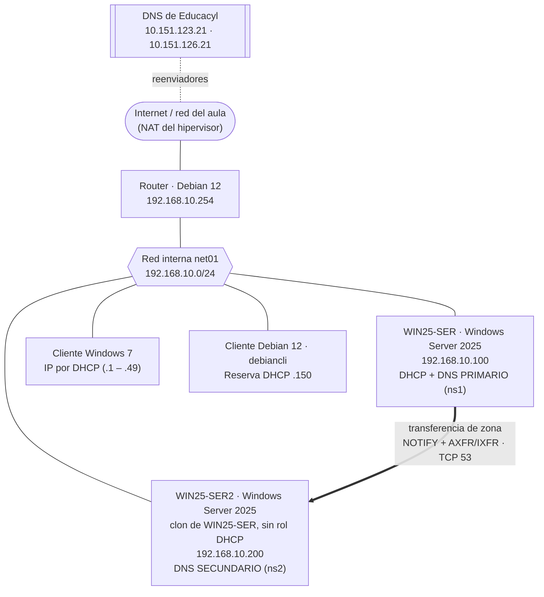
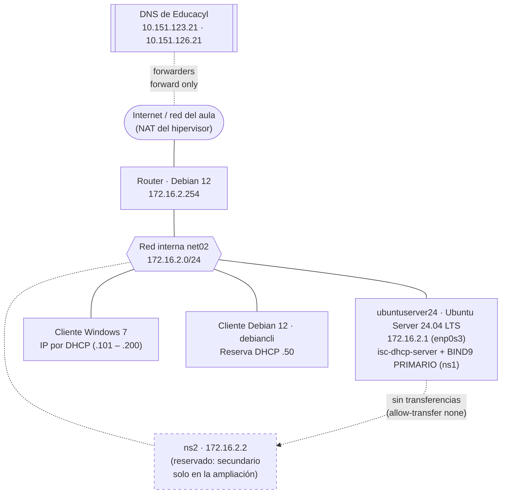
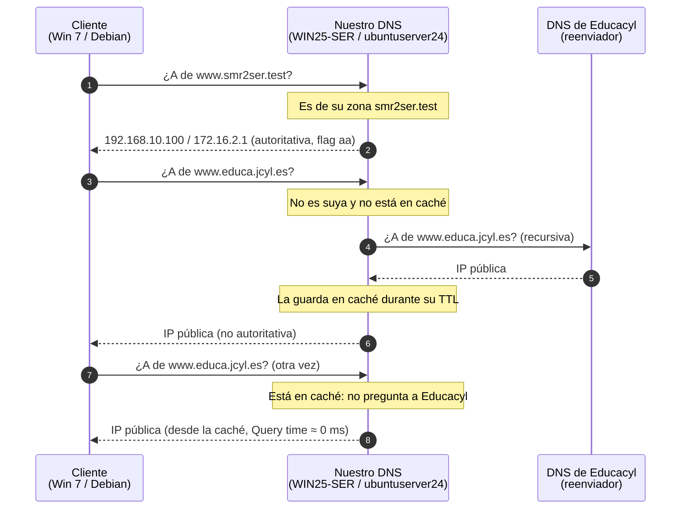

# Escenarios de red de la UT2 (DNS)

> **Ruta:** `recursos/ut2-dns/diagramas/escenario-red.md`
> Fuente de los esquemas de `docs/ut2-dns/practica-windows.md` (UT2-P1) y `docs/ut2-dns/practica-ubuntu.md` (UT2-P2). Cada escenario está en Mermaid (GitHub lo dibuja) y en ASCII (para copiar en Teams o en un examen).
> Son los mismos escenarios de la UT1 (`recursos/ut1-dhcp/diagramas/escenario-red.md`) con el servicio DNS añadido. Las dos prácticas usan **redes internas distintas** (`net01` y `net02`), así que se pueden tener montadas a la vez.
> Dominio de pruebas de la UT2: **`smr2ser.test`** (TLD reservado, RFC 2606 / RFC 6761). Sustituye a `smr2ser.org` de la UT1.

---

## Escenario 1 · UT2-P1 · DNS en Windows Server (`net01`)



```text
                      Internet / red del aula (NAT)  ←  DNS Educacyl 10.151.123.21 / .126.21
                                   │                      (reenviadores de WIN25-SER)
                     ┌─────────────┴─────────────┐
                     │  Router · Debian 12       │
                     │  192.168.10.254           │
                     └─────────────┬─────────────┘
  ═════════════════════════ net01 · 192.168.10.0/24 ═════════════════════════
         │                    │                    │                    │
┌────────┴────────┐ ┌─────────┴───────┐ ┌──────────┴──────┐ ┌───────────┴─────┐
│ WIN25-SER       │ │ WIN25-SER2      │ │ Cliente Win 7   │ │ Cliente Debian  │
│ 192.168.10.100  │ │ 192.168.10.200  │ │ DHCP (.1 – .49) │ │ debiancli       │
│ DHCP            │ │ DNS secundario  │ │                 │ │ reserva .150    │
│ DNS primario    │ │ (ns2)           │ │                 │ │                 │
│ (ns1)           │ │ clon, sin DHCP  │ │                 │ │                 │
└─────────────────┘ └─────────────────┘ └─────────────────┘ └─────────────────┘
        │  ══ transferencia de zona smr2ser.test (TCP 53) ══▶  │

Zona directa:  smr2ser.test             (fichero C:\Windows\System32\dns\smr2ser.test.dns)
Zona inversa:  10.168.192.in-addr.arpa  (fichero 10.168.192.in-addr.arpa.dns)
SOA:           ns1.smr2ser.test. · admin.smr2ser.test. · serial automático
NS:            win25-ser.smr2ser.test. · ns1.smr2ser.test. (.100) · ns2.smr2ser.test. (.200)
Reenviadores:  10.151.123.21 · 10.151.126.21
DHCP (UT1):    006 DNS → 192.168.10.100, 192.168.10.200 · 015 Dominio → smr2ser.test
```

**Registros de la zona `smr2ser.test` (net01)**

| Nombre | Tipo | Valor | PTR en `10.168.192.in-addr.arpa` |
|---|---|---|---|
| `win25-ser` | A | 192.168.10.100 | `100 → win25-ser.smr2ser.test.` |
| `win25-ser2` | A | 192.168.10.200 | `200 → win25-ser2.smr2ser.test.` |
| `router` | A | 192.168.10.254 | `254 → router.smr2ser.test.` |
| `debiancli` | A | 192.168.10.150 | `150 → debiancli.smr2ser.test.` |
| `ns1` · `www` · `mail` | A | 192.168.10.100 | — (comparten IP con `win25-ser`) |
| `ns2` | A | 192.168.10.200 | — (comparte IP con `win25-ser2`) |
| `web` | CNAME | `www.smr2ser.test.` | — |
| `ftp` | CNAME | `win25-ser.smr2ser.test.` | — |
| `@` | MX | `10 mail.smr2ser.test.` | — |
| `intranet` | CNAME | `win25-ser.smr2ser.test.` | — (se crea en el paso 17 para probar la transferencia) |

---

## Escenario 2 · UT2-P2 · DNS en Ubuntu Server con BIND9 (`net02`)



```text
                      Internet / red del aula (NAT)  ←  DNS Educacyl 10.151.123.21 / .126.21
                                   │                      (forwarders de BIND, forward only)
                     ┌─────────────┴─────────────┐
                     │  Router · Debian 12       │
                     │  172.16.2.254             │
                     └─────────────┬─────────────┘
  ═══════════════════════ net02 · 172.16.2.0/24 ═══════════════════════
            │                         │                         │
┌───────────┴───────────┐ ┌───────────┴───────────┐ ┌───────────┴───────────┐
│ ubuntuserver24        │ │ Cliente Windows 7     │ │ Cliente Debian 12     │
│ Ubuntu Server 24.04   │ │ DHCP (.101 – .200)    │ │ debiancli             │
│ 172.16.2.1 (enp0s3)   │ │                       │ │ reserva .50           │
│ isc-dhcp-server       │ │                       │ │                       │
│ BIND9 primario (ns1)  │ │                       │ │                       │
└───────────────────────┘ └───────────────────────┘ └───────────────────────┘
      ┄ ns2 = 172.16.2.2: reservado (fuera del range .101 – .200), sin servidor ┄

Zona directa:  smr2ser.test           → /etc/bind/db.smr2ser.test
Zona inversa:  2.16.172.in-addr.arpa  → /etc/bind/db.172.16.2
Declaradas en: /etc/bind/named.conf.local (type primary)
SOA:           ns1.smr2ser.test. · admin.smr2ser.test. · serial a mano (AAAAMMDDnn)
NS:            ns1.smr2ser.test. · ns2.smr2ser.test. · ubuntuserver24.smr2ser.test.
Opciones:      forwarders 10.151.123.21, 10.151.126.21 · forward only
               allow-query / allow-recursion { localhost; 172.16.2.0/24; }
               allow-transfer { none; } · dnssec-validation no
DHCP (UT1):    domain-name "smr2ser.test" · domain-name-servers 172.16.2.1
Netplan:       nameservers 172.16.2.1 · search smr2ser.test
```

**Registros de la zona `smr2ser.test` (net02)**

| Nombre | Tipo | Valor | PTR en `2.16.172.in-addr.arpa` |
|---|---|---|---|
| `ubuntuserver24` | A | 172.16.2.1 | `1 → ubuntuserver24.smr2ser.test.` |
| `router` | A | 172.16.2.254 | `254 → router.smr2ser.test.` |
| `debiancli` | A | 172.16.2.50 | `50 → debiancli.smr2ser.test.` |
| `ns1` · `www` · `mail` | A | 172.16.2.1 | — (comparten IP con `ubuntuserver24`) |
| `ns2` | A | 172.16.2.2 | — (aún no existe el equipo) |
| `web` | CNAME | `www` | — |
| `ftp` | CNAME | `ubuntuserver24` | — |
| `@` | MX | `10 mail.smr2ser.test.` | — |
| `intranet` | CNAME | `ubuntuserver24` | — (se añade en el paso 15, subiendo el serial a `…02`) |

> **¿Por qué `ns2` en la `.2` y no en la `.200`, como en `net01`?** En `net02`, el `range` del DHCP de la UT1 es `.101`–`.200`: la `.200` se podría repartir a un cliente. En `net01` no pasa porque el reparto dinámico es `.1`–`.49`.

---

## Flujo de una consulta en el escenario (válido para los dos)



---

## Equivalencias Windows Server ↔ BIND9

| Concepto | Windows Server (Administrador de DNS) | BIND9 en Ubuntu |
|---|---|---|
| Instalación | Rol *Servidor DNS* | `sudo apt install bind9 bind9-dnsutils` |
| Servicio | *DNS Server* (icono DNS en el Administrador del servidor) | `named` (`systemctl status named`) |
| Opciones generales | *Propiedades del servidor* | `/etc/bind/named.conf.options` |
| Reenviadores | Pestaña *Reenviadores* | `forwarders { …; };` y `forward only;` |
| Quién puede consultar / pedir recursión | Pestaña *Opciones avanzadas* (deshabilitar recursividad) | `allow-query` y `allow-recursion` |
| Declarar una zona | Asistente *Zona nueva* | Bloque `zone "…" { type primary; file "…"; };` en `named.conf.local` |
| Fichero de zona | `C:\Windows\System32\dns\<zona>.dns` | `/etc/bind/db.<zona>` |
| Crear registros | *Host nuevo*, *Alias nuevo*, *Nuevo intercambio de correo*… | Líneas en el fichero de zona |
| Número de serie | Se incrementa **solo** | Se sube **a mano** en cada cambio |
| Comprobar errores | La consola valida al guardar | `named-checkconf` · `named-checkzone` |
| Aplicar cambios | Inmediato · *Actualizar archivo de datos del servidor* para escribirlo en disco | `sudo rndc reload` o `sudo systemctl restart named` |
| Zona inversa | Asistente: Id. de red `192.168.10` → `10.168.192.in-addr.arpa` | Se escribe a mano: `zone "2.16.172.in-addr.arpa"` |
| Crear PTR | Casilla *Crear/Actualizar registro del puntero (PTR) asociado* o *Nuevo puntero (PTR)* | Líneas `N IN PTR nombre.` en el fichero de la zona inversa |
| Ver / borrar la caché | *Ver → Avanzada → Búsquedas en caché* · *Borrar caché* | `sudo rndc dumpdb -cache` · `sudo rndc flush` |
| Permitir transferencias | Pestaña *Transferencias de zona* | `allow-transfer { IP; };` |
| Notificar a secundarios | Botón *Notificar…* | `also-notify { IP; };` (los NS se notifican por defecto) |
| Zona secundaria | Asistente *Zona nueva → Zona secundaria* | `type secondary; primaries { IP; };` (fichero en `/var/lib/bind/`) |
| Registro de eventos | *Visor de eventos → Servidor DNS* | `journalctl -u named` |

---

## Hipervisor (VirtualBox)

| Máquina | Adaptador 1 | Adaptador 2 | Práctica |
|---|---|---|---|
| Router Debian 12 | NAT (salida a Internet) | Red interna `net01` o `net02` | Las dos |
| WIN25-SER | Red interna `net01` | — | UT2-P1 |
| WIN25-SER2 (clon completo, MAC nuevas) | Red interna `net01` | — | UT2-P1 (Parte C) |
| ubuntuserver24 | Red interna `net02` | — | UT2-P2 |
| Cliente Windows 7 | Red interna `net01` o `net02`, según la práctica | — | Las dos |
| Cliente Debian 12 | Red interna `net01` o `net02`, según la práctica | — | Las dos |

> Si el router tiene que dar servicio a las dos prácticas a la vez, necesita un tercer adaptador (NAT + `net01` + `net02`). **No pongas ningún servidor DNS ni DHCP en modo «Adaptador puente»:** respondería en la red real del aula.
>
> Al clonar `WIN25-SER`, desmarca **«Cable conectado»** en el clon hasta cambiarle la IP a `.200`, y quítale el rol DHCP: en `net01` solo puede haber un servidor DHCP.
