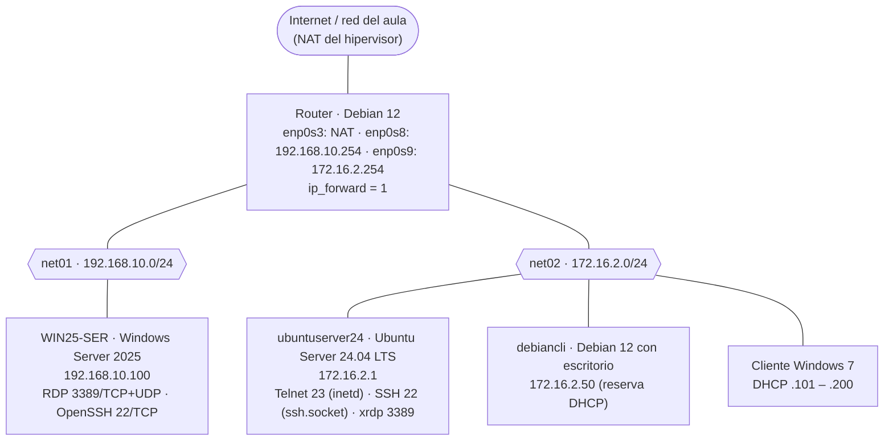

# Escenario de red de la UT3 (acceso remoto)

> **Ruta:** `recursos/ut3-acceso-remoto/diagramas/escenario-red.md`
> Fuente del esquema de `docs/ut3-acceso-remoto/index.md` y de los ejercicios de las páginas 01 a 04. Cada esquema está en Mermaid (GitHub lo dibuja) y en ASCII (para copiar en Teams o en un examen).
> Son las redes `net01` y `net02` de la UT1 y la UT2, **enrutadas entre sí** por el router. Dominio: `smr2ser.test` (solo `ubuntuserver24` está en la zona de `net02`; a `WIN25-SER` se accede por IP).

---

## Esquema



```text
                         Internet / red del aula (NAT del hipervisor)
                                          │ enp0s3
                          ┌───────────────┴────────────────┐
                          │  Router · Debian 12            │
                          │  ip_forward = 1                │
                          └───────┬────────────────┬───────┘
                      enp0s8      │                │      enp0s9
                 192.168.10.254   │                │   172.16.2.254
  ════ net01 · 192.168.10.0/24 ═══╧══   ═══════════╧═════ net02 · 172.16.2.0/24 ══════════════
              │                                │                  │                   │
   ┌──────────┴──────────┐       ┌─────────────┴──────┐ ┌─────────┴────────┐ ┌────────┴────────┐
   │ WIN25-SER           │       │ ubuntuserver24     │ │ debiancli        │ │ Cliente Win 7   │
   │ Windows Server 2025 │       │ Ubuntu Server 24.04│ │ Debian 12 + GUI  │ │ DHCP .101–.200  │
   │ 192.168.10.100      │       │ 172.16.2.1         │ │ 172.16.2.50      │ │                 │
   │ RDP 3389 · SSH 22   │       │ Telnet 23 · SSH 22 │ │ telnet · ssh ·   │ │ telnet · PuTTY ·│
   │                     │       │ xrdp 3389          │ │ Remmina ·        │ │ mstsc           │
   │                     │       │                    │ │ Wireshark        │ │                 │
   └─────────────────────┘       └────────────────────┘ └──────────────────┘ └─────────────────┘
```

> Los nombres de interfaz del router (`enp0s3`, `enp0s8`, `enp0s9`) son los habituales en VirtualBox con tres adaptadores; compruébalos con `ip a`.

---

## Qué conexión se prueba en cada página

| Desde → hasta | Protocolo | Cliente | Página | Criterio |
|---|---|---|---|---|
| `debiancli` → `ubuntuserver24` | Telnet (23) | `telnet` | 02 | RA6.b, RA6.d |
| Windows 7 → `ubuntuserver24` | Telnet (23) | Cliente Telnet de Windows | 02 | RA6.f |
| `debiancli` → `ubuntuserver24` | SSH (22), SCP, SFTP, X11 | `ssh`, `scp`, `sftp`, `ssh -X` | 03 | RA6.b, RA6.d |
| Windows 7 → `ubuntuserver24` | SSH (22) | PuTTY | 03 | RA6.f, RA6.g |
| `debiancli` → `WIN25-SER` | SSH (22) | `ssh` | 03 | RA6.f, RA6.g |
| Windows 7 → `WIN25-SER` | RDP (3389) | `mstsc` | 04 | RA6.c, RA6.d |
| `debiancli` → `WIN25-SER` | RDP (3389) | Remmina | 04 | RA6.f |
| Windows 7 → `ubuntuserver24` | RDP (3389) → xrdp | `mstsc` | 04 | RA6.c, RA6.f |
| `debiancli` → `ubuntuserver24` | RDP (3389) → xrdp | Remmina | 04 | RA6.f |

---

## Hipervisor (VirtualBox)

| Máquina | Adaptador 1 | Adaptador 2 | Adaptador 3 |
|---|---|---|---|
| Router Debian 12 | NAT | Red interna `net01` | Red interna `net02` |
| WIN25-SER | Red interna `net01` | — | — |
| ubuntuserver24 | Red interna `net02` | — | — |
| debiancli | Red interna `net02` | — | — |
| Cliente Windows 7 | Red interna `net02` | — | — |

> **No** poner ningún servidor en «Adaptador puente».
> `WIN25-SER2` (clon de la UT2) no se usa en esta unidad: apágalo.
> Antes de la unidad, haz una **instantánea** de `ubuntuserver24` y `WIN25-SER` («antes-UT3»). La instalación de XFCE ocupa varios cientos de MB: comprueba que `ubuntuserver24` tiene al menos 3 GB libres (`df -h /`).
