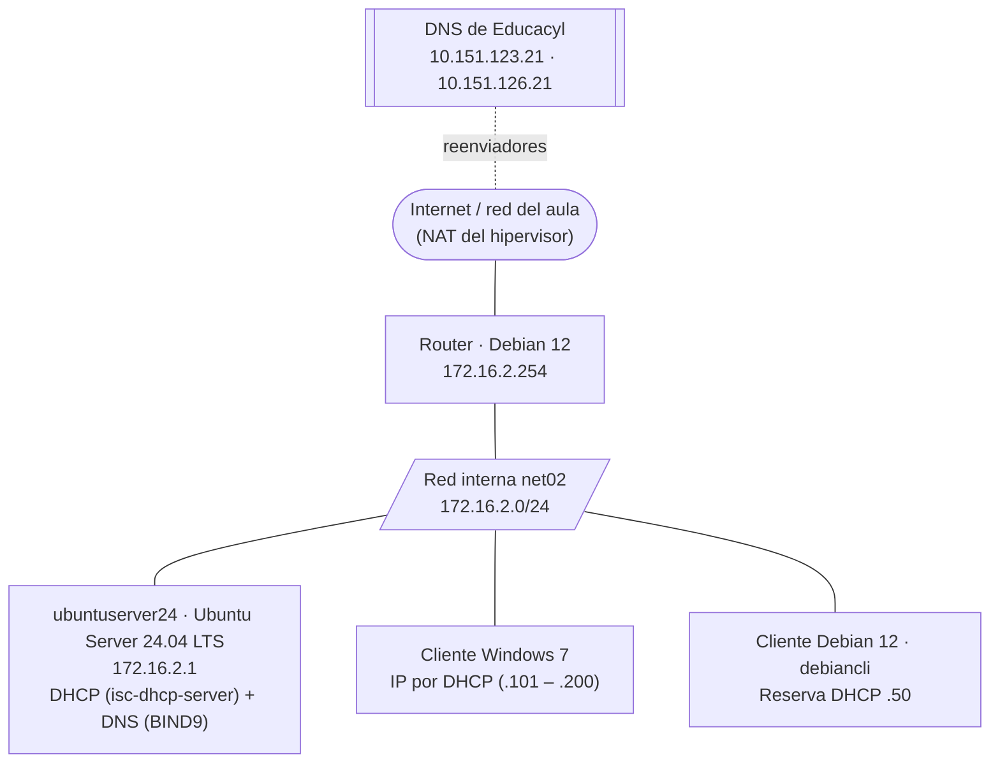

# UT2-P2 · Servidor DNS en Ubuntu Server 24.04 con BIND9

> **Módulo:** Servicios en Red · 2º SMR · **RA2:** Instala servicios de resolución de nombres, describiendo sus características y aplicaciones.
> **Duración orientativa:** 3 sesiones de 2 h (Parte A: pasos 1–6 · Parte B: pasos 7–10 · Parte C: pasos 11–15)
> **Forma de trabajo:** todo por **línea de comandos**, editando ficheros de texto con `nano`. Es el mismo servidor DNS que en Windows, pero aquí verás «por dentro» lo que la consola gráfica hacía por ti.
> [← Volver a la portada de la UT2](index.md) · [Teoría del servicio DNS](teoria.md) · [Práctica en Windows Server](practica-windows.md)

---

## 1. Objetivo y criterios de evaluación

Instalar y configurar **BIND9** en el mismo `ubuntuserver24` de la práctica de DHCP, para que sea el servidor de nombres de la red `net02`:

- **Servidor caché con reenviadores** hacia los DNS de Educacyl, para que los equipos de la red resuelvan nombres de Internet.
- **Primario** de la zona directa `smr2ser.test` y de la zona inversa `2.16.172.in-addr.arpa`.
- Repartido por **DHCP** a los clientes de la red.

| Criterio | Qué se hace en esta práctica | Pasos |
|---|---|---|
| **RA2.d** | Instalar un servicio jerárquico de resolución de nombres | 2, 3, 4 |
| **RA2.e** | Preparar el servicio para almacenar las respuestas de servidores públicos y servirlas a la red local (caché + reenviadores) | 5, 6 |
| **RA2.f** | Añadir registros a una zona nueva, con opciones de correo (MX) y alias (CNAME) | 7, 8, 11, 12 |
| **RA2.h** | Comprobar el funcionamiento correcto del servidor | 9, 10, 13, 15 y apartado 5 |

> **RA2.g** (transferencias de zona) se trabaja en la [práctica de Windows Server](practica-windows.md). Aquí aparece como ampliación opcional.

**Windows frente a BIND:** es el mismo servicio con otra forma de configurarlo.

| Concepto | Windows Server (UT2-P1) | BIND9 en Ubuntu (esta práctica) |
|---|---|---|
| Instalar | Rol *Servidor DNS* | `apt install bind9` |
| Opciones generales y reenviadores | *Propiedades del servidor* | `/etc/bind/named.conf.options` |
| Declarar una zona | Asistente *Zona nueva* | Bloque `zone` en `/etc/bind/named.conf.local` |
| Registros de la zona | *Host nuevo*, *Alias nuevo*… | Fichero de zona: `/etc/bind/db.smr2ser.test` |
| Número de serie del SOA | Lo sube Windows solo | **Lo subes tú** a mano en cada cambio |
| Aplicar cambios | Automático | `sudo rndc reload` o `sudo systemctl restart named` |
| Comprobar errores | La consola no deja guardar | `named-checkconf` y `named-checkzone` |

---

## 2. Escenario

Es el mismo escenario de la UT1 (red interna `net02`): `ubuntuserver24` pasa a ser también el servidor DNS.



```text
                      Internet / red del aula (NAT)  ←  DNS Educacyl 10.151.123.21 / .126.21
                                   │
                     ┌─────────────┴─────────────┐
                     │  Router · Debian 12       │
                     │  172.16.2.254             │
                     └─────────────┬─────────────┘
  ═══════════════════════ net02 · 172.16.2.0/24 ═══════════════════════
            │                         │                         │
┌───────────┴───────────┐ ┌───────────┴───────────┐ ┌───────────┴───────────┐
│ ubuntuserver24        │ │ Cliente Windows 7     │ │ Cliente Debian 12     │
│ Ubuntu Server 24.04   │ │ DHCP (.101 – .200)    │ │ debiancli             │
│ 172.16.2.1 (enp0s3)   │ │                       │ │ Reserva DHCP .50      │
│ isc-dhcp-server       │ │                       │ │                       │
│ BIND9 (ns1)           │ │                       │ │                       │
└───────────────────────┘ └───────────────────────┘ └───────────────────────┘
```

**Datos de la práctica**

| Dato | Valor |
|---|---|
| Zona directa | `smr2ser.test` → fichero `/etc/bind/db.smr2ser.test` |
| Zona inversa | `2.16.172.in-addr.arpa` → fichero `/etc/bind/db.172.16.2` |
| Servidor principal (SOA) | `ns1.smr2ser.test.` |
| Persona responsable (SOA) | `admin.smr2ser.test.` (= `admin@smr2ser.test`) |
| Servidores de nombres (NS) | `ns1.smr2ser.test.` y `ubuntuserver24.smr2ser.test.` (172.16.2.1) · `ns2.smr2ser.test.` (172.16.2.2, reservado para un futuro secundario) |
| Reenviadores | `10.151.123.21` · `10.151.126.21` (DNS de Educacyl) |
| Actualizaciones dinámicas | No |

**Registros que vamos a crear** (los mismos que en la práctica de Windows, adaptados a `net02`):

| Nombre | Tipo | Valor | ¿Lleva PTR? | Para qué |
|---|---|---|---|---|
| `ubuntuserver24` | A | 172.16.2.1 | ✅ Sí | Nombre real del servidor |
| `router` | A | 172.16.2.254 | ✅ Sí | Puerta de enlace |
| `debiancli` | A | 172.16.2.50 | ✅ Sí | Cliente Debian (tiene reserva DHCP) |
| `ns1` | A | 172.16.2.1 | ❌ No | Servidor de nombres primario |
| `ns2` | A | 172.16.2.2 | ❌ No | Servidor de nombres secundario (aún no existe) |
| `www` | A | 172.16.2.1 | ❌ No | Servidor web (UT6) |
| `mail` | A | 172.16.2.1 | ❌ No | Servidor de correo (UT5) |
| `web` | CNAME | `www.smr2ser.test.` | — | Alias de `www` |
| `ftp` | CNAME | `ubuntuserver24.smr2ser.test.` | — | Alias del servidor FTP (UT4) |
| `@` | MX | `10 mail.smr2ser.test.` | — | Correo de `@smr2ser.test` |

> **¿Por qué `ns2` en la `.2` y no en la `.200`?** En la UT1, el `range` del DHCP de `net02` es `.101`–`.200`: la `.200` se podría repartir a un cliente. La `.2` está fuera del rango.

**Hipervisor (VirtualBox)**

| Máquina | Adaptador 1 | Adaptador 2 |
|---|---|---|
| Router Debian 12 | NAT | Red interna `net02` |
| ubuntuserver24 | Red interna `net02` | — |
| Cliente Windows 7 | Red interna `net02` | — |
| Cliente Debian 12 | Red interna `net02` | — |

---

## 3. Requisitos previos

- [ ] Práctica **UT1-P2** terminada: `ubuntuserver24` con IP `172.16.2.1/24` (netplan, interfaz `enp0s3`), puerta de enlace `172.16.2.254` e `isc-dhcp-server` funcionando.
- [ ] Router Debian 12 encendido y dando salida a Internet (desde el servidor, `ping -c2 10.151.123.21` debe responder).
- [ ] Clientes Windows 7 y Debian 12 recibiendo IP por DHCP (el Debian, la `.50`).
- [ ] **Instantánea** de `ubuntuserver24` antes de empezar: en VirtualBox, *Máquina → Tomar instantánea* → nombre `UT1-fin-DHCP`.
- [ ] En el cliente Debian, la herramienta `dig`: `sudo apt install dnsutils`.

---

## 4. Pasos

### Parte A · Instalación y servidor caché (sesión 1)

#### Paso 1 · Comprobar el punto de partida

```bash
hostname                                  # ubuntuserver24
ip -br a                                  # enp0s3  UP  172.16.2.1/24
ip route                                  # default via 172.16.2.254 dev enp0s3
systemctl status isc-dhcp-server          # active (running)
```

Si algo no coincide, corrígelo antes de seguir.

#### Paso 2 · Instalar BIND9 · RA2.d

```bash
sudo apt update
sudo apt install bind9 bind9-dnsutils
```

- `bind9`: el servidor DNS. Su programa se llama **`named`** (*name daemon*).
- `bind9-dnsutils`: las herramientas `dig`, `nslookup` y `host` para hacer pruebas desde el propio servidor.

> En Ubuntu 24.04 se instala la rama **9.18** de BIND: `named -v`.

#### Paso 3 · Comprobar que el servicio está en marcha · RA2.d

```bash
sudo systemctl status named               # Active: active (running)
ps -ef | grep named                       # /usr/sbin/named -f -u bind
sudo ss -tulpn | grep named               # Puertos en los que escucha
```

**Resultado esperado** de `ss`: líneas `udp` y `tcp` en `127.0.0.1:53` y en **`172.16.2.1:53`**, todas del proceso `named`. (También aparece el puerto `953` en `127.0.0.1`: es `rndc`, la herramienta de control de BIND.)

> En la guía antigua se usaba `netstat -ltun`. `netstat` pertenece al paquete `net-tools`, que está **obsoleto** y no viene instalado en Ubuntu 24.04. Su sustituto es `ss`.
>
> El servicio se llama `named`. `bind9` también funciona en `systemctl` porque es un alias.

#### Paso 4 · Conocer los ficheros de BIND y hacer una copia de seguridad

```bash
ls -l /etc/bind
```

| Fichero | Para qué sirve | ¿Lo tocamos? |
|---|---|---|
| `named.conf` | Fichero principal. Solo contiene tres `include` de los ficheros siguientes | ❌ No |
| `named.conf.options` | Opciones generales del servidor: reenviadores, quién puede consultar… | ✅ Paso 5 |
| `named.conf.local` | Declaración de **nuestras zonas** | ✅ Pasos 7 y 11 |
| `named.conf.default-zones` | Zonas que BIND trae creadas (`localhost`, `127`, `0`, `255`) | ❌ No |
| `db.local` · `db.127` | Zona directa e inversa de `localhost` | ❌ No |
| `db.0` · `db.255` | Zonas inversas de las direcciones 0.x y 255.x | ❌ No |
| `db.empty` | Zona vacía. **La usaremos como plantilla** de nuestros ficheros de zona | ❌ No (se copia) |
| `rndc.key` | Clave para controlar `named` con `rndc` | ❌ No |
| `/usr/share/dns/root.hints` | Servidores raíz de Internet (antes era `/etc/bind/db.root`) | ❌ No |

```bash
cat /etc/bind/named.conf                  # Mira los tres include
cd /etc/bind
sudo cp named.conf.options bck_named.conf.options
sudo cp named.conf.local   bck_named.conf.local
ls -l bck_*
```

**Resultado esperado:** las dos copias `bck_named.conf.options` y `bck_named.conf.local`. Si algo se rompe, se recupera el original con `sudo cp bck_named.conf.options named.conf.options`.

#### Paso 5 · Servidor caché con reenviadores · RA2.e

Recién instalado, BIND ya funciona como **servidor caché**: resuelve nombres de Internet y guarda las respuestas. Pero intentaría preguntar a los servidores raíz, y desde la red del aula no se llega a ellos. Le decimos que pregunte a los DNS de Educacyl.

```bash
sudo nano /etc/bind/named.conf.options
```

Deja el bloque `options` así (los comentarios en inglés que trae el fichero se pueden borrar):

```text
options {
        directory "/var/cache/bind";

        forwarders {
                10.151.123.21;
                10.151.126.21;
        };
        forward only;

        allow-query { localhost; 172.16.2.0/24; };
        allow-recursion { localhost; 172.16.2.0/24; };
        allow-transfer { none; };

        dnssec-validation no;

        listen-on-v6 { any; };
};
```

| Directiva | Qué hace |
|---|---|
| `forwarders` | Servidores a los que se reenvían las consultas que no son de nuestras zonas. En casa: `8.8.8.8` y `8.8.4.4` |
| `forward only` | Si los reenviadores no responden, **no** intenta ir a los servidores raíz |
| `allow-query` | Quién puede hacer consultas: el propio servidor y la red `net02` |
| `allow-recursion` | Quién puede pedir consultas **recursivas** (nombres de Internet). Por seguridad, solo nuestra red |
| `allow-transfer { none; }` | Nadie puede descargar nuestras zonas completas (no tenemos secundario) |
| `dnssec-validation no` | Desactiva la validación DNSSEC. Con los reenviadores de Educacyl, si se deja en `auto` (valor por defecto), las respuestas de Internet fallan con errores `no valid RRSIG` |

> ⚠️ Cuidado con la sintaxis: **cada línea termina en `;`**, también después de cada `}`. Es el error más habitual.

Comprueba y reinicia:

```bash
sudo named-checkconf                      # Si NO dice nada, la sintaxis es correcta
sudo systemctl restart named
sudo systemctl status named               # active (running)
```

> El fichero completo y comentado está en `recursos/ut2-dns/ficheros-config/named.conf.options`.

#### Paso 6 · El servidor usa su propio DNS · RA2.e

Hasta ahora, `ubuntuserver24` preguntaba directamente a Educacyl (netplan de la UT1). Ahora debe preguntarse a sí mismo, y Educacyl pasa a ser el reenviador de BIND.

```bash
sudo nano /etc/netplan/50-cloud-init.yaml
```

Cambia solo la sección `nameservers`:

```yaml
      nameservers:
        addresses:
          - 172.16.2.1          # El propio servidor (BIND)
        search:
          - smr2ser.test        # Antes: smr2ser.org
```

```bash
sudo netplan try                          # Pulsa Intro para confirmar antes de 120 s
resolvectl status                         # enp0s3 → DNS Servers: 172.16.2.1 · DNS Domain: smr2ser.test
```

> Ubuntu usa **systemd-resolved**: los programas preguntan a `127.0.0.53` (por eso lo ves en `/etc/resolv.conf`), y este reenvía a los DNS de netplan, que ahora es BIND.

**Prueba de la caché:** pregunta dos veces por el mismo nombre de Internet y compara el tiempo:

```bash
dig @127.0.0.1 www.educa.jcyl.es
dig @127.0.0.1 www.educa.jcyl.es
```

**Resultado esperado:** `status: NOERROR` con la IP en la sección `ANSWER`. La primera vez, `Query time` de decenas de milisegundos (BIND pregunta a Educacyl); la segunda, **0–1 ms** (responde desde su caché) y el **TTL más bajo**, porque va descontando el tiempo que lleva guardado.

📸 **Instantánea:** `UT2-P2-cache`.

### Parte B · Zona de búsqueda directa (sesión 2)

#### Paso 7 · Declarar la zona directa en `named.conf.local` · RA2.f

```bash
sudo nano /etc/bind/named.conf.local
```

Añade, debajo de `// Do any local configuration here`:

```text
// Zona de búsqueda directa de smr2ser.test
zone "smr2ser.test" {
        type primary;
        file "/etc/bind/db.smr2ser.test";
};
```

- `type primary`: este servidor tiene la copia original de la zona. En guías antiguas verás `type master`: es lo mismo y sigue funcionando, pero BIND usa ahora `primary`.
- `file`: el fichero con los registros. El nombre lo eliges tú; por costumbre empieza por `db.`. Si no pones la ruta completa, BIND lo busca en `/var/cache/bind`.

#### Paso 8 · Crear el fichero de zona directa · RA2.f

La forma más cómoda es copiar la plantilla `db.empty`:

```bash
sudo cp /etc/bind/db.empty /etc/bind/db.smr2ser.test
sudo nano /etc/bind/db.smr2ser.test
```

Borra el contenido y escribe la zona. Antes, tres reglas que causan la mayoría de errores:

| Regla | Ejemplo |
|---|---|
| **`@`** equivale al nombre de la zona declarado en `named.conf.local` | `@` = `smr2ser.test.` |
| Un nombre **sin punto final** es relativo: se le añade la zona | `www` → `www.smr2ser.test.` |
| Un nombre **con punto final** es un FQDN y se deja tal cual. Si olvidas el punto en un FQDN, se duplica el dominio | `ns1.smr2ser.test` → `ns1.smr2ser.test.smr2ser.test.` ❌ |
| Si el **primer campo se deja en blanco**, toma el nombre de la línea anterior | (útil para varios registros del mismo nombre) |

```text
$TTL    86400
@       IN      SOA     ns1.smr2ser.test. admin.smr2ser.test. (
                        2026102201      ; Serial
                        3600            ; Refresh
                        900             ; Retry
                        604800          ; Expire
                        3600 )          ; Negative Cache TTL

; Servidores de nombres
@       IN      NS      ns1.smr2ser.test.
@       IN      NS      ns2.smr2ser.test.
@       IN      NS      ubuntuserver24.smr2ser.test.

; Servidor de correo
@       IN      MX      10 mail.smr2ser.test.

; Registros A (hosts)
ubuntuserver24  IN      A       172.16.2.1
ns1             IN      A       172.16.2.1
ns2             IN      A       172.16.2.2
router          IN      A       172.16.2.254
debiancli       IN      A       172.16.2.50
www             IN      A       172.16.2.1
mail            IN      A       172.16.2.1

; Registros CNAME (alias)
web             IN      CNAME   www
ftp             IN      CNAME   ubuntuserver24
```

> **Número de serie:** usa el formato `AAAAMMDDnn` (año, mes, día y número de cambio de ese día): `2026102201`. **En BIND tienes que subirlo a mano cada vez que modifiques la zona.** En Windows lo hacía la consola sola.
>
> **SOA:** el servidor principal es `ns1.smr2ser.test.`, no el nombre de la zona. Y el responsable es un correo con un punto en lugar de la `@`.
>
> El fichero completo y comentado está en `recursos/ut2-dns/ficheros-config/db.smr2ser.test`.

#### Paso 9 · Comprobar la configuración y cargar la zona · RA2.h

BIND trae dos herramientas para revisar los ficheros **antes** de cargarlos:

```bash
sudo named-checkconf
sudo named-checkzone smr2ser.test /etc/bind/db.smr2ser.test
```

**Resultado esperado:**

```text
zone smr2ser.test/IN: loaded serial 2026102201
OK
```

Si aparece un error, el mensaje indica el **número de línea**. Corrígelo y vuelve a comprobar. Después, carga la zona:

```bash
sudo rndc reload                          # Recarga la configuración y las zonas sin parar el servicio
sudo systemctl status named               # active (running)
sudo journalctl -u named -n 20            # Últimas 20 líneas del registro de named
```

**Resultado esperado** en `journalctl`: una línea `zone smr2ser.test/IN: loaded serial 2026102201`, sin errores.

> `rndc reload` y `systemctl restart named` aplican los cambios. `rndc reload` es más suave: no corta el servicio.

#### Paso 10 · Primeras pruebas desde el propio servidor · RA2.h

```bash
dig @localhost www.smr2ser.test
dig @localhost smr2ser.test MX +short
dig @localhost web.smr2ser.test +short
dig @localhost smr2ser.test NS +short
dig @localhost smr2ser.test SOA +short
```

**Resultado esperado:**

- `www.smr2ser.test`: `status: NOERROR`, la IP `172.16.2.1` en `ANSWER SECTION` y el flag **`aa`** (*authoritative answer*) en la línea `flags:`. Responde con autoridad porque la zona es suya.
- MX: `10 mail.smr2ser.test.`
- `web`: `www.smr2ser.test.` y después `172.16.2.1` (primero el alias y luego la IP).
- NS: los tres servidores de nombres.
- SOA: `ns1.smr2ser.test. admin.smr2ser.test. 2026102201 3600 900 604800 3600`.

📸 **Instantánea:** `UT2-P2-zona-directa`.

### Parte C · Zona inversa, DHCP y clientes (sesión 3)

#### Paso 11 · Declarar la zona inversa · RA2.f

```bash
sudo nano /etc/bind/named.conf.local
```

Añade debajo de la zona directa:

```text
// Zona de búsqueda inversa de la red 172.16.2.0/24
zone "2.16.172.in-addr.arpa" {
        type primary;
        file "/etc/bind/db.172.16.2";
};
```

> El nombre de la zona inversa es la parte de red de la IP **al revés** más `.in-addr.arpa`: `172.16.2` → `2.16.172.in-addr.arpa`. En Windows lo calculaba el asistente; aquí lo escribes tú.

#### Paso 12 · Crear el fichero de zona inversa · RA2.f

```bash
sudo cp /etc/bind/db.empty /etc/bind/db.172.16.2
sudo nano /etc/bind/db.172.16.2
```

```text
$TTL    86400
@       IN      SOA     ns1.smr2ser.test. admin.smr2ser.test. (
                        2026102201      ; Serial
                        3600            ; Refresh
                        900             ; Retry
                        604800          ; Expire
                        3600 )          ; Negative Cache TTL

; Servidores de nombres
@       IN      NS      ns1.smr2ser.test.
@       IN      NS      ns2.smr2ser.test.
@       IN      NS      ubuntuserver24.smr2ser.test.

; Registros PTR (IP → nombre)
1       IN      PTR     ubuntuserver24.smr2ser.test.
50      IN      PTR     debiancli.smr2ser.test.
254     IN      PTR     router.smr2ser.test.
```

> - Aquí `@` es `2.16.172.in-addr.arpa.`, así que `50` se completa como `50.2.16.172.in-addr.arpa.`: la IP `172.16.2.50`.
> - Los nombres de destino de los PTR van **siempre completos y con punto final**. Sin el punto quedaría `debiancli.smr2ser.test.2.16.172.in-addr.arpa.`
> - Un PTR por IP, con el nombre principal del equipo: `ns1`, `www` y `mail` comparten la `.1` y no llevan PTR propio.

#### Paso 13 · Comprobar y cargar la zona inversa · RA2.h

```bash
sudo named-checkconf
sudo named-checkzone 2.16.172.in-addr.arpa /etc/bind/db.172.16.2
sudo rndc reload
dig @localhost -x 172.16.2.50 +short       # debiancli.smr2ser.test.
dig @localhost -x 172.16.2.254 +short      # router.smr2ser.test.
```

**Resultado esperado** de `named-checkzone`: `zone 2.16.172.in-addr.arpa/IN: loaded serial 2026102201` y `OK`.

#### Paso 14 · El DHCP reparte nuestro DNS

Los clientes reciben el DNS por DHCP. Edita el `dhcpd.conf` de la UT1:

```bash
sudo nano /etc/dhcp/dhcpd.conf
```

| Línea | Antes (UT1) | Ahora |
|---|---|---|
| `option domain-name` | `"smr2ser.org";` | `"smr2ser.test";` |
| `option domain-name-servers` | `10.151.123.21, 10.151.126.21;` | `172.16.2.1;` |

```text
option domain-name "smr2ser.test";
option domain-name-servers 172.16.2.1;
```

> Solo repartimos `172.16.2.1`: `ns2` (`.2`) todavía no existe y los clientes perderían tiempo preguntándole.

```bash
sudo dhcpd -t -cf /etc/dhcp/dhcpd.conf    # Comprueba la sintaxis
sudo systemctl restart isc-dhcp-server
systemctl status isc-dhcp-server          # active (running)
```

#### Paso 15 · Pruebas desde los clientes · RA2.h

**Renovar la concesión:**

```bash
# Cliente Debian 12
sudo dhclient -r && sudo dhclient
cat /etc/resolv.conf                      # search smr2ser.test · nameserver 172.16.2.1
```

> Si tu Debian tiene escritorio y usa **NetworkManager** (no el fichero `/etc/network/interfaces` de la UT1), renueva con `sudo nmcli networking off && sudo nmcli networking on`, o desconectando y conectando la red desde el icono.

```bat
:: Cliente Windows 7 (Símbolo del sistema)
ipconfig /release
ipconfig /renew
ipconfig /all                             :: Servidores DNS: 172.16.2.1 · Sufijo DNS: smr2ser.test
```

**Consultas desde el cliente Debian:**

```bash
nslookup www                              # Nombre corto: se completa con smr2ser.test
dig ns1.smr2ser.test                      # flag aa · ANSWER: 172.16.2.1
dig smr2ser.test MX +short
dig -x 172.16.2.254 +short
dig www.educa.jcyl.es                     # Nombre de Internet: sin flag aa
```

**Consultas desde el cliente Windows 7:**

```bat
nslookup www.smr2ser.test
nslookup web.smr2ser.test
nslookup -type=MX smr2ser.test
nslookup 172.16.2.50
nslookup www.educa.jcyl.es
```

**Cambio en la zona: el número de serie.** Añade un alias nuevo y comprueba cómo cambia el serial:

1. En el servidor, edita `/etc/bind/db.smr2ser.test`: añade la línea `intranet IN CNAME ubuntuserver24` y **sube el serial** a `2026102202`.
2. `sudo named-checkzone smr2ser.test /etc/bind/db.smr2ser.test` → `loaded serial 2026102202`.
3. `sudo rndc reload`.
4. Desde el cliente Debian: `dig intranet.smr2ser.test +short` y `dig smr2ser.test SOA +short`.

📸 **Instantánea:** `UT2-P2-final`.

---

## 5. Verificación

| Prueba | Dónde | Comando | Qué debe verse |
|---|---|---|---|
| Servicio activo | Servidor | `systemctl status named` | `active (running)` |
| Escucha en el puerto 53 | Servidor | `sudo ss -tulpn \| grep named` | `udp` y `tcp` en `172.16.2.1:53`, proceso `named` |
| Sintaxis de la configuración | Servidor | `sudo named-checkconf` | No muestra nada |
| Zonas correctas | Servidor | `sudo named-checkzone …` (pasos 9 y 13) | `loaded serial …` y `OK` |
| Zonas cargadas | Servidor | `sudo journalctl -u named \| grep loaded` | `zone smr2ser.test/IN: loaded serial …` y `zone 2.16.172.in-addr.arpa/IN: loaded serial …` |
| DNS del propio servidor | Servidor | `resolvectl status` | `DNS Servers: 172.16.2.1` · `DNS Domain: smr2ser.test` |
| Caché + reenviadores | Servidor | `dig @127.0.0.1 www.educa.jcyl.es` (dos veces) | La 2ª vez, `Query time: 0 msec` y TTL más bajo |
| Respuesta autoritativa | Cliente Debian | `dig www.smr2ser.test` | `status: NOERROR` · flag **`aa`** · `172.16.2.1` · `SERVER: 172.16.2.1#53` |
| Nombre corto (sufijo) | Cliente Debian | `nslookup www` | `Name: www.smr2ser.test` · `Address: 172.16.2.1` |
| Alias | Cliente Debian | `dig web.smr2ser.test +short` | `www.smr2ser.test.` y `172.16.2.1` |
| Correo | Cliente Win 7 | `nslookup -type=MX smr2ser.test` | `MX preference = 10, mail exchanger = mail.smr2ser.test` |
| Resolución inversa | Cliente Win 7 | `nslookup 172.16.2.50` | `Nombre: debiancli.smr2ser.test` |
| Nombre de Internet | Cliente Win 7 | `nslookup www.educa.jcyl.es` | Una IP pública y **«Respuesta no autoritativa»** |
| Transferencia bloqueada | Cliente Debian | `dig @172.16.2.1 smr2ser.test AXFR` | `Transfer failed.` (por `allow-transfer { none; }`) |

---

## 6. Resolución de problemas típicos

| Síntoma | Causa probable | Solución |
|---|---|---|
| `named-checkconf` muestra `missing ';' before '}'` | Falta un `;` al final de una línea o después de una `}` | Ir a la línea que indica el mensaje |
| `named-checkzone` muestra `… .smr2ser.test.smr2ser.test` o `CNAME and other data` | Falta el punto final en un FQDN, o un nombre tiene CNAME y otro registro a la vez | Revisar los puntos finales (paso 8) |
| `named` no arranca tras un cambio | Error de sintaxis | `sudo named-checkconf` y `sudo journalctl -u named -n 30` |
| `dig` da `SERVFAIL` en nuestra zona | La zona no se ha cargado por un error en el fichero | `journalctl -u named \| grep smr2ser`: indica la línea con el error |
| `dig` da `REFUSED` desde un cliente | El cliente no está en `allow-query` / `allow-recursion` | Comprobar que la red es `172.16.2.0/24` en `named.conf.options` |
| No resuelve nombres de Internet; `journalctl` muestra `no valid RRSIG` | Validación DNSSEC activada | `dnssec-validation no;` (paso 5) |
| No resuelve nombres de Internet; `journalctl` muestra `timed out resolving` | Reenviadores mal escritos o el router no da salida | Revisar `forwarders`; `ping -c2 10.151.123.21` desde el servidor |
| `journalctl` muestra muchos `network unreachable resolving … 2001:…` | BIND intenta salir por IPv6, que no tenemos | Es un aviso, no impide funcionar. Para quitarlo: en `/etc/default/named` (compruébalo con `cat`: debe tener la línea `OPTIONS="-u bind"`), déjala como `OPTIONS="-u bind -4"` y reinicia `named` |
| Los cambios de la zona no se ven | No se recargó la zona, o la respuesta antigua está en la caché del cliente | `sudo rndc reload`; en Windows, `ipconfig /flushdns`; en Debian, repetir la consulta pasado el TTL |
| El cliente sigue usando los DNS de Educacyl | No ha renovado la concesión o el `dhcpd.conf` no se cambió | Paso 14 y renovar (paso 15) |
| `nslookup www` no encuentra el nombre corto | El cliente no tiene el sufijo `smr2ser.test` | `option domain-name "smr2ser.test";` en el DHCP y renovar |

---

## 7. Entregable para Teams

Sube **un PDF** con las capturas, cada una con un pie que diga qué demuestra.

**Capturas obligatorias**

1. `systemctl status named` y `sudo ss -tulpn | grep named` con el servicio en marcha y escuchando en `172.16.2.1:53`. *(RA2.d)*
2. `cat /etc/bind/named.conf.options` con los reenviadores y las directivas `allow-…`. *(RA2.e)*
3. Los dos `dig @127.0.0.1 www.educa.jcyl.es` del paso 6, donde se vea la diferencia de `Query time`. *(RA2.e)*
4. `cat /etc/bind/named.conf.local` con las dos zonas declaradas. *(RA2.f)*
5. `cat /etc/bind/db.smr2ser.test` y `cat /etc/bind/db.172.16.2`. *(RA2.f)*
6. `named-checkconf` y los dos `named-checkzone` con `OK`. *(RA2.h)*
7. Cliente Debian: `cat /etc/resolv.conf` y `dig www.smr2ser.test` con el flag `aa`. *(RA2.h)*
8. Cliente Windows 7: `ipconfig /all` y los `nslookup` del paso 15 (directa, alias, MX, inversa y nombre de Internet). *(RA2.h)*
9. Cambio del serial: el fichero con `intranet` y `2026102202`, y `dig smr2ser.test SOA +short` mostrando el serial nuevo. *(RA2.f, RA2.h)*

**Preguntas de reflexión**

1. ¿Qué diferencia hay entre `forwarders` y `forward only`? ¿Qué pasaría en el aula sin `forward only`?
2. ¿Por qué `dig www.smr2ser.test` tiene el flag `aa` y `dig www.educa.jcyl.es` no?
3. Si quitas el punto final de `ns1.smr2ser.test.` en el SOA, ¿qué nombre resultaría? Compruébalo con `named-checkzone` y explica el resultado.
4. ¿Qué tienes que hacer en BIND cada vez que cambias un registro que en Windows no hacías? ¿Por qué es importante aunque no tengamos secundario?
5. Compara la configuración de esta práctica con la de Windows: ¿qué te ha resultado más fácil en cada sistema y por qué?
6. ¿Por qué hemos puesto `ns2` en la `.2` y no en la `.200`?

---

## 8. Ampliación opcional

- **Servidor secundario (RA2.g):** clona `ubuntuserver24` como `ubuntuserver24-2` con la IP `172.16.2.2` (quitando `isc-dhcp-server`). En el primario, cambia `allow-transfer { none; }` por `allow-transfer { 172.16.2.2; };` y añade `also-notify { 172.16.2.2; };` en cada zona. En el secundario, declara las zonas con `type secondary;`, `primaries { 172.16.2.1; };` y `file "/var/lib/bind/db.smr2ser.test";` (el secundario debe escribir en `/var/lib/bind`, no en `/etc/bind`). Comprueba el serial en los dos con `dig … SOA +short`.
- **Actividad 5 de la teoría en real:** copia el fichero de zona con errores de *Jamones Guijuelo* en `/tmp/db.jamones` y pásale `named-checkzone jamones-guijuelo.test /tmp/db.jamones`. ¿Cuántos de los 10 errores detecta BIND?
- **Registro de consultas:** `sudo rndc querylog on` y sigue en tiempo real las consultas de los clientes con `sudo journalctl -u named -f`. Desactívalo después con `sudo rndc querylog off`.
- **Caché del servidor:** `sudo rndc dumpdb -cache` vuelca la caché en `/var/cache/bind/named_dump.db`. Busca en ese fichero `educa.jcyl.es`. Vacía la caché con `sudo rndc flush`.
- **Solo IPv4:** elimina los avisos `network unreachable` con `OPTIONS="-u bind -4"` en `/etc/default/named`.
