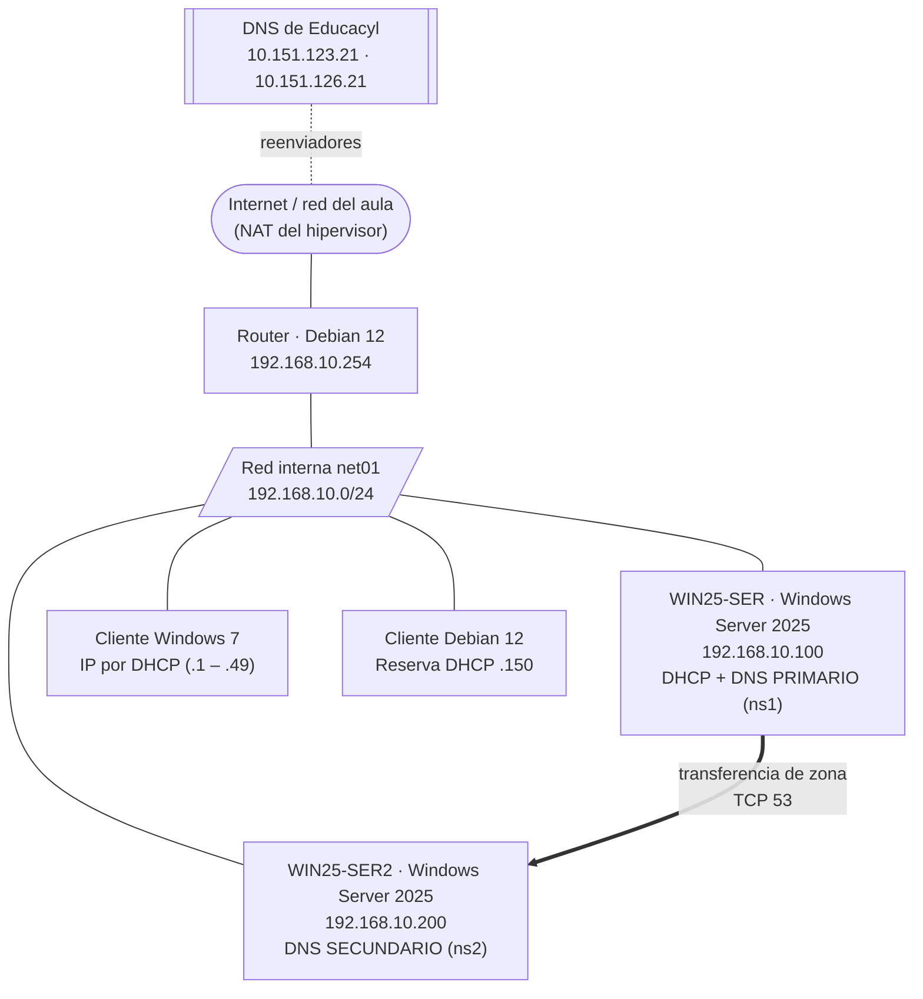

# UT2-P1 · Servidor DNS en Windows Server 2025

> **Módulo:** Servicios en Red · 2º SMR · **RA2:** Instala servicios de resolución de nombres, describiendo sus características y aplicaciones.
> **Duración orientativa:** 3 sesiones de 2 h (Parte A: pasos 1–7 · Parte B: pasos 8–12 · Parte C: pasos 13–17)
> **Forma de trabajo:** todo se hace de forma **gráfica**, desde el *Administrador del servidor* y la consola *Administrador de DNS*. Solo usaremos la línea de comandos en los clientes, para comprobar que todo funciona.
> [← Volver a la portada de la UT2](index.md) · [Teoría del servicio DNS](teoria.md)

---

## 1. Objetivo y criterios de evaluación

Instalar y configurar el rol **Servidor DNS** en el mismo `WIN25-SER` de la práctica de DHCP, para que sea el servidor de nombres de la red `net01`:

- **Primario** de la zona directa `smr2ser.test` y de la zona inversa `10.168.192.in-addr.arpa`.
- **Caché y reenviador** hacia los DNS de Educacyl, para que los equipos de la red puedan resolver nombres de Internet.
- Con un **servidor secundario**, `WIN25-SER2`, que recibe una copia de la zona mediante **transferencia de zona**.

| Criterio | Qué se hace en esta práctica | Pasos |
|---|---|---|
| **RA2.d** | Instalar un servicio jerárquico de resolución de nombres | 2, 3, 8 |
| **RA2.e** | Preparar el servicio para almacenar las respuestas de servidores públicos y servirlas a la red local (caché + reenviadores) | 10 |
| **RA2.f** | Añadir registros a una zona nueva, con opciones de correo (MX) y alias (CNAME) | 4, 5, 6, 7, 9 |
| **RA2.g** | Realizar transferencias de zona entre dos servidores | 13 – 17 |
| **RA2.h** | Comprobar el funcionamiento correcto del servidor | 12, 17 y apartado 5 |

---

## 2. Escenario

Es el mismo escenario de la UT1 (red interna `net01`), con dos cambios: `WIN25-SER` pasa a ser también servidor DNS y se añade un segundo servidor, `WIN25-SER2`.



```text
                      Internet / red del aula (NAT)  ←  DNS Educacyl 10.151.123.21 / .126.21
                                   │
                     ┌─────────────┴─────────────┐
                     │  Router · Debian 12       │
                     │  192.168.10.254           │
                     └─────────────┬─────────────┘
  ═════════════════════════ net01 · 192.168.10.0/24 ═════════════════════════
         │                    │                    │                    │
┌────────┴────────┐ ┌─────────┴───────┐ ┌──────────┴──────┐ ┌───────────┴─────┐
│ WIN25-SER       │ │ WIN25-SER2      │ │ Cliente Win 7   │ │ Cliente Debian  │
│ 192.168.10.100  │ │ 192.168.10.200  │ │ DHCP (.1 – .49) │ │ DHCP · reserva  │
│ DHCP            │ │ DNS secundario  │ │                 │ │ 192.168.10.150  │
│ DNS primario    │ │ (ns2)           │ │                 │ │                 │
│ (ns1)           │ │                 │ │                 │ │                 │
└─────────────────┘ └─────────────────┘ └─────────────────┘ └─────────────────┘
        │  ══ transferencia de zona (AXFR/IXFR, TCP 53) ══▶  │
```

**Datos de la práctica**

| Dato | Valor |
|---|---|
| Zona directa | `smr2ser.test` (fichero `smr2ser.test.dns`) |
| Zona inversa | `10.168.192.in-addr.arpa` (fichero `10.168.192.in-addr.arpa.dns`) |
| Servidor principal (SOA) | `ns1.smr2ser.test.` |
| Persona responsable (SOA) | `admin.smr2ser.test.` (= `admin@smr2ser.test`) |
| Servidores de nombres (NS) | `win25-ser.smr2ser.test.` y `ns1.smr2ser.test.` (192.168.10.100) · `ns2.smr2ser.test.` (192.168.10.200) |
| Reenviadores | `10.151.123.21` · `10.151.126.21` (DNS de Educacyl) |
| Actualizaciones dinámicas | No |

**Registros que vamos a crear** (son los del ejemplo del apartado 7 de la [teoría](teoria.md)):

| Nombre | Tipo | Valor | ¿Lleva PTR? | Para qué |
|---|---|---|---|---|
| `win25-ser` | A | 192.168.10.100 | ✅ Sí | Nombre real del servidor primario |
| `win25-ser2` | A | 192.168.10.200 | ✅ Sí | Nombre real del servidor secundario |
| `router` | A | 192.168.10.254 | ✅ Sí | Puerta de enlace |
| `debiancli` | A | 192.168.10.150 | ✅ Sí | Cliente Debian (tiene reserva DHCP) |
| `ns1` | A | 192.168.10.100 | ❌ No | Servidor de nombres primario |
| `ns2` | A | 192.168.10.200 | ❌ No | Servidor de nombres secundario |
| `www` | A | 192.168.10.100 | ❌ No | Servidor web (UT6) |
| `mail` | A | 192.168.10.100 | ❌ No | Servidor de correo (UT5) |
| `web` | CNAME | `www.smr2ser.test.` | — | Alias de `www` |
| `ftp` | CNAME | `win25-ser.smr2ser.test.` | — | Alias del servidor FTP (UT4) |
| `(igual que la carpeta principal)` | MX | `10 mail.smr2ser.test.` | — | Correo de `@smr2ser.test` |

> **¿Por qué no lleva PTR `ns1`, `www` o `mail`?** Comparten IP con `win25-ser`. Una IP debe tener **un solo PTR**, con el nombre principal del equipo.

**Hipervisor (VirtualBox)**

| Máquina | Adaptador 1 | Adaptador 2 |
|---|---|---|
| Router Debian 12 | NAT | Red interna `net01` |
| WIN25-SER | Red interna `net01` | — |
| WIN25-SER2 (clon) | Red interna `net01` | — |
| Cliente Windows 7 | Red interna `net01` | — |
| Cliente Debian 12 | Red interna `net01` | — |

---

## 3. Requisitos previos

- [ ] Práctica **UT1-P1** terminada: `WIN25-SER` con IP `192.168.10.100/24`, puerta de enlace `192.168.10.254` y el servicio DHCP funcionando.
- [ ] Router Debian 12 encendido y dando salida a Internet.
- [ ] Clientes Windows 7 y Debian 12 recibiendo IP por DHCP (el Debian, la `.150`).
- [ ] **Instantánea** de `WIN25-SER` antes de empezar: en VirtualBox, *Máquina → Tomar instantánea* → nombre `UT1-fin-DHCP`.
- [ ] Espacio en disco para un clon completo de `WIN25-SER` (Parte C).
- [ ] En el cliente Debian, la herramienta `dig`: `sudo apt install dnsutils` (con el router dando salida).

---

## 4. Pasos

### Parte A · Instalación, zona directa y registros (sesión 1)

#### Paso 1 · Comprobar el punto de partida

En `WIN25-SER`, abre el **Administrador del servidor → Servidor local** y comprueba:

| Dato | Valor esperado |
|---|---|
| Nombre del equipo | `WIN25-SER` |
| Ethernet | `192.168.10.100` |
| Roles (en *Panel*) | DHCP con el indicador en verde |

Si algo no coincide, corrígelo antes de seguir.

#### Paso 2 · Instalar el rol Servidor DNS · RA2.d

1. *Administrador del servidor → Administrar → Agregar roles y características*.
2. *Instalación basada en características o roles* → servidor `WIN25-SER`.
3. Marca **Servidor DNS**. Aparece la ventana *¿Desea agregar las características requeridas para Servidor DNS?* → **Agregar características** (son las herramientas de administración).
4. *Siguiente* hasta *Instalar*. Al terminar, *Cerrar*.

**Resultado esperado:** en el panel izquierdo del *Administrador del servidor* aparece **DNS**, y en el menú **Herramientas** aparece la entrada **DNS**, que abre la consola *Administrador de DNS*.

> No hace falta reiniciar. La instalación del rol abre en el firewall el puerto 53 (UDP y TCP).

#### Paso 3 · Asistente «Configurar un servidor DNS»: zona de búsqueda directa · RA2.d

*Herramientas → DNS*. En el *Administrador de DNS*, clic derecho sobre **WIN25-SER → Configurar un servidor DNS…** y recorre el asistente:

| Pantalla del asistente | Qué elegir |
|---|---|
| Seleccionar acción de configuración | **Crear una zona de búsqueda directa** (la inversa la crearemos aparte en el paso 8) |
| Ubicación del servidor principal | **Este servidor mantiene la zona** |
| Nombre de zona | `smr2ser.test` |
| Archivo de zona | **Crear un archivo nuevo con este nombre:** `smr2ser.test.dns` (Windows lo propone solo) |
| Actualización dinámica | **No admitir actualizaciones dinámicas** |
| Reenviadores | **No, no reenviar consultas** (los configuraremos en el paso 10, desde las propiedades del servidor) |
| Finalización | *Finalizar* |

> Al finalizar, el asistente puede avisar de que **no encuentra las sugerencias de raíz** (los servidores raíz de Internet). Es normal: desde la red del aula no se llega a ellos. Acepta y continúa: por eso usaremos reenviadores.

**Resultado esperado:** en *Zonas de búsqueda directa* aparece `smr2ser.test` con dos registros creados automáticamente:

| Nombre | Tipo | Datos |
|---|---|---|
| (igual que la carpeta principal) | Inicio de autoridad (SOA) | `[1], win25-ser., hostmaster.` |
| (igual que la carpeta principal) | Servidor de nombres (NS) | `win25-ser.` |

Fíjate en el **`[1]`** del SOA: es el **número de serie** de la zona.

#### Paso 4 · Modificar el registro SOA · RA2.f

Doble clic sobre el registro **Inicio de autoridad (SOA)** (o clic derecho sobre la zona → *Propiedades* → pestaña **Inicio de autoridad (SOA)**):

| Campo | Valor |
|---|---|
| Servidor principal | `ns1.smr2ser.test.` |
| Persona responsable | `admin.smr2ser.test.` (es el correo `admin@smr2ser.test`, con un punto en lugar de la @) |
| Intervalo de actualización / reintento / expira / TTL mínimo | Se dejan por defecto: 15 min · 10 min · 1 día · 1 h |

*Aplicar*. Mira el **Número de serie**: ha pasado de 1 a 2. **Windows lo incrementa solo** cada vez que cambias algo en la zona. (En BIND, en la práctica de Ubuntu, habrá que subirlo a mano.)

#### Paso 5 · Modificar los servidores de nombres (NS) · RA2.f

En las mismas *Propiedades de smr2ser.test*, pestaña **Servidores de nombres**:

1. Selecciona `win25-ser.` → **Modificar…** → *Nombre de dominio completo (FQDN) del servidor*: `win25-ser.smr2ser.test.` → en *Direcciones IP de este registro NS* escribe `192.168.10.100` → *Aceptar*.
   > El asistente puso `win25-ser.`, **sin dominio**: ningún otro equipo podría resolver ese nombre. Por eso lo completamos.
2. **Agregar…** → FQDN `ns1.smr2ser.test.` → IP `192.168.10.100` → *Aceptar*.
3. **Agregar…** → FQDN `ns2.smr2ser.test.` → IP `192.168.10.200` → *Aceptar*.
4. *Aplicar* y *Aceptar*.

**Resultado esperado:** la lista muestra los tres servidores de nombres:

| FQDN del servidor | Dirección IP |
|---|---|
| `ns1.smr2ser.test.` | `[192.168.10.100]` |
| `ns2.smr2ser.test.` | `[192.168.10.200]` |
| `win25-ser.smr2ser.test.` | `[192.168.10.100]` |

> Las IP entre corchetes se han escrito a mano. Para que cualquier equipo pueda resolver esos nombres hacen falta sus **registros A**, que creamos en el paso siguiente.
>
> `ns2` (`192.168.10.200`) todavía no existe: lo montaremos en la Parte C. Si al validar la IP aparece un aviso de que no responde, acéptalo igualmente.

#### Paso 6 · Registros A (Host) · RA2.f

Clic derecho sobre la zona `smr2ser.test` → **Host nuevo (A o AAAA)…** Crea los ocho registros A de la tabla del apartado 2:

| Campo | Ejemplo |
|---|---|
| Nombre | `debiancli` (el FQDN se completa solo: `debiancli.smr2ser.test.`) |
| Dirección IP | `192.168.10.150` |
| Crear registro del puntero (PTR) asociado | ❌ **Sin marcar**: todavía no tenemos zona de búsqueda inversa |

Pulsa **Agregar host** después de cada uno. La ventana se queda abierta para el siguiente; al terminar, *Listo*.

**Resultado esperado:** ocho registros *Host (A)* en la zona: `win25-ser`, `win25-ser2`, `router`, `debiancli`, `ns1`, `ns2`, `www` y `mail`.

#### Paso 7 · Registros MX y CNAME · RA2.f

**MX (servidor de correo):** clic derecho sobre `smr2ser.test` → **Nuevo intercambio de correo (MX)…**

| Campo | Valor |
|---|---|
| Host o dominio secundario | *(en blanco: el correo es del propio dominio `smr2ser.test`)* |
| FQDN del servidor de correo electrónico | `mail.smr2ser.test` |
| Prioridad del servidor de correo | `10` |

> El MX apunta a `mail`, que es un registro **A**. Nunca debe apuntar a un alias (CNAME): lo vimos en la Actividad 5 de la teoría.

**CNAME (alias):** clic derecho sobre `smr2ser.test` → **Alias nuevo (CNAME)…**

| Nombre de alias | FQDN para el host de destino |
|---|---|
| `web` | `www.smr2ser.test` |
| `ftp` | `win25-ser.smr2ser.test` |

> Con **Examinar…** puedes buscar el host de destino dentro de la zona en lugar de escribirlo: así no hay errores de escritura.

📸 **Instantánea:** `UT2-P1-zona-directa`.

### Parte B · Zona inversa, reenviadores y clientes (sesión 2)

#### Paso 8 · Crear la zona de búsqueda inversa · RA2.d

Clic derecho sobre **Zonas de búsqueda inversa → Zona nueva…**

| Pantalla del asistente | Qué elegir |
|---|---|
| Tipo de zona | **Zona principal** (la casilla *Almacenar la zona en Active Directory* queda desactivada: no tenemos dominio) |
| Nombre de la zona de búsqueda inversa | **Zona de búsqueda inversa para IPv4** |
| Id. de red | `192.168.10` → abajo aparece el nombre **`10.168.192.in-addr.arpa`** |
| Archivo de zona | **Crear un archivo nuevo con este nombre:** `10.168.192.in-addr.arpa.dns` |
| Actualización dinámica | **No admitir actualizaciones dinámicas** |

> El Id. de red se escribe **al derecho** y Windows le da la vuelta. Es justo lo que vimos en la teoría: en DNS lo más general va a la derecha.

Después, en la nueva zona → *Propiedades*, ajusta el **SOA** (`ns1.smr2ser.test.` y `admin.smr2ser.test.`) y los **Servidores de nombres** igual que en los pasos 4 y 5.

#### Paso 9 · Registros PTR · RA2.f

Ahora que existe la zona inversa, creamos los PTR de los cuatro equipos que lo llevan (`win25-ser`, `win25-ser2`, `router` y `debiancli`). Hay dos formas; usa cualquiera de ellas:

- **Desde el registro A:** en la zona `smr2ser.test`, doble clic sobre el host (por ejemplo, `debiancli`) → marca **Actualizar registro del puntero (PTR) asociado** → *Aceptar*.
- **Desde la zona inversa:** clic derecho sobre `10.168.192.in-addr.arpa` → **Nuevo puntero (PTR)…** → *Dirección IP del host*: `192.168.10.150` → *Nombre de host*: **Examinar…** y elige `debiancli` dentro de `smr2ser.test` → *Aceptar*.

**Resultado esperado:** en `10.168.192.in-addr.arpa` (pulsa F5) aparecen cuatro registros *Puntero (PTR)*:

| Nombre | Datos |
|---|---|
| `192.168.10.100` | `win25-ser.smr2ser.test.` |
| `192.168.10.150` | `debiancli.smr2ser.test.` |
| `192.168.10.200` | `win25-ser2.smr2ser.test.` |
| `192.168.10.254` | `router.smr2ser.test.` |

#### Paso 10 · Reenviadores y caché · RA2.e

**Reenviadores:** clic derecho sobre **WIN25-SER → Propiedades** → pestaña **Reenviadores** → **Editar…**

1. Haz clic en *<Haga clic aquí para agregar una dirección IP o un nombre DNS>* y escribe `10.151.123.21`. Repite con `10.151.126.21`.
2. Espera a que la columna **Validado** muestre **Aceptar** y, en *FQDN de servidor*, sus nombres (`serviciosda.educa.jcyl.es` y `edgc0exp01.educa.jcyl.es`).
3. *Aceptar*. Deja marcada **Usar sugerencias de raíz si no hay reenviadores disponibles** → *Aceptar*.

> 🏠 **En casa** no se llega a los DNS de Educacyl: usa los de Google, `8.8.8.8` y `8.8.4.4`, o los de tu router.

**Caché del servidor:** en el *Administrador de DNS*, menú **Ver → Avanzada**. Bajo `WIN25-SER` aparece la carpeta **Búsquedas en caché**. Ahora está casi vacía; la volveremos a mirar en el paso 12.

> ⚠️ **Ojo con `cache.dns`.** En `C:\Windows\System32\dns\` hay un fichero llamado `cache.dns`, pero **no es la caché**: contiene las *sugerencias de raíz* (los 13 servidores raíz de Internet), que el servidor usa cuando no tiene reenviadores. La caché de verdad está en memoria y es lo que se ve en *Búsquedas en caché*. Se vacía con clic derecho sobre el servidor → **Borrar caché**.

#### Paso 11 · El servidor y el DHCP usan nuestro DNS

**a) DNS del propio servidor.** Hasta ahora `WIN25-SER` preguntaba directamente a Educacyl. Ahora debe preguntarse a sí mismo, y Educacyl pasa a ser su reenviador.

*Panel de control → Redes e Internet → Centro de redes y recursos compartidos → Cambiar configuración del adaptador → Ethernet → Propiedades → Protocolo de Internet versión 4 (TCP/IPv4) → Propiedades*:

| Campo | Valor |
|---|---|
| Servidor DNS preferido | `192.168.10.100` |
| Servidor DNS alternativo | `192.168.10.200` |

**b) Opciones del ámbito DHCP.** Los clientes reciben el DNS por DHCP, así que hay que cambiarlo en el ámbito de la UT1. *Herramientas → DHCP → WIN25-SER → IPv4 → Ámbito [192.168.10.0] → Opciones de ámbito*:

| Opción | Antes (UT1) | Ahora |
|---|---|---|
| 006 Servidores DNS | `10.151.123.21`, `10.151.126.21` | `192.168.10.100`, `192.168.10.200` |
| 015 Nombre de dominio DNS | `smr2ser.org` | `smr2ser.test` |

Para cambiarlas: doble clic sobre cada opción. En la 006, quita las dos IP de Educacyl con **Quitar**, escribe la nueva IP y pulsa **Agregar**.

> Al agregar `192.168.10.200`, la consola puede avisar de que **no es un servidor DNS válido**: todavía no existe. Acepta el aviso para añadirla igualmente.

**c) Renovar la concesión en los clientes:**

```bat
:: Cliente Windows 7 (Símbolo del sistema)
ipconfig /release
ipconfig /renew
ipconfig /all
```

**Resultado esperado:** *Servidores DNS: 192.168.10.100 y 192.168.10.200* · *Sufijo DNS específico para la conexión: smr2ser.test*.

```bash
# Cliente Debian 12
sudo dhclient -r && sudo dhclient
cat /etc/resolv.conf
```

**Resultado esperado:** `search smr2ser.test` · `nameserver 192.168.10.100` · `nameserver 192.168.10.200`.

#### Paso 12 · Guardar los cambios y primeras pruebas · RA2.h

1. Menú **Acción → Actualizar archivo de datos del servidor** (o clic derecho sobre `WIN25-SER` → *Actualizar archivos de datos del servidor*). Así Windows escribe los ficheros `.dns` en disco.
2. Abre con el Bloc de notas `C:\Windows\System32\dns\smr2ser.test.dns`. Es un fichero de zona como el de la teoría: localiza el SOA (con su número de serie), los NS, el MX y los CNAME. **No lo edites** a mano.
3. Desde el **cliente Windows 7**:

```bat
nslookup www.smr2ser.test
nslookup web.smr2ser.test
nslookup -type=MX smr2ser.test
nslookup 192.168.10.150
nslookup www.educa.jcyl.es
nslookup www.educa.jcyl.es
ipconfig /displaydns
```

4. Vuelve a **Búsquedas en caché** en el servidor (F5): ahora aparecen carpetas como `es` → `jcyl` → `educa`. El servidor ha guardado la respuesta que le dio Educacyl y la próxima vez responderá él directamente.

> `ipconfig /displaydns` muestra la **caché del cliente**: cada entrada con su *Nombre de registro*, *Tipo*, *Tiempo de vida* (segundos que le quedan en caché) y la IP. `ipconfig /flushdns` la vacía.

📸 **Instantánea:** `UT2-P1-primario`.

### Parte C · Servidor secundario y transferencia de zona (sesión 3) · RA2.g

#### Paso 13 · Clonar WIN25-SER para crear WIN25-SER2

1. **Apaga** `WIN25-SER`.
2. En VirtualBox: clic derecho sobre `WIN25-SER` → **Clonar…**
   - Nombre: `WIN25-SER2`.
   - Política de dirección MAC: **Generar nuevas direcciones MAC para todos los adaptadores de red**.
   - Tipo de clonación: **Clonación completa**.
3. Antes de arrancar el clon: *Configuración → Red → Adaptador 1 → Avanzadas* → **desmarca «Cable conectado»**. Así no choca con la `.100` del original mientras lo cambiamos.

> ⚠️ **Clon sin sysprep:** el clon tiene el mismo identificador de seguridad (SID) que el original. Sin dominio de Active Directory no da problemas en esta práctica, pero en una empresa se haría con `sysprep` o con una instalación nueva.

#### Paso 14 · Convertir el clon en WIN25-SER2

Arranca **solo** `WIN25-SER2`, con el cable desconectado, y haz estos cambios **en este orden**:

1. **Quitar el rol DHCP** (en `net01` solo puede haber un servidor DHCP): *Administrador del servidor → Administrar → Quitar roles y características* → desmarca **Servidor DHCP** → *Quitar características* → *Siguiente* → *Quitar*.
2. **Borrar las zonas copiadas** (este servidor tendrá copias secundarias, no primarias): *Herramientas → DNS* → clic derecho sobre `smr2ser.test` → **Eliminar** → *Sí*. Repite con `10.168.192.in-addr.arpa`.
   > Los **reenviadores** se conservan del original: no hay que volver a configurarlos.
3. **Nueva IP:** propiedades de *Protocolo de Internet versión 4* (como en el paso 11):

   | Campo | Valor |
   |---|---|
   | Dirección IP | `192.168.10.200` |
   | Máscara de subred | `255.255.255.0` |
   | Puerta de enlace predeterminada | `192.168.10.254` |
   | Servidor DNS preferido | `192.168.10.200` |
   | Servidor DNS alternativo | `192.168.10.100` |

4. **Nuevo nombre:** *Administrador del servidor → Servidor local* → clic sobre el nombre del equipo → **Cambiar…** → `WIN25-SER2` → *Aceptar* → **reiniciar**.

Tras el reinicio: apaga `WIN25-SER2`, vuelve a marcar **Cable conectado** y arranca **los dos** servidores. Comprueba en *Servidor local* que el nombre es `WIN25-SER2` y la IP `192.168.10.200`.

#### Paso 15 · Permitir la transferencia en el primario (WIN25-SER)

En `WIN25-SER` → *Administrador de DNS* → clic derecho sobre `smr2ser.test` → **Propiedades** → pestaña **Transferencias de zona**:

1. Marca **Permitir transferencias de zona**.
2. Elige **Solo a los servidores nombrados en la pestaña Servidores de nombres** (ahí está `ns2.smr2ser.test`, del paso 5).
3. Pulsa **Notificar…** → marca **Notificar automáticamente** → **Servidores de la pestaña Servidores de nombres** → *Aceptar*.
4. *Aplicar* y *Aceptar*.

> 🔒 Nunca elijas **A cualquier servidor**: cualquiera podría descargar el listado completo de equipos de la red.

#### Paso 16 · Crear la zona secundaria en WIN25-SER2

En `WIN25-SER2` → *Herramientas → DNS* → clic derecho sobre **Zonas de búsqueda directa → Zona nueva…**

| Pantalla del asistente | Qué elegir |
|---|---|
| Tipo de zona | **Zona secundaria** |
| Nombre de zona | `smr2ser.test` |
| Servidores DNS maestros | Escribe `192.168.10.100` y espera a que *Validado* muestre **Aceptar** |
| Finalización | *Finalizar* |

**Resultado esperado:** al principio la zona puede mostrar el aviso *«La zona no está cargada por el servidor DNS»*. Espera unos segundos y pulsa F5, o clic derecho sobre la zona → **Transferir desde maestro**. Aparecen **todos los registros** del primario. Si intentas crear o modificar uno, no podrás: es una **copia de solo lectura**.

#### Paso 17 · Comprobar que el secundario se actualiza · RA2.g, RA2.h

1. Compara el **número de serie** en los dos servidores: *Propiedades de la zona → Inicio de autoridad (SOA)* en `WIN25-SER` y en `WIN25-SER2`. Deben coincidir. También desde el cliente Windows 7:

   ```bat
   nslookup -type=SOA smr2ser.test 192.168.10.100
   nslookup -type=SOA smr2ser.test 192.168.10.200
   ```

   Busca la línea `serial = …` en las dos respuestas.

2. En el **primario** (`WIN25-SER`), crea un registro nuevo: **Alias nuevo (CNAME)** → `intranet` → `win25-ser.smr2ser.test`.
3. Vuelve a mirar los seriales: el del primario ha subido. En unos segundos, gracias a la **notificación**, el del secundario también. En `WIN25-SER2` pulsa F5: aparece `intranet`. Si no aparece, clic derecho sobre la zona → **Transferir desde maestro**.
4. Desde el cliente Windows 7: `nslookup intranet.smr2ser.test 192.168.10.200`. Responde el secundario con el registro nuevo.
5. **Prueba de tolerancia a fallos:** apaga `WIN25-SER` y, desde el cliente Windows 7, ejecuta `nslookup www.smr2ser.test 192.168.10.200` y `ping www.smr2ser.test`. El secundario sigue respondiendo. Vuelve a encender `WIN25-SER`.

📸 **Instantánea** de los dos servidores: `UT2-P1-final`.

---

## 5. Verificación

| Prueba | Dónde | Cómo | Qué debe verse |
|---|---|---|---|
| Rol instalado y en marcha | WIN25-SER y WIN25-SER2 | *Administrador del servidor → Panel* | Icono **DNS** en verde |
| Resolución directa | Cliente Win 7 | `nslookup www.smr2ser.test` | `Servidor: win25-ser.smr2ser.test` · `Address: 192.168.10.100` y, debajo, `Nombre: www.smr2ser.test` · `Address: 192.168.10.100` |
| Alias | Cliente Win 7 | `nslookup web.smr2ser.test` | `Nombre: www.smr2ser.test` · `Aliases: web.smr2ser.test` |
| Correo | Cliente Win 7 | `nslookup -type=MX smr2ser.test` | `MX preference = 10, mail exchanger = mail.smr2ser.test` |
| Resolución inversa | Cliente Win 7 | `nslookup 192.168.10.150` | `Nombre: debiancli.smr2ser.test` |
| Sufijo DNS | Cliente Win 7 | `ping debiancli` | Hace ping a `debiancli.smr2ser.test [192.168.10.150]` |
| Caché + reenviadores | Cliente Win 7 | `nslookup www.educa.jcyl.es` | Una IP pública y el aviso **«Respuesta no autoritativa»** |
| Caché del servidor | WIN25-SER | *Ver → Avanzada → Búsquedas en caché* | Carpetas `es` → `jcyl` → `educa` |
| Caché del cliente | Cliente Win 7 | `ipconfig /displaydns` | Entradas de `www.smr2ser.test`, `www.educa.jcyl.es`… con su tiempo de vida |
| Respuesta autoritativa | Cliente Debian | `dig @192.168.10.100 www.smr2ser.test` | `status: NOERROR` · flag **`aa`** en `flags:` · `ANSWER: 1` |
| Respuesta desde caché | Cliente Debian | `dig @192.168.10.100 www.educa.jcyl.es` (dos veces) | Sin flag `aa`; la 2ª vez, `Query time` mucho menor |
| Inversa con dig | Cliente Debian | `dig -x 192.168.10.100 +short` | `win25-ser.smr2ser.test.` |
| Secundario actualizado | Cliente Win 7 | `nslookup -type=SOA smr2ser.test 192.168.10.200` | El mismo `serial` que en el `.100` |
| Transferencia bloqueada a extraños | Cliente Debian | `dig @192.168.10.100 smr2ser.test AXFR` | `Transfer failed.` (el cliente no está en la pestaña *Servidores de nombres*) |

---

## 6. Resolución de problemas típicos

| Síntoma | Causa probable | Solución |
|---|---|---|
| `nslookup` muestra `Servidor: UnKnown` | No hay PTR para la IP del servidor DNS (`.100`) | Paso 9: PTR `192.168.10.100 → win25-ser.smr2ser.test.` |
| `nslookup` responde un servidor `10.151.x.x` | El cliente sigue usando los DNS de Educacyl | Paso 11 b) y c): opción 006 del DHCP e `ipconfig /release` + `/renew` |
| Resuelve `smr2ser.test` pero no `www.educa.jcyl.es` | Reenviadores mal escritos o el router no da salida | Paso 10: la columna *Validado* debe decir **Aceptar** |
| Al crear un host, aviso de que no se puede crear el PTR | Se marcó *Crear registro del puntero* sin zona inversa | Desmarcarlo (paso 6) y crear el PTR en el paso 9 |
| En el secundario: «zona no cargada» o transferencia denegada | En el primario no se permiten transferencias, o `ns2` no está en *Servidores de nombres* | Pasos 15 y 5 (`ns2.smr2ser.test.` con IP `192.168.10.200`) |
| El secundario no recibe los cambios | No se configuró *Notificar…* y aún no han pasado los 15 min del intervalo de actualización | Paso 15.3 o **Transferir desde maestro** |
| Al arrancar el clon, aviso de **conflicto de IP** | Los dos servidores con la `.100` a la vez | Cable desconectado en el clon hasta cambiar la IP (paso 13) |
| Los clientes reciben IP de **dos servidores DHCP** | Al clon no se le quitó el rol DHCP | Paso 14.1 |
| `dig: command not found` en Debian | Falta el paquete | `sudo apt install dnsutils` |
| El fichero `.dns` no refleja los cambios | Windows aún no los ha escrito en disco | *Actualizar archivo de datos del servidor* (paso 12) |
| Los cambios no se ven en el cliente | Respuesta antigua guardada en caché | `ipconfig /flushdns` en el cliente y **Borrar caché** en el servidor |

---

## 7. Entregable para Teams

Sube **un PDF** con las capturas, cada una con un pie que diga qué demuestra.

**Capturas obligatorias**

1. *Administrador de DNS* de `WIN25-SER` con `smr2ser.test` desplegada y todos sus registros visibles (SOA, NS, A, MX, CNAME). *(RA2.d, RA2.f)*
2. Propiedades de `smr2ser.test`: pestañas **Inicio de autoridad (SOA)** y **Servidores de nombres**. *(RA2.f)*
3. Zona inversa `10.168.192.in-addr.arpa` con los cuatro PTR. *(RA2.f)*
4. Pestaña **Reenviadores** con los DNS de Educacyl validados, y carpeta **Búsquedas en caché** con contenido tras las pruebas del paso 12. *(RA2.e)*
5. Opciones del ámbito DHCP (006 y 015) y `ipconfig /all` del cliente Windows 7. *(RA2.h)*
6. Cliente Windows 7 con los `nslookup` de `www`, `web`, MX, `192.168.10.150` y `www.educa.jcyl.es` (con «Respuesta no autoritativa»). *(RA2.h)*
7. Cliente Debian con `dig @192.168.10.100 www.smr2ser.test`, donde se vea el flag `aa`. *(RA2.h)*
8. Pestaña **Transferencias de zona** del primario. *(RA2.g)*
9. `WIN25-SER2` con la zona secundaria cargada y el registro `intranet` ya copiado. *(RA2.g)*
10. Los dos `nslookup -type=SOA` con el mismo serial **después** de crear `intranet`. *(RA2.g)*

**Preguntas de reflexión**

1. ¿Qué diferencia hay entre la respuesta a `nslookup www.smr2ser.test` y a `nslookup www.educa.jcyl.es`? ¿Por qué una es autoritativa y la otra no?
2. ¿Por qué hemos cambiado `win25-ser.` por `win25-ser.smr2ser.test.` en los servidores de nombres?
3. ¿Qué número de serie tenía la zona al terminar el paso 7 y cuál al terminar el paso 17? ¿Quién lo ha ido cambiando?
4. ¿Qué hay en el fichero `cache.dns`? ¿Y dónde está realmente la caché del servidor?
5. ¿Qué pasaría si en el paso 15 eligieras **A cualquier servidor**? Demuéstralo con el `dig … AXFR` del cliente Debian.
6. En la prueba de tolerancia a fallos, ¿qué habría pasado si el DHCP solo repartiera un servidor DNS?

---

## 8. Ampliación opcional

- **Zona inversa secundaria:** permite las transferencias en `10.168.192.in-addr.arpa` y crea su copia secundaria en `WIN25-SER2`. Compruébalo con `nslookup 192.168.10.150 192.168.10.200`.
- **Delegación:** en `WIN25-SER2`, crea una zona **principal** `fp.smr2ser.test` con un host `www`. Después, en `WIN25-SER`, clic derecho sobre `smr2ser.test` → **Delegación nueva…** → dominio `fp` → servidor `ns2.smr2ser.test` (`192.168.10.200`). Explica la diferencia entre una zona delegada y una zona secundaria.
- **Reenviador condicional:** en `WIN25-SER`, *Reenviadores condicionales → Nuevo reenviador condicional* → dominio `jcyl.es` → `10.151.123.21`. ¿Qué ventaja tiene frente a los reenviadores generales?
- **Registro de depuración:** en *Propiedades del servidor → Registro de depuración*, activa *Registrar paquetes para depuración* y localiza en el fichero tus consultas desde el cliente.
- **Wireshark:** captura en `WIN25-SER2` mientras pulsas *Transferir desde maestro* y localiza la consulta SOA (UDP 53) y la transferencia AXFR (TCP 53).