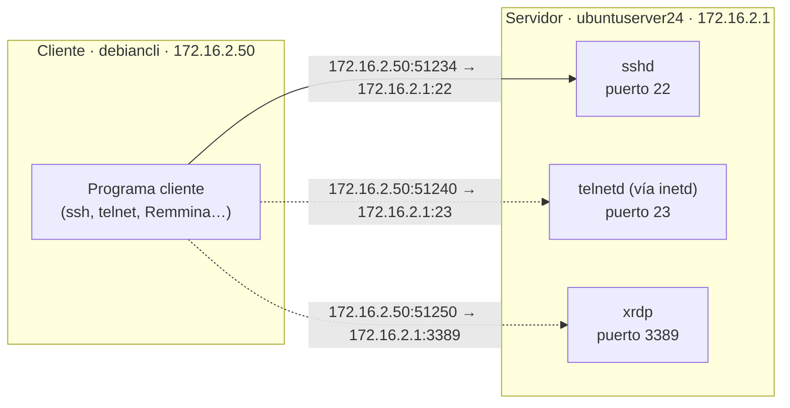
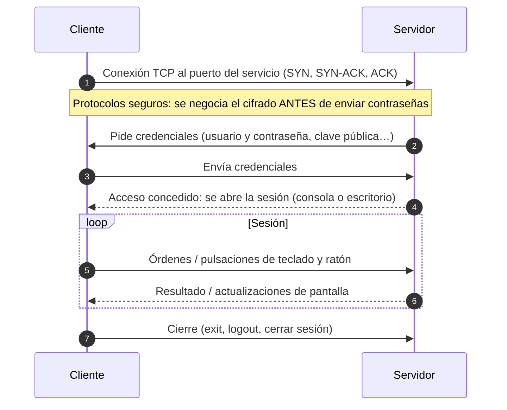

# UT3 · 1. Conceptos y funcionamiento general del acceso remoto

> **Criterios:** RA6.a (y base de RA6.f y RA6.g)
> [← Portada de la UT3](index.md) · **Siguiente:** [2. Telnet →](02-telnet.md)

## Índice

1. [¿Qué es el acceso remoto?](#1-qué-es-el-acceso-remoto)
2. [Acceso remoto y administración remota](#2-acceso-remoto-y-administración-remota)
3. [Dos formas de interactuar: CLI y GUI](#3-dos-formas-de-interactuar-cli-y-gui)
4. [Funcionamiento general: cliente, servidor y puertos](#4-funcionamiento-general-cliente-servidor-y-puertos)
5. [Fases de una sesión remota](#5-fases-de-una-sesión-remota)
6. [Ejercicio 1 · Preparar el escenario](#6-ejercicio-1--preparar-el-escenario)
7. [Errores frecuentes](#7-errores-frecuentes)
8. [Entregable para Teams](#8-entregable-para-teams)

---

## 1. ¿Qué es el acceso remoto?

El **acceso remoto** permite **conectarse a un equipo a través de la red y trabajar con él como si estuviéramos sentados delante**: ejecutar órdenes, abrir programas, ver su escritorio o copiar ficheros.

En la empresa es imprescindible:

- El técnico **resuelve incidencias sin desplazarse** (ahorra tiempo y dinero).
- Los **servidores** suelen estar en un CPD o en la nube, **sin monitor ni teclado**: solo se gestionan en remoto.
- Permite el **teletrabajo** y el soporte a usuarios de otras sedes.

> 🔒 **Regla de oro de esta unidad:** ningún servicio de acceso remoto se expone a Internet ni a la red real del aula. Todo se prueba en **redes internas** del hipervisor. Abrir SSH, RDP o VNC a Internet sin protección es una de las vías de ataque más habituales contra las empresas.

---

## 2. Acceso remoto y administración remota

El RA6 distingue dos ideas que conviene no confundir:

| | **Acceso remoto** | **Administración remota** |
|---|---|---|
| Qué es | Obtener una **sesión** en el otro equipo (consola o escritorio) | **Gestionar** el sistema remoto: servicios, usuarios, configuración, actualizaciones |
| Ejemplo | Abrir el escritorio de `WIN25-SER` por RDP desde `debiancli` | Reiniciar el DNS de `ubuntuserver24` con `ssh alumno@172.16.2.1 sudo systemctl restart named` |
| Herramientas típicas | SSH, RDP, VNC, NX | SSH, PowerShell Remoting, Cockpit, Windows Admin Center, consolas MMC remotas |
| Criterio | RA6.f | RA6.g |

> Casi siempre se administra **a través de** un acceso remoto, pero no siempre hace falta una sesión completa: con SSH se puede ejecutar **una sola orden** en el servidor y volver.

---

## 3. Dos formas de interactuar: CLI y GUI

| | **Línea de comandos (CLI)** | **Modo gráfico (GUI)** |
|---|---|---|
| Qué se transmite | **Texto**: lo que escribes y lo que responde la consola | **Imágenes** del escritorio + teclado y ratón |
| Protocolos | Telnet, **SSH** | **RDP**, **VNC**, NX, reenvío X11 |
| Ancho de banda | Muy bajo (bytes) | Alto (imágenes, aunque comprimidas) |
| ¿Necesita entorno gráfico en el servidor? | No | Sí (salvo el reenvío X11 de una sola aplicación) |
| Automatizable (scripts) | Sí, muy fácil | Difícil |
| Curva de aprendizaje | Mayor: hay que saber los comandos | Menor: «como si estuvieras delante» |
| Criterio | **RA6.b** | **RA6.c** |

---

## 4. Funcionamiento general: cliente, servidor y puertos

Todos los servicios de acceso remoto siguen el modelo **cliente/servidor**:

- **Servidor** (equipo al que se accede): tiene un **servicio** (*demonio*) escuchando en un **puerto conocido** (22 para SSH, 3389 para RDP…).
- **Cliente** (equipo desde el que se accede): usa un **programa cliente** que se conecta a la IP o nombre del servidor y a ese puerto. El cliente usa un **puerto de origen aleatorio** (efímero, normalmente ≥ 49152 en Windows y ≥ 32768 en Linux).



Una conexión TCP queda identificada por **cuatro datos**: IP y puerto del cliente + IP y puerto del servidor. Por eso un mismo servidor puede atender a muchos clientes a la vez en el mismo puerto 22: cada conexión tiene un puerto de cliente distinto.

### Puertos de los servicios de la unidad

| Servicio | Puerto | Cifra | Página |
|---|---|---|---|
| Telnet | 23/TCP | ❌ | [2](02-telnet.md) |
| SSH (y SCP, SFTP, X11, túneles) | 22/TCP | ✅ | [3](03-ssh.md) |
| RDP (y xrdp) | 3389/TCP y UDP | ✅ | [4](04-escritorio-remoto.md) |
| VNC | 5900 + N/TCP | ❌ (versión básica) | [4](04-escritorio-remoto.md) |
| NX (NoMachine) | 4000/TCP | ✅ | [4](04-escritorio-remoto.md) |

### Requisitos para conectarse

1. **Conectividad IP** entre cliente y servidor (misma red o rutas entre las redes). Se comprueba con `ping`.
2. **Identificación del servidor**: por su IP o por su nombre, si hay DNS (UT2): `ssh alumno@ubuntuserver24.smr2ser.test`.
3. **Servicio instalado y en marcha** en el servidor, escuchando en su puerto.
4. **Cortafuegos** del servidor (y de la red) que deje pasar ese puerto.
5. **Credenciales**: un usuario del servidor con permiso para conectarse en remoto.

> Cuando una conexión falla, revisa los requisitos **en este orden**. Es inútil buscar errores en la configuración de SSH si el cliente no llega por `ping` al servidor.

---

## 5. Fases de una sesión remota



1. **Conexión:** el cliente abre una conexión TCP con el puerto del servicio.
2. **Canal seguro:** en los protocolos seguros (SSH, RDP) se acuerda el **cifrado** antes de pedir nada.
3. **Autenticación:** el servidor comprueba quién es el usuario.
4. **Sesión:** el usuario trabaja: comandos, ficheros o escritorio, según el tipo de acceso.
5. **Cierre:** `exit`, `logout` o cerrar sesión. Ojo: en RDP, cerrar la ventana **desconecta** pero deja la sesión abierta en el servidor.

> ⚠️ La fase 2 **no existe en todos los protocolos**. Telnet y VNC básico no cifran nada: usuario, contraseña y datos viajan **en claro**. Es la diferencia más importante entre los métodos de esta unidad, y la vas a **ver con tus propios ojos** en Wireshark.

---

## 6. Ejercicio 1 · Preparar el escenario

**Objetivo:** tener las dos redes de las unidades anteriores comunicadas a través del router, para poder probar conexiones entre sistemas distintos.

**Escenario:** ver la [portada de la UT3](index.md#escenario-de-la-unidad).

### Paso 1 · Instantáneas y adaptadores de red

1. Con las máquinas **apagadas**, haz una instantánea «antes-UT3» de `ubuntuserver24` y `WIN25-SER`.
2. Configura los adaptadores en VirtualBox:

   | Máquina | Adaptador 1 | Adaptador 2 | Adaptador 3 |
   |---|---|---|---|
   | Router Debian 12 | NAT | Red interna `net01` | Red interna `net02` |
   | WIN25-SER | Red interna `net01` | — | — |
   | ubuntuserver24 · debiancli · Windows 7 | Red interna `net02` | — | — |

3. Apaga `WIN25-SER2`: no se usa en esta unidad.

### Paso 2 · El router encamina entre `net01` y `net02`

En el **router**:

```bash
ip -br a                         # debe tener IP en las dos redes internas
sysctl net.ipv4.ip_forward       # debe ser 1
```

Resultado esperado:

```text
enp0s3   UP   10.0.2.15/24 …
enp0s8   UP   192.168.10.254/24 …
enp0s9   UP   172.16.2.254/24 …
net.ipv4.ip_forward = 1
```

Si al router le falta la tercera interfaz, añádela en `/etc/network/interfaces` (Debian 12 no usa netplan):

```text
# Interfaz hacia net02
auto enp0s9
iface enp0s9 inet static
    address 172.16.2.254/24
```

```bash
sudo systemctl restart networking
```

Si `ip_forward` vale `0`, actívalo de forma permanente:

```bash
echo "net.ipv4.ip_forward=1" | sudo tee /etc/sysctl.d/99-router.conf
sudo sysctl --system
```

> La salida a Internet de las dos redes funciona si la regla de NAT del router es del tipo `-o enp0s3 -j MASQUERADE` (enmascara todo lo que sale por la interfaz NAT, venga de la red que venga). La necesitas para instalar paquetes en `ubuntuserver24`.

### Paso 3 · Comprobar la configuración de los equipos

| Equipo | Comando | Debe verse |
|---|---|---|
| `ubuntuserver24` | `ip -br a` · `ip route` | `172.16.2.1/24` · `default via 172.16.2.254` |
| `debiancli` | `ip -br a` · `ip route` | `172.16.2.50/24` · `default via 172.16.2.254` |
| Windows 7 | `ipconfig` | IP entre `.101` y `.200` · puerta de enlace `172.16.2.254` |
| `WIN25-SER` | `ipconfig` | `192.168.10.100` · puerta de enlace `192.168.10.254` |

### Paso 4 · Permitir el ping a Windows Server

El Firewall de Windows **bloquea el ping por defecto**. Para poder diagnosticar, en `WIN25-SER` (PowerShell como administrador):

```powershell
# Regla «Archivos e impresoras compartidos (petición de eco: ICMPv4 de entrada)».
# Se usa el nombre interno de la regla, que no depende del idioma de Windows.
Enable-NetFirewallRule -Name FPS-ICMP4-ERQ-In
```

### Paso 5 · Prueba de conectividad

Desde `debiancli`:

```bash
ping -c2 172.16.2.1          # ubuntuserver24 (misma red)
ping -c2 192.168.10.100      # WIN25-SER (otra red: pasa por el router)
traceroute 192.168.10.100    # debe aparecer 172.16.2.254 como primer salto
```

Desde Windows 7:

```text
ping 172.16.2.1
ping 192.168.10.100
tracert 192.168.10.100
```

> `traceroute` no viene instalado en Debian 12: `sudo apt install traceroute`.

**Resultado esperado:** todos los `ping` responden y el primer salto hacia `192.168.10.100` es el router (`172.16.2.254`).

---

## 7. Errores frecuentes

| Error | Síntoma | Solución |
|---|---|---|
| El router no tiene `ip_forward` activado | `ping` a la otra red sin respuesta; `traceroute` se queda en el router | `net.ipv4.ip_forward=1` (paso 2) |
| `WIN25-SER` sin puerta de enlace `192.168.10.254` | Desde `net02` no llega nada a Windows, pero desde el router sí | Revisar la configuración IP de `WIN25-SER` |
| Ping a Windows bloqueado | `ping` a `192.168.10.100` falla aunque todo esté bien configurado | Paso 4, o probar el puerto directamente: `nc -zv 192.168.10.100 3389` |
| Equipo en la red interna equivocada | IP de la otra red o sin IP | Revisar el adaptador en VirtualBox (`net01` / `net02`) |
| Servidor en «Adaptador puente» | El servicio queda visible en la red del aula | Solo redes internas |
| Intentar usar `win25-ser.smr2ser.test` desde `net02` | `Name or service not known` | El DNS de `net02` (`ubuntuserver24`) no tiene ese nombre: usa la IP `192.168.10.100` |

---

## 8. Entregable para Teams

Captura de pantalla de:

1. La configuración de los tres adaptadores del router en VirtualBox.
2. En el router: `ip -br a` y `sysctl net.ipv4.ip_forward`.
3. En `debiancli`: `traceroute 192.168.10.100` (se ve el router como primer salto).
4. En Windows 7: `ipconfig` y `ping 192.168.10.100`.

**Preguntas de reflexión:**

1. ¿Qué cuatro datos identifican la conexión que abrirás desde `debiancli` al puerto 22 de `ubuntuserver24`? ¿Cuál de ellos no conoces de antemano?
2. Pon un ejemplo de **acceso remoto** y otro de **administración remota** con las máquinas del escenario.
3. ¿Por qué crees que el ping a Windows Server está bloqueado por defecto?

---

**Siguiente:** [2. Telnet →](02-telnet.md)
