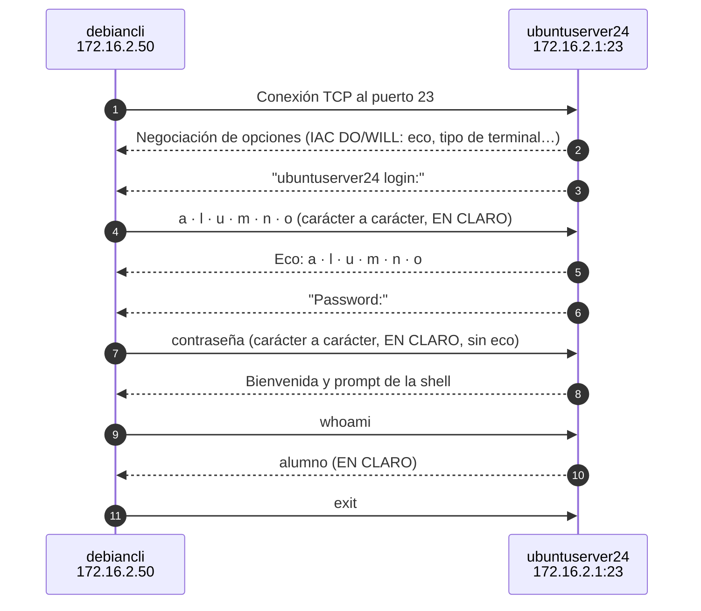
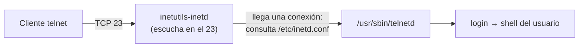

# UT3 · 2. Telnet: acceso remoto en línea de comandos (sin cifrar)

> **Criterios:** RA6.a, RA6.b, RA6.d, RA6.e, RA6.f
> [← 1. Conceptos](01-conceptos.md) · [Portada de la UT3](index.md) · **Siguiente:** [3. SSH →](03-ssh.md)

## Índice

1. [¿Qué es Telnet?](#1-qué-es-telnet)
2. [Intercambio de mensajes](#2-intercambio-de-mensajes)
3. [Telnet en Ubuntu Server: el superservidor inetd](#3-telnet-en-ubuntu-server-el-superservidor-inetd)
4. [Por qué Telnet es inseguro](#4-por-qué-telnet-es-inseguro)
5. [Ejercicios](#5-ejercicios)
6. [Verificación](#6-verificación)
7. [Errores frecuentes](#7-errores-frecuentes)
8. [Comprueba antes de seguir](#8-comprueba-antes-de-seguir)
9. [Ampliación opcional](#9-ampliación-opcional)

---

## 1. ¿Qué es Telnet?

**Telnet** (*Teletype Network*, RFC 854, 1983) es uno de los primeros protocolos de acceso remoto. Ofrece una **terminal de texto** en el equipo remoto: lo que escribes se envía al servidor y lo que el servidor responde aparece en tu pantalla.

| Característica | Valor |
|---|---|
| Tipo de acceso | Línea de comandos (CLI) |
| Puerto | **23/TCP** |
| Cliente | `telnet` (Linux) · *Cliente Telnet* (Windows) |
| Servidor | `telnetd` |
| Cifrado | ❌ **Ninguno**: usuario, contraseña y comandos viajan en claro |

---

## 2. Intercambio de mensajes



1. El cliente abre una conexión TCP con el puerto 23.
2. Cliente y servidor **negocian opciones** con mensajes especiales (empiezan por el byte `IAC`): quién hace el eco de lo que se escribe, tipo de terminal, tamaño de ventana…
3. El servidor muestra `login:`. Cada tecla que pulsas se envía **en un paquete** y el servidor la **devuelve** (eco) para que la veas en pantalla.
4. En `Password:` el servidor **no hace eco**, pero la contraseña se envía igualmente **en claro**.
5. Si las credenciales son correctas, obtienes una shell. Todo lo que escribas y todo lo que responda el servidor sigue viajando **sin cifrar**.

En el servidor, `telnetd` crea un **pseudoterminal** (`/dev/pts/N`) y lanza el programa `login`. Por eso al conectar aparece algo como `Linux 6.8.0-86-generic (ubuntuserver24) (pts/0)`.

---

## 3. Telnet en Ubuntu Server: el superservidor inetd

En Ubuntu, `telnetd` no se ejecuta como un servicio independiente: lo arranca **inetd** (*Internet service daemon*), un **superservidor** que escucha en varios puertos y lanza el programa adecuado **solo cuando llega una conexión**. Así no hay un proceso por servicio esperando todo el tiempo.



| Elemento | Valor en Ubuntu 24.04 |
|---|---|
| Paquete | `telnetd` (paquete de transición que instala `inetutils-telnetd`, `inetutils-inetd` y `update-inetd`) |
| Servicio | `inetutils-inetd.service` (se puede llamar también `inetd`) |
| Configuración | `/etc/inetd.conf`: una línea por servicio |
| Activar / desactivar servicios | `sudo update-inetd --enable telnet` · `--disable telnet` (o editar el fichero) |
| Cliente | Paquete `telnet` |

La línea de Telnet en `/etc/inetd.conf` tiene este formato:

```text
# servicio  tipo    proto  espera  usuario  programa         argumentos
telnet      stream  tcp    nowait  root     /usr/sbin/tcpd   /usr/sbin/telnetd
```

| Campo | Valor | Significado |
|---|---|---|
| servicio | `telnet` | Nombre del servicio; inetd busca su puerto (23) en `/etc/services` |
| tipo | `stream` | Conexión TCP (`dgram` sería UDP) |
| espera | `nowait` | Lanza un proceso nuevo por cada conexión |
| usuario | `root` | Usuario con el que se ejecuta |
| programa | `/usr/sbin/tcpd` | *TCP wrapper*: puede filtrar por IP antes de pasar la conexión a `telnetd` |

> Si `/etc/inetd.conf` no tiene ninguna línea activa, el servicio aparece como **inactive (dead)** con «*condition unmet*». No es un error: inetd no arranca si no tiene nada que servir.

> En **Windows**, el **servidor** Telnet desapareció en Windows Server 2016. El **cliente** sigue disponible como característica opcional.

---

## 4. Por qué Telnet es inseguro

| Problema | Consecuencia |
|---|---|
| **Sin confidencialidad** | Cualquiera que capture el tráfico (Wireshark, `tcpdump`) lee el usuario, la contraseña y los comandos |
| **Sin integridad** | Un atacante en medio (*man-in-the-middle*) puede **modificar** los datos sin que se note |
| **Sin autenticación del servidor** | El cliente no puede saber si habla con el servidor de verdad o con un impostor |

> Telnet **sí autentica al usuario** (pide usuario y contraseña), pero lo hace en claro. Lo que no tiene es **cifrado**, **control de integridad** ni forma de **verificar la identidad del servidor**.

### Ventajas y deficiencias (RA6.e)

| ✅ Ventajas | ❌ Deficiencias |
|---|---|
| Muy sencillo de instalar y de usar | Todo viaja en claro, incluida la contraseña |
| Consume muy pocos recursos (solo texto) | Vulnerable a la captura de tráfico (*sniffing*) y a ataques *man-in-the-middle* |
| Disponible en equipos de red antiguos (switches, routers) | Obsoleto: sustituido por SSH en todos los ámbitos |
| El **cliente** sirve para comprobar si un puerto TCP está abierto | Ya no existe servidor Telnet en Windows |

**¿Para qué se usa hoy?** Para equipos de red antiguos sin SSH (siempre en una red de gestión aislada) y, sobre todo, como **herramienta de diagnóstico**: `telnet IP puerto` (ejercicio 5).

---

## 5. Ejercicios

> **Requisitos previos:** [Ejercicio 1](01-conceptos.md#6-ejercicio-1--preparar-el-escenario) terminado. Instantánea de `ubuntuserver24` hecha. Usuario de laboratorio `alumno` con contraseña ficticia `Alumno.UT3!` en `ubuntuserver24`.

### Ejercicio 2 · Instalar el servidor Telnet en `ubuntuserver24` (RA6.b)

1. Instala el paquete:

   ```bash
   sudo apt update
   sudo apt install telnetd
   ```

   Se instalarán también `inetutils-inetd`, `inetutils-telnetd`, `tcpd` y `update-inetd`.

2. Mira el estado de inetd:

   ```bash
   systemctl status inetd
   ```

   **Resultado esperado:** `inactive (dead)` y `start condition unmet`. La línea de Telnet está desactivada.

3. Mira la línea de Telnet en la configuración:

   ```bash
   grep telnet /etc/inetd.conf
   ```

   Si empieza por `#<off>#`, está desactivada.

4. Actívala y reinicia el superservidor:

   ```bash
   sudo update-inetd --enable telnet
   sudo systemctl restart inetd
   systemctl status inetd
   ```

   > También puedes editar `/etc/inetd.conf` con `sudo nano` y borrar el `#<off>#` del principio de la línea.

   **Resultado esperado:** `active (running)`.

5. Comprueba que el puerto 23 está en escucha:

   ```bash
   sudo ss -tlnp | grep :23
   ```

   **Resultado esperado:**

   ```text
   LISTEN 0  128  0.0.0.0:23  0.0.0.0:*  users:(("inetutils-inetd",pid=…,fd=…))
   ```

   > El proceso que escucha es **inetd**, no `telnetd`. `telnetd` solo aparecerá cuando alguien se conecte.

### Ejercicio 3 · Conectar desde `debiancli` (RA6.d)

1. Instala el cliente y conéctate:

   ```bash
   sudo apt install telnet
   telnet 172.16.2.1
   ```

2. Inicia sesión como `alumno` y ejecuta:

   ```bash
   whoami
   hostname
   who          # aparece tu sesión en pts/N desde 172.16.2.50
   ```

3. Sal con `exit`.

**Resultado esperado:**

```text
Trying 172.16.2.1...
Connected to 172.16.2.1.
Escape character is '^]'.

Linux 6.8.0-… (ubuntuserver24) (pts/0)

ubuntuserver24 login: alumno
Password:
Welcome to Ubuntu 24.04.3 LTS …
alumno@ubuntuserver24:~$
```

### Ejercicio 4 · Conectar desde Windows 7 (RA6.f)

1. Activa el cliente Telnet: *Panel de control → Programas → Activar o desactivar las características de Windows → **Cliente Telnet***. O, en un `cmd` abierto como administrador:

   ```text
   dism /online /Enable-Feature /FeatureName:TelnetClient
   ```

2. Conéctate desde `cmd`:

   ```text
   telnet 172.16.2.1
   ```

3. Inicia sesión como `alumno`, ejecuta `who` y comprueba que aparece la IP del cliente Windows. Sal con `exit`.

> Acabas de acceder **desde Windows a Linux**: el protocolo es un estándar independiente del sistema operativo.

### Ejercicio 5 · Telnet como herramienta de diagnóstico de puertos

El cliente Telnet sirve para saber si un puerto TCP está abierto. Desde `debiancli`:

```bash
telnet 172.16.2.1 22        # SSH de ubuntuserver24
telnet 172.16.2.1 8080      # puerto sin servicio
telnet 192.168.10.100 3389  # RDP de WIN25-SER (aún no activado)
```

Para salir de una conexión abierta: `Ctrl + ]` y después `quit`.

| Resultado | Significado |
|---|---|
| `Connected to …` (y quizá un texto como `SSH-2.0-OpenSSH_…`) | Hay un servicio escuchando y el cortafuegos deja pasar |
| `Connection refused` | El equipo responde, pero **no hay ningún servicio** en ese puerto |
| Se queda esperando hasta `timed out` | Un **cortafuegos** descarta los paquetes, o el equipo no es accesible |

> Anota qué resultado obtienes con cada puerto. El último lo repetirás en la página 4, después de activar RDP.

> ⚖️ Comprobar puertos de equipos **ajenos** sin permiso puede ser delito. Hazlo solo con las máquinas de tu laboratorio.

### Ejercicio 6 · Capturar una sesión Telnet con Wireshark (RA6.e)

1. En `debiancli`, instala Wireshark y permite capturar sin ser root:

   ```bash
   sudo apt install wireshark       # responde «Sí» a si los usuarios sin privilegios pueden capturar
   sudo usermod -aG wireshark $USER
   ```

   Cierra la sesión gráfica y vuelve a entrar para que se aplique el grupo.

2. Abre Wireshark y empieza a capturar en la interfaz de `net02` (normalmente `enp0s3`).
3. En un terminal: `telnet 172.16.2.1`. Inicia sesión, ejecuta `whoami` y `exit`.
4. Para la captura y escribe `telnet` en el filtro de visualización.
5. Sobre cualquier paquete: **Analizar → Seguir → Flujo TCP**.

**Resultado esperado:** en el flujo se lee **el usuario y la contraseña**. Las letras del usuario aparecen **dobles** (lo que envía el cliente + el eco del servidor) y las de la contraseña, **una sola vez** (no hay eco).

### Ejercicio 7 · Desactivar Telnet

Al terminar la página, **desactiva Telnet**: un servidor no debe tener servicios inseguros abiertos que no se usan.

```bash
sudo update-inetd --disable telnet
sudo systemctl restart inetd
sudo ss -tlnp | grep :23         # ya no debe aparecer nada
```

---

## 6. Verificación

| Comprobación | Comando | Qué debe verse |
|---|---|---|
| Superservidor en marcha | `systemctl status inetd` | `active (running)` |
| Línea de Telnet activa | `grep ^telnet /etc/inetd.conf` | La línea, sin `#` |
| Puerto en escucha | `sudo ss -tlnp \| grep :23` | `LISTEN … 0.0.0.0:23 … inetutils-inetd` |
| Conexiones establecidas | `ss -tn state established '( sport = :23 )'` | Una línea por cliente conectado |
| Usuarios conectados | `who` | `alumno pts/0 … (172.16.2.50)` |
| Registro de accesos | `sudo journalctl -t login -n 20` | Entradas de inicio de sesión |

> El último comando muestra lo que registra el programa `login`. Si no aparece nada, prueba `sudo journalctl -n 50 | grep -i telnet`.

---

## 7. Errores frecuentes

| Error | Síntoma | Solución |
|---|---|---|
| Instalar `telnetd` y no activar la línea | `inetd` en `inactive (dead)` · `Connection refused` | `sudo update-inetd --enable telnet` y reiniciar `inetd` |
| Buscar un servicio `telnetd` | `Unit telnetd.service could not be found` | El servicio es `inetd` (`inetutils-inetd`) |
| Editar `/etc/inetd.conf` y no reiniciar | Sigue sin escuchar | `sudo systemctl restart inetd` |
| Instalar `telnet` en el servidor en lugar de `telnetd` | Solo tienes el **cliente** | El servidor es `telnetd` |
| Windows: `"telnet" no se reconoce como un comando…` | El cliente no está activado | Activar *Cliente Telnet* (ejercicio 4) |
| Intentar entrar como `root` | `Login incorrect` | Usa un usuario normal y `sudo`. Que root no pueda entrar por la red es lo correcto |
| No salir de una prueba de puerto | El terminal parece colgado | `Ctrl + ]` y `quit` |
| Wireshark no muestra interfaces | Sin permisos para capturar | `usermod -aG wireshark` y volver a iniciar sesión |
| Dejar Telnet activado | Servicio inseguro abierto | Ejercicio 7 |

---

## 8. Comprueba antes de seguir

Los puntos marcados con 📎 **PR0301** son evidencias de la **Parte A de la práctica PR0301** (Teams): guarda esas capturas.

- ☐ `inetd` está `active (running)` y `ss` muestra el puerto 23 en escucha.
- ☐ Te has conectado por Telnet desde `debiancli` y desde Windows 7, y `who` muestra la IP de cada cliente.
- ☐ Sabes interpretar `Connected`, `Connection refused` y `timed out` (ejercicio 5).
- ☐ 📎 **PR0301** Wireshark: **Seguir flujo TCP** de la sesión Telnet con el usuario y la contraseña legibles (ejercicio 6). Usa la contraseña ficticia del laboratorio.
- ☐ Has desactivado Telnet al terminar (ejercicio 7).

**Para comentar en clase:**

1. ¿Por qué el proceso que escucha en el puerto 23 es `inetutils-inetd` y no `telnetd`?
2. En la captura, ¿por qué las letras del usuario aparecen dobles y las de la contraseña no?
3. Telnet pide usuario y contraseña. Entonces, ¿por qué se dice que es inseguro? Nombra sus tres carencias.
4. ¿Qué diferencia hay entre `Connection refused` y `timed out` al probar un puerto?

---

## 9. Ampliación opcional

- **Capturar desde el servidor, sin entorno gráfico:** en `ubuntuserver24`, mientras alguien se conecta por Telnet:

  ```bash
  sudo tcpdump -i enp0s3 -A 'tcp port 23'
  ```

  La opción `-A` muestra el contenido de los paquetes en texto: intenta localizar la contraseña.

- **TCP wrappers:** como `inetd` lanza `telnetd` a través de `tcpd`, se puede limitar el acceso por IP con `/etc/hosts.allow` y `/etc/hosts.deny` (`man hosts_access`). Prueba a permitir solo a `debiancli` y comprueba que Windows 7 queda rechazado.

---

**Siguiente:** [3. SSH →](03-ssh.md)