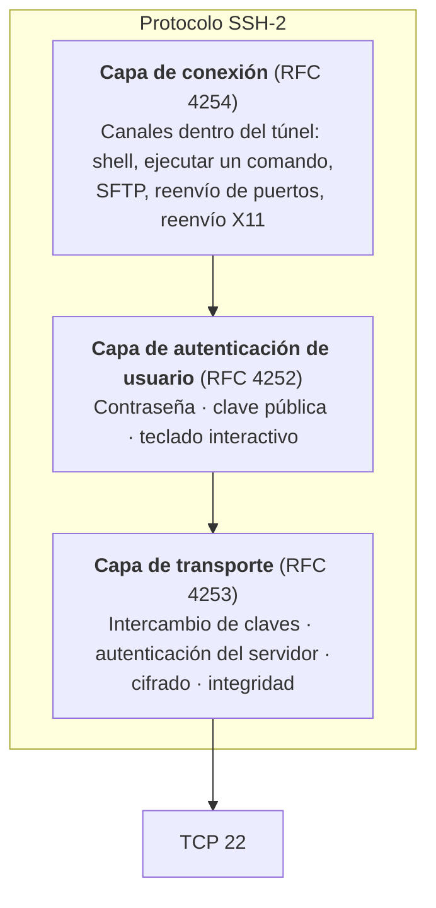
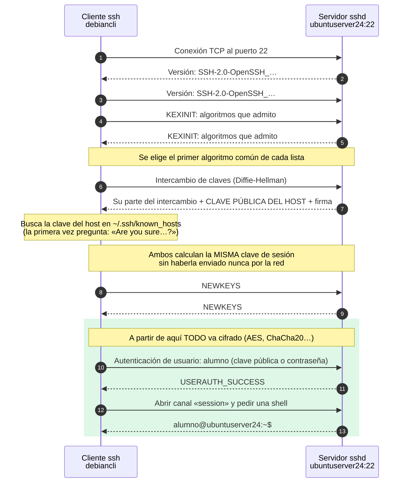
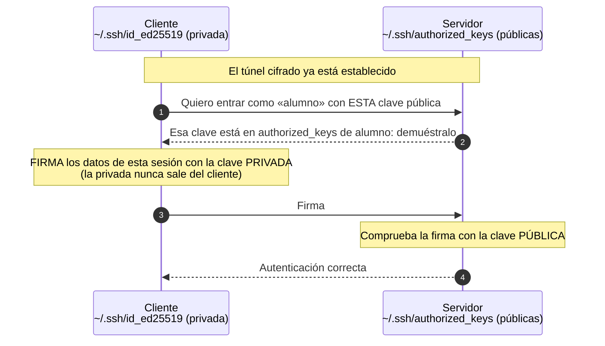
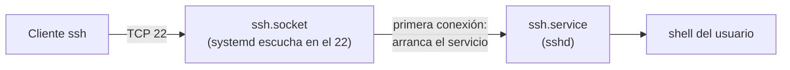
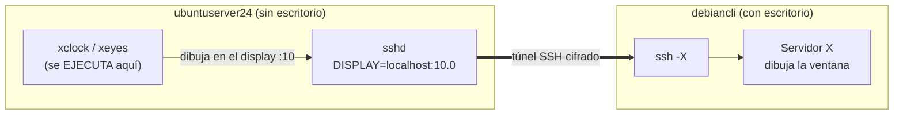
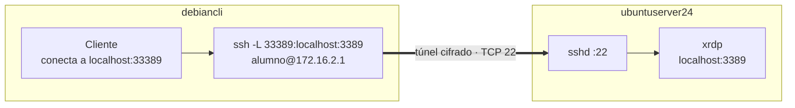

# UT3 · 3. SSH: acceso y administración remota segura

> **Criterios:** RA6.a, RA6.b, RA6.d, RA6.e, RA6.f, RA6.g
> [← 2. Telnet](02-telnet.md) · [Portada de la UT3](index.md) · **Siguiente:** [4. Escritorio remoto →](04-escritorio-remoto.md)

## Índice

1. [¿Qué es SSH?](#1-qué-es-ssh)
2. [Cómo se establece una conexión SSH](#2-cómo-se-establece-una-conexión-ssh)
3. [Autenticación del usuario: contraseña y clave pública](#3-autenticación-del-usuario-contraseña-y-clave-pública)
4. [OpenSSH: ficheros y directivas](#4-openssh-ficheros-y-directivas)
5. [SSH en Ubuntu Server 24.04 y en Windows](#5-ssh-en-ubuntu-server-2404-y-en-windows)
6. [Transferencia de ficheros: SCP y SFTP](#6-transferencia-de-ficheros-scp-y-sftp)
7. [Reenvío X11](#7-reenvío-x11)
8. [Túneles SSH](#8-túneles-ssh)
9. [Ventajas y deficiencias](#9-ventajas-y-deficiencias)
10. [Ejercicios](#10-ejercicios)
11. [Verificación](#11-verificación)
12. [Errores frecuentes](#12-errores-frecuentes)
13. [Entregable para Teams](#13-entregable-para-teams)
14. [Ampliación opcional](#14-ampliación-opcional)

---

## 1. ¿Qué es SSH?

**SSH** (*Secure Shell*, versión 2, RFC 4251–4254) es el protocolo estándar para el **acceso remoto seguro en línea de comandos**. Sustituye a Telnet y a las antiguas herramientas `rlogin`, `rsh` y `rcp`.

| Característica | Valor |
|---|---|
| Tipo de acceso | Línea de comandos (CLI), más transferencia de ficheros, túneles y aplicaciones gráficas sueltas (X11) |
| Puerto | **22/TCP** |
| Cifrado | ✅ **Toda** la comunicación, incluidas las contraseñas |
| Verifica al servidor | ✅ Con su **clave de host** (huella) |
| Implementación más usada | **OpenSSH**: Linux, macOS, Windows 10/11 y Windows Server 2019 en adelante |

> La versión 1 del protocolo (SSH-1) es insegura y está eliminada de OpenSSH. Hoy «SSH» significa siempre SSH-2.

### Las tres capas de SSH



---

## 2. Cómo se establece una conexión SSH



1. El cliente abre una conexión TCP con el puerto 22 y ambos se envían su **versión**. Es lo único que se ve en claro en Wireshark.
2. Cada uno envía la lista de **algoritmos** que admite (KEXINIT) y se elige el primero que tengan en común.
3. **Intercambio de claves** (*Diffie-Hellman*): cliente y servidor calculan la misma **clave de sesión** combinando valores que se envían, **sin que la clave viaje nunca** por la red. Las versiones recientes de OpenSSH usan por defecto un intercambio **híbrido**, pensado para resistir también a futuros ordenadores cuánticos.
4. El servidor **firma** el intercambio con su **clave de host** (`/etc/ssh/ssh_host_*_key`). El cliente comprueba que es la misma que tiene guardada en `~/.ssh/known_hosts`. **La primera vez** no la conoce y muestra su **huella** (*fingerprint*).
5. Desde **NEWKEYS**, todo va **cifrado** con un algoritmo **simétrico** (AES, ChaCha20) y con control de **integridad**.
6. **Solo entonces** se autentica el usuario. Si usa contraseña, ya viaja cifrada.
7. Se abre un **canal** dentro del túnel: una shell, un comando suelto, SFTP, un reenvío…

> ⚠️ **Error muy extendido:** el túnel cifrado **no se crea después** de autenticar al usuario, sino **antes**. Si fuera al revés, la contraseña viajaría en claro, como en Telnet.

### Criptografía simétrica y asimétrica en SSH

| | **Simétrica** | **Asimétrica (clave pública)** |
|---|---|---|
| Claves | Una sola clave secreta compartida | Un **par**: clave **privada** (secreta) y clave **pública** (se puede repartir) |
| Velocidad | Muy rápida | Lenta |
| Uso en SSH | **Cifrar toda la sesión** | **Intercambio de claves**, **identificar al servidor** y **autenticar al usuario** |
| Algoritmos | AES, ChaCha20 | Ed25519, ECDSA, RSA |

> Por eso «el túnel se cifra con AES o RSA» es impreciso: **AES** cifra los datos de la sesión; **RSA** (o Ed25519) solo se usa para **firmar** y **autenticar**.

### La huella del servidor y los ataques *man-in-the-middle*

```text
The authenticity of host '172.16.2.1 (172.16.2.1)' can't be established.
ED25519 key fingerprint is SHA256:ZALCEWsJImffEUy9DDwe4XNTjlcbkca6520Ky45vIGQ.
Are you sure you want to continue connecting (yes/no/[fingerprint])? yes
Warning: Permanently added '172.16.2.1' (ED25519) to the list of known hosts.
```

- La primera vez, lo correcto es **comparar la huella** con la del servidor antes de escribir `yes` (ejercicio 9).
- Si más adelante la clave **cambia**, el cliente muestra `WARNING: REMOTE HOST IDENTIFICATION HAS CHANGED!` y **se niega a conectar**. Puede ser un ataque *man-in-the-middle*… o que se reinstaló el servidor o se clonó la VM. Si el cambio es legítimo: `ssh-keygen -R 172.16.2.1`.

---

## 3. Autenticación del usuario: contraseña y clave pública

| Método | Cómo funciona | Seguridad |
|---|---|---|
| **Contraseña** | La contraseña viaja **cifrada** dentro del túnel | Vulnerable a ataques de **fuerza bruta** si es débil |
| **Clave pública** | El usuario tiene un par de claves; la pública está en el servidor | **Más segura** y permite automatizar (scripts, copias) sin escribir contraseñas |
| **Teclado interactivo** | El servidor hace preguntas (contraseña, código de un solo uso…) | Base del **doble factor** |

### Autenticación con clave pública paso a paso



> La clave **privada nunca se envía**. El cliente solo demuestra que la tiene **firmando** un dato que cambia en cada sesión. Quien capture el tráfico no obtiene nada reutilizable.

| Fichero | Dónde | Qué es |
|---|---|---|
| `~/.ssh/id_ed25519` | Cliente | Clave **privada**. Permisos `600`. No se copia nunca a otro equipo |
| `~/.ssh/id_ed25519.pub` | Cliente | Clave **pública** |
| `~/.ssh/authorized_keys` | Servidor, en el *home* del usuario | Claves públicas que pueden entrar como ese usuario. Una por línea |

> **Actualización respecto a los apuntes de otros años:** se usaba `ssh-keygen -t rsa -b 4096`. Hoy se recomienda **Ed25519**: claves más cortas, más rápidas e igual de seguras. Desde OpenSSH 9.5, `ssh-keygen` sin opciones ya genera Ed25519. RSA sigue siendo útil con equipos antiguos que no admiten Ed25519.

> **Frase de paso (*passphrase*):** cifra la clave privada en el disco. Si te roban el fichero, no les sirve sin la frase. Para no escribirla cada vez existe el agente (`ssh-agent`).

---

## 4. OpenSSH: ficheros y directivas

| Fichero | Equipo | Contenido |
|---|---|---|
| `/etc/ssh/sshd_config` | Servidor | Configuración del **servidor** (`sshd`, con **d** de *daemon*) |
| `/etc/ssh/sshd_config.d/*.conf` | Servidor | Ficheros adicionales que **tienen prioridad** (ver nota) |
| `/etc/ssh/ssh_host_*_key` · `.pub` | Servidor | Claves de host: la identidad del servidor |
| `/etc/ssh/ssh_config` · `~/.ssh/config` | Cliente | Configuración del **cliente** (`ssh`, sin **d**) |
| `~/.ssh/known_hosts` | Cliente | Claves de host de los servidores ya conocidos |

> ⚠️ **`sshd_config` frente a `sshd_config.d/`:** en OpenSSH, para cada directiva **vale el primer valor que se lee**. Como `sshd_config` empieza con `Include /etc/ssh/sshd_config.d/*.conf`, lo que haya en esos ficheros **gana** a lo que escribas más abajo en `sshd_config`. Por eso nuestros cambios irán en un fichero propio, `10-ut3-seguridad.conf`, que se lee antes que los demás. La configuración **efectiva** se ve con `sudo sshd -T`.

**Directivas más usadas del servidor** (`man sshd_config`):

| Directiva | Valor por defecto | Para qué sirve |
|---|---|---|
| `Port` | `22` | Puerto de escucha |
| `ListenAddress` | todas las IP | IP en la que escucha |
| `PermitRootLogin` | `prohibit-password` | `root` solo entra con clave pública. Recomendado: `no` |
| `PubkeyAuthentication` | `yes` | Permite la autenticación con clave pública |
| `PasswordAuthentication` | `yes` | Permite contraseña. Con claves configuradas, se recomienda `no` |
| `AuthorizedKeysFile` | `.ssh/authorized_keys .ssh/authorized_keys2` | Dónde busca las claves públicas |
| `AllowUsers` / `AllowGroups` | (sin límite) | Lista blanca de usuarios o grupos que pueden entrar |
| `MaxAuthTries` | `6` | Intentos de autenticación por conexión |
| `LoginGraceTime` | `2m` | Tiempo para completar el inicio de sesión |
| `Banner` | `none` | Fichero de texto que se muestra **antes** de pedir la contraseña |
| `X11Forwarding` | `no` (Ubuntu lo trae a `yes` en `sshd_config`) | Permite el reenvío X11 |
| `StrictModes` | `yes` | Ignora las claves si los permisos de `~/.ssh` son demasiado abiertos |

---

## 5. SSH en Ubuntu Server 24.04 y en Windows

### Ubuntu Server 24.04: activación por socket

En Ubuntu 24.04, **quien escucha en el puerto 22 es `ssh.socket` (systemd)**, no el servicio `ssh.service`. El servicio arranca cuando llega la primera conexión.



Consecuencias prácticas:

- Recién instalado, `systemctl status ssh` puede mostrar **`inactive (dead)`** con `TriggeredBy: ssh.socket`, y **aun así** el puerto 22 está abierto.
- `ss -tlnp` muestra `systemd` como proceso que escucha en el 22.

| Cambio en la configuración | Cómo se aplica |
|---|---|
| Cualquier directiva **salvo** `Port` y `ListenAddress` | `sudo systemctl restart ssh` |
| `Port` o `ListenAddress` | `sudo systemctl daemon-reload` y `sudo systemctl restart ssh.socket` |

> Antes de reiniciar, comprueba la sintaxis con `sudo sshd -t` (si no dice nada, está bien). Un error en la configuración de un servidor remoto puede **dejarte sin acceso**: mantén abierta la sesión actual mientras pruebas en otra.

### Windows

| Sistema | Cliente SSH | Servidor OpenSSH |
|---|---|---|
| **Windows 7** (nuestro cliente) | No incluido → **PuTTY** | No |
| Windows 10 (1809+) / 11 | `ssh` incluido | Característica opcional |
| Windows Server 2019 / 2022 | `ssh` incluido | Característica opcional: `Add-WindowsCapability -Online -Name OpenSSH.Server~~~~0.0.1.0` |
| **Windows Server 2025** | `ssh` incluido | **Ya instalado, pero desactivado.** Se activa en *Administrador del servidor → Servidor local → Acceso SSH remoto* o con PowerShell |

- Configuración: `C:\ProgramData\ssh\sshd_config`. Al conectar se obtiene `cmd.exe`; escribe `powershell` para cambiar de intérprete.
- Para usuarios **administradores**, las claves públicas no van en su `authorized_keys`, sino en `C:\ProgramData\ssh\administrators_authorized_keys`.

---

## 6. Transferencia de ficheros: SCP y SFTP

| Herramienta | Uso | Ejemplo |
|---|---|---|
| **scp** | Copia rápida, al estilo de `cp` | `scp notas.txt alumno@172.16.2.1:/home/alumno/` |
| | Del servidor al cliente | `scp alumno@172.16.2.1:/etc/hostname ./` |
| | Un directorio completo | `scp -r ./apuntes alumno@172.16.2.1:~` |
| **sftp** | Sesión interactiva al estilo FTP (`ls`, `cd`, `get`, `put`) | `sftp alumno@172.16.2.1` |
| Clientes gráficos | FileZilla, WinSCP | Protocolo SFTP, puerto 22 |
| Windows 7 | `pscp.exe` y `psftp.exe` (vienen con PuTTY) | `pscp notas.txt alumno@172.16.2.1:` |

> **SFTP no es FTP.** SFTP es un subsistema de SSH (puerto 22, cifrado). FTP y FTPS son otros protocolos que veremos en la **UT4**.

---

## 7. Reenvío X11

En Linux, el entorno gráfico clásico es el **sistema X Window (X11)**, que funciona al revés de lo que parece:

- El **servidor X** es el programa que **dibuja la pantalla** y lee teclado y ratón: está en el equipo **donde te sientas** (el cliente SSH).
- Los **clientes X** son las **aplicaciones** gráficas: se ejecutan en el equipo **remoto**.

El **reenvío X11** permite ejecutar **una aplicación gráfica** en el servidor y verla en tu escritorio, **sin instalar un escritorio completo** en el servidor y con el tráfico protegido por SSH.



| Elemento | Detalle |
|---|---|
| Servidor (`sshd_config`) | `X11Forwarding yes` (Ubuntu ya lo trae), `X11DisplayOffset 10` y `X11UseLocalhost yes` (valores por defecto) |
| Servidor (paquetes) | **`xauth`** (imprescindible) y alguna aplicación de prueba: `x11-apps` (`xclock`, `xeyes`, `xcalc`) |
| Cliente | `ssh -X alumno@172.16.2.1` (o `-Y`, modo «de confianza», con menos restricciones) |
| Comprobación | En la sesión remota, `echo $DISPLAY` → `localhost:10.0` |
| Cliente Windows | Necesita un servidor X: VcXsrv, Xming o MobaXterm |

---

## 8. Túneles SSH

SSH puede **transportar otro protocolo** dentro de su túnel cifrado. Sirve para proteger protocolos inseguros (como VNC) o para llegar a servicios que solo escuchan en `localhost`.



| Opción | Tipo | Ejemplo |
|---|---|---|
| `-L` | **Local**: un puerto del cliente se reenvía a un destino visto desde el servidor | `ssh -L 33389:localhost:3389 alumno@172.16.2.1` |
| `-R` | **Remoto**: un puerto del servidor se reenvía hacia el cliente | `ssh -R 8080:localhost:80 alumno@172.16.2.1` |
| `-D` | **Dinámico**: el cliente actúa como proxy SOCKS | `ssh -D 1080 alumno@172.16.2.1` |

> El túnel de la figura se prueba en la [ampliación de la página 4](04-escritorio-remoto.md#10-ampliación-opcional).

---

## 9. Ventajas y deficiencias

| ✅ Ventajas | ❌ Deficiencias |
|---|---|
| Cifra **toda** la comunicación | Solo texto (salvo aplicaciones sueltas por X11) |
| Verifica la identidad del servidor (huella) | La configuración inicial es algo más compleja que Telnet |
| Autenticación con claves: más segura y automatizable | Las claves exigen disciplina: proteger la privada, retirar las que ya no se usan |
| Transfiere ficheros (SCP, SFTP) y crea túneles | Expuesto a Internet recibe ataques de fuerza bruta constantes |
| Estándar en Linux, macOS, Windows y equipos de red | El cifrado consume algo de CPU (despreciable en equipos actuales) |
| Muy poco ancho de banda | Windows 7 y versiones antiguas no traen cliente |

---

## 10. Ejercicios

> **Requisitos previos:** [Ejercicio 1](01-conceptos.md#6-ejercicio-1--preparar-el-escenario) terminado. Usuario `alumno` (contraseña ficticia `Alumno.UT3!`) en `ubuntuserver24` y `debiancli`. En `WIN25-SER` se usa la cuenta `Administrador` con la contraseña de laboratorio de las unidades anteriores.

### Ejercicio 8 · Comprobar e instalar OpenSSH en `ubuntuserver24` (RA6.b)

1. OpenSSH suele instalarse con Ubuntu Server. Compruébalo e instálalo si falta:

   ```bash
   dpkg -l openssh-server | grep ^ii || sudo apt install openssh-server
   ```

2. Mira el estado del socket y del servicio:

   ```bash
   systemctl status ssh.socket ssh --no-pager
   ```

   **Resultado esperado:** `ssh.socket` en `active (listening)`. `ssh.service` puede estar `inactive (dead)` con `TriggeredBy: ● ssh.socket`.

3. Comprueba el puerto:

   ```bash
   sudo ss -tlnp | grep :22
   ```

   **Resultado esperado:** `LISTEN … 0.0.0.0:22 … users:(("systemd",pid=1,…))` (y la línea equivalente en `[::]:22`). Quien escucha es **systemd**.

4. Apunta la **huella** de la clave de host Ed25519 del servidor. La necesitarás en el ejercicio siguiente:

   ```bash
   ssh-keygen -lf /etc/ssh/ssh_host_ed25519_key.pub
   ```

### Ejercicio 9 · Primera conexión desde `debiancli` y administración remota (RA6.d, RA6.g)

1. Conéctate:

   ```bash
   ssh alumno@172.16.2.1
   ```

2. Antes de escribir `yes`, **compara la huella** que muestra el cliente con la que anotaste. Si coincide, acepta e introduce la contraseña.
3. Ya dentro, comprueba desde dónde estás conectado y sal:

   ```bash
   who
   echo $SSH_CONNECTION     # IP y puerto del cliente, IP y puerto del servidor
   exit
   ```

4. En `debiancli`, mira lo que se ha guardado:

   ```bash
   cat ~/.ssh/known_hosts
   ```

5. Conéctate ahora **por nombre**, usando el DNS de la UT2:

   ```bash
   ssh alumno@ubuntuserver24.smr2ser.test
   ```

   > Vuelve a preguntar la huella: `known_hosts` guarda una entrada **por cada nombre o IP** con el que te conectas.

6. **Administración remota sin abrir una sesión interactiva.** Ejecuta un único comando en el servidor:

   ```bash
   ssh alumno@172.16.2.1 'hostname; uptime; systemctl is-active named isc-dhcp-server'
   ssh -t alumno@172.16.2.1 'sudo systemctl restart named && systemctl status named --no-pager | head -5'
   ```

   > La opción `-t` reserva un terminal para que `sudo` pueda pedir la contraseña.

### Ejercicio 10 · Telnet frente a SSH en Wireshark (RA6.e)

Repite la captura del [ejercicio 6](02-telnet.md#ejercicio-6--capturar-una-sesión-telnet-con-wireshark-ra6e), ahora con `ssh alumno@172.16.2.1` y filtro `ssh`.

1. ¿Qué información puedes leer en claro? *(Pista: los dos primeros paquetes del servidor y del cliente.)*
2. Localiza los mensajes *Key Exchange Init*, *Elliptic Curve Diffie-Hellman Key Exchange* y *New Keys*. ¿Qué ves en los paquetes posteriores?
3. Usa **Seguir → Flujo TCP**: ¿se lee el usuario o la contraseña?

### Ejercicio 11 · Copiar ficheros con SCP y SFTP

En `debiancli`:

```bash
echo "Fichero de prueba de la UT3" > prueba-ut3.txt

scp prueba-ut3.txt alumno@172.16.2.1:/home/alumno/      # cliente → servidor
scp alumno@172.16.2.1:/etc/hostname ./hostname-servidor  # servidor → cliente
cat hostname-servidor                                     # debe poner ubuntuserver24
```

Sesión SFTP:

```bash
sftp alumno@172.16.2.1
sftp> ls
sftp> get prueba-ut3.txt copia-sftp.txt
sftp> put hostname-servidor
sftp> bye
```

> Captura la transferencia con Wireshark mientras copias el fichero: ¿aparece el texto «Fichero de prueba de la UT3» en algún paquete?

### Ejercicio 12 · Autenticación con clave pública (RA6.b)

1. En `debiancli`, genera un par de claves Ed25519. Pon una **frase de paso** (ficticia, del laboratorio):

   ```bash
   ssh-keygen -t ed25519 -C "alumno@debiancli"
   ls -l ~/.ssh/
   ```

   **Resultado esperado:** `id_ed25519` con permisos `-rw-------` y `id_ed25519.pub` con `-rw-r--r--`.

2. Copia la clave **pública** al servidor:

   ```bash
   ssh-copy-id alumno@172.16.2.1
   ```

   Te pide la contraseña de `alumno` **por última vez**.

3. En `ubuntuserver24`, comprueba dónde ha quedado y sus permisos:

   ```bash
   ls -ld ~/.ssh
   ls -l ~/.ssh/authorized_keys
   cat ~/.ssh/authorized_keys
   ```

   **Resultado esperado:** `~/.ssh` con `drwx------` (700), `authorized_keys` con `-rw-------` (600) y una línea que empieza por `ssh-ed25519 AAAA…` y acaba en `alumno@debiancli`.

4. Conéctate en modo detallado para ver qué método se usa:

   ```bash
   ssh -v alumno@172.16.2.1 2>&1 | grep -i authenticated
   ```

   **Resultado esperado:** pide la **frase de paso de la clave**, no la contraseña de `alumno`, y aparece `Authenticated to 172.16.2.1 … using "publickey"`.

### Ejercicio 13 · Endurecer el servidor SSH

1. Crea el banner que se mostrará antes de pedir la contraseña:

   ```bash
   echo "Acceso restringido al laboratorio de SMR. Toda la actividad queda registrada." | sudo tee /etc/issue.net
   ```

2. Crea `/etc/ssh/sshd_config.d/10-ut3-seguridad.conf` (`sudo nano …`). La versión comentada línea a línea está en el repositorio, en `recursos/ut3-acceso-remoto/ficheros-config/10-ut3-seguridad.conf`. Lo esencial es:

   ```text
   PermitRootLogin no
   MaxAuthTries 3
   LoginGraceTime 30s
   PubkeyAuthentication yes
   PasswordAuthentication yes
   X11Forwarding yes
   Banner /etc/issue.net
   ```

3. Comprueba la sintaxis, aplica y mira la configuración **efectiva**:

   ```bash
   sudo sshd -t
   sudo systemctl restart ssh
   sudo sshd -T | grep -Ei '^(permitrootlogin|maxauthtries|logingracetime|passwordauthentication|banner)'
   ```

4. **Sin cerrar tu sesión actual**, prueba desde `debiancli`:

   ```bash
   ssh root@172.16.2.1       # debe aparecer el banner y acabar en «Permission denied»
   ssh alumno@172.16.2.1     # debe aparecer el banner y entrar
   ```

> `PasswordAuthentication` se deja en `yes` porque Windows 7 entrará con contraseña desde PuTTY (ejercicio 15). Desactivarla es parte de la [ampliación](#14-ampliación-opcional).

### Ejercicio 14 · Reenvío X11: una aplicación gráfica del servidor en tu escritorio

1. En `ubuntuserver24`, instala `xauth` y unas aplicaciones de prueba:

   ```bash
   sudo apt install xauth x11-apps
   ```

2. Desde un terminal de la sesión gráfica de `debiancli`:

   ```bash
   ssh -X alumno@172.16.2.1
   echo $DISPLAY          # debe mostrar localhost:10.0
   xeyes &
   xclock
   ```

**Resultado esperado:** las ventanas de `xeyes` y `xclock` aparecen en el escritorio de `debiancli`, aunque los programas se ejecutan en `ubuntuserver24` (compruébalo con `ps aux | grep xeyes` en otra sesión SSH al servidor).

### Ejercicio 15 · De Windows 7 a Ubuntu con PuTTY: acceso y administración (RA6.f, RA6.g)

1. Descarga **PuTTY** de su web oficial (`https://www.chiark.greenend.org.uk/~sgtatham/putty/`) en el cliente Windows 7 y cópialo a una carpeta. Si la versión actual no arranca en Windows 7, prueba con una versión anterior de la misma web.
2. Abre `putty.exe`:
   - *Host Name:* `172.16.2.1` · *Port:* `22` · *Connection type:* `SSH`.
   - En *Saved Sessions* escribe `ubuntuserver24` y pulsa **Save**. Después, **Open**.
3. Aparece el aviso **PuTTY Security Alert** con la huella del servidor. Compárala con la del ejercicio 8 y pulsa **Accept**.
4. Se muestra el banner. Inicia sesión como `alumno`.
5. **Administra** `ubuntuserver24` desde Windows:

   ```bash
   who                                            # aparece la IP del cliente Windows 7
   systemctl status isc-dhcp-server named --no-pager
   sudo journalctl -u ssh -n 10 --no-pager        # verás tus propios inicios de sesión
   df -h /
   sudo apt update
   ```

6. **Ampliación del ejercicio:** copia un fichero de Windows al servidor con `pscp` desde `cmd` (en la carpeta de PuTTY):

   ```text
   pscp C:\Windows\win.ini alumno@172.16.2.1:/home/alumno/
   ```

### Ejercicio 16 · De Debian a Windows Server por SSH: acceso y administración (RA6.f, RA6.g)

En **`WIN25-SER`**:

1. Activa el servidor SSH. **Gráficamente:** *Administrador del servidor → Servidor local → Acceso SSH remoto* (aparece como **Deshabilitado**) → haz clic y acepta el script que se ejecuta. **Con PowerShell** (como administrador):

   ```powershell
   Get-Service sshd                              # ya existe en Windows Server 2025
   Set-Service -Name sshd -StartupType Automatic
   Start-Service sshd
   Get-Service sshd                              # Status: Running
   ```

   > En Windows Server 2022 o anteriores, antes hay que instalarlo: `Add-WindowsCapability -Online -Name OpenSSH.Server~~~~0.0.1.0`.

2. Comprueba el puerto y la regla del cortafuegos:

   ```powershell
   netstat -ano | findstr :22
   Get-NetFirewallRule -Name *OpenSSH* | Format-Table Name, Enabled, Profile
   Get-NetConnectionProfile | Format-Table InterfaceAlias, NetworkCategory
   ```

   > Si la regla solo está activa para el perfil **Privado** y la red de `WIN25-SER` es **Pública**, las conexiones no llegarán. En el laboratorio, amplía la regla a todos los perfiles:
   >
   > ```powershell
   > Get-NetFirewallRule -Name *OpenSSH* | Set-NetFirewallRule -Profile Any
   > ```

Desde **`debiancli`**:

3. Comprueba el puerto y conéctate como `Administrador`:

   ```bash
   nc -zv 192.168.10.100 22
   ssh Administrador@192.168.10.100
   ```

   **Resultado esperado:** tras aceptar la huella y escribir la contraseña, aparece el intérprete de Windows: `administrador@WIN25-SER C:\Users\Administrador>`.

4. **Administra Windows Server desde Linux.** Cambia a PowerShell y consulta los servicios de las unidades anteriores:

   ```powershell
   powershell
   hostname
   Get-NetIPAddress -AddressFamily IPv4 | Format-Table IPAddress, InterfaceAlias
   Get-Service DHCPServer, DNS, sshd, TermService
   Get-DhcpServerv4Scope                         # ámbito de la UT1
   Get-DnsServerZone                             # zonas de la UT2
   Restart-Service DNS
   exit
   exit
   ```

5. Ejecuta un comando suelto, sin abrir sesión:

   ```bash
   ssh Administrador@192.168.10.100 "powershell -Command Get-Service sshd,TermService"
   ```

> Si un usuario que **no** es administrador no puede entrar por SSH, añádelo al grupo local **OpenSSH Users** de `WIN25-SER`.

---

## 11. Verificación

| Comprobación | Dónde | Comando | Qué debe verse |
|---|---|---|---|
| Socket en escucha | Ubuntu | `systemctl status ssh.socket` | `active (listening)` |
| Puerto 22 | Ubuntu | `sudo ss -tlnp \| grep :22` | `LISTEN … :22 … "systemd"` |
| Sesiones abiertas | Ubuntu | `who` · `ss -tn state established '( sport = :22 )'` | Una línea por cliente, con su IP |
| Configuración efectiva | Ubuntu | `sudo sshd -T \| grep -i permitrootlogin` | `permitrootlogin no` |
| Registro de accesos | Ubuntu | `sudo journalctl -u ssh -n 20` | `Accepted publickey for alumno from 172.16.2.50` · `Accepted password for alumno from 172.16.2.1xx` |
| Intentos fallidos | Ubuntu | `sudo journalctl -u ssh \| grep -i fail` | Los intentos de `root` del ejercicio 13 |
| Método usado | Cliente | `ssh -v … 2>&1 \| grep Authenticated` | `using "publickey"` o `using "password"` |
| X11 | Sesión remota | `echo $DISPLAY` | `localhost:10.0` |
| Servicio en Windows | Windows Server | `Get-Service sshd` | `Running` |
| Puerto en Windows | Windows Server | `netstat -ano \| findstr :22` | `TCP 0.0.0.0:22 … LISTENING` |
| Registro en Windows | Windows Server | *Visor de eventos → Registros de aplicaciones y servicios → OpenSSH → Operational* | Inicios de sesión de `Administrador` desde `172.16.2.50` |

---

## 12. Errores frecuentes

| Error | Síntoma | Solución |
|---|---|---|
| Creer que el túnel se cifra **después** del login | Explicación del protocolo al revés | Primero se cifra; después se autentica al usuario |
| `ssh.service` **inactive** en Ubuntu 24.04 | Se cree que SSH no funciona | Es normal: escucha `ssh.socket`. Comprobar con `ss -tlnp \| grep :22` |
| Cambiar `Port` y solo reiniciar `ssh` | Sigue en el 22 | `sudo systemctl daemon-reload && sudo systemctl restart ssh.socket` |
| Escribir una directiva en `sshd_config` que no se aplica | «No hace caso» | Otro fichero de `sshd_config.d/` la define antes. Ver `sudo sshd -T` |
| Error de sintaxis y reinicio sin comprobar | El servidor deja de aceptar conexiones | `sudo sshd -t` antes de reiniciar; no cerrar la sesión abierta |
| `REMOTE HOST IDENTIFICATION HAS CHANGED!` | El cliente no conecta | Si el cambio es legítimo (servidor reinstalado, VM clonada): `ssh-keygen -R IP` |
| Pide contraseña aunque se copió la clave | La clave se ignora | Permisos: `~/.ssh` 700 y `authorized_keys` 600, propietario el usuario. Ver `journalctl -u ssh` |
| Copiar la clave **privada** al servidor | Riesgo de seguridad; no funciona | Al servidor solo va la **`.pub`** (`ssh-copy-id` lo hace bien) |
| `ssh -X` sin `xauth` en el servidor | `echo $DISPLAY` vacío; `Can't open display` | `sudo apt install xauth` y volver a conectar |
| `ssh -X` desde una consola de texto sin escritorio | `Can't open display` | Ejecutarlo desde un terminal de la **sesión gráfica** de `debiancli` |
| `sudo` falla en un comando suelto por SSH | `a terminal is required to read the password` | Añadir `-t`: `ssh -t …` |
| Windows Server no responde en el 22 | `nc` se queda esperando | Servicio `sshd` parado o regla del cortafuegos solo para el perfil Privado |
| Clave pública de un **administrador** de Windows en su `authorized_keys` | Sigue pidiendo contraseña | Va en `C:\ProgramData\ssh\administrators_authorized_keys` |
| Windows 7: `"ssh" no se reconoce como un comando…` | No hay cliente | Usar PuTTY |

---

## 13. Entregable para Teams

Capturas de pantalla de:

1. `systemctl status ssh.socket ssh` y `sudo ss -tlnp | grep :22` en `ubuntuserver24`.
2. La huella del servidor (ejercicio 8) junto a la pregunta del cliente en la primera conexión.
3. El comando suelto con `sudo systemctl restart named` ejecutado desde `debiancli` (ejercicio 9).
4. Wireshark con una sesión SSH: mensajes *Key Exchange Init* y *New Keys* y el flujo TCP ilegible.
5. `ls -l ~/.ssh` en el cliente, `authorized_keys` en el servidor y `ssh -v` con `using "publickey"`.
6. `sudo sshd -T` filtrado (ejercicio 13) y el intento de `root` rechazado con el banner visible.
7. `xeyes` o `xclock` en el escritorio de `debiancli` con `echo $DISPLAY` en el terminal.
8. PuTTY en Windows 7 con `who` y `systemctl status isc-dhcp-server named`.
9. Sesión SSH de `debiancli` a `WIN25-SER` con `Get-DhcpServerv4Scope` y `Get-DnsServerZone`.

**Preguntas de reflexión:**

1. ¿Por qué no se puede capturar la contraseña de una sesión SSH, aunque se use autenticación por contraseña?
2. ¿Qué protege la huella del servidor? ¿Qué harías si un día aparece `REMOTE HOST IDENTIFICATION HAS CHANGED`?
3. ¿Qué ventaja tiene la clave pública frente a la contraseña? ¿Y qué riesgo aparece si no pones frase de paso?
4. En el ejercicio 13, ¿por qué el fichero se llama `10-ut3-seguridad.conf` y no se edita directamente `sshd_config`?
5. ¿Qué diferencia hay entre el ejercicio 14 (X11) y un escritorio remoto completo?
6. En los ejercicios 15 y 16 has administrado un sistema desde otro distinto. ¿Qué tienen en común y qué ha cambiado en cada lado?

---

## 14. Ampliación opcional

- **Solo claves.** Copia también tu clave pública desde Windows 7 (genérala con **PuTTYgen** y pégala en `authorized_keys`), y después cambia `PasswordAuthentication no` en `10-ut3-seguridad.conf`. Comprueba que la contraseña ya no se acepta. *(Si lo haces antes de configurar la clave en PuTTY, Windows 7 no podrá entrar.)*
- **Claves en Windows Server.** Copia `id_ed25519.pub` de `debiancli` a `C:\ProgramData\ssh\administrators_authorized_keys` en `WIN25-SER` y entra sin contraseña como `Administrador`. Revisa los permisos que exige ese fichero en la documentación de Microsoft.
- **Alias en el cliente.** Crea `~/.ssh/config` en `debiancli`:

  ```text
  Host ubu
      HostName 172.16.2.1
      User alumno
  Host win
      HostName 192.168.10.100
      User Administrador
  ```

  Ahora basta con `ssh ubu` o `ssh win`.
- **Ataques en directo.** Con `sudo journalctl -u ssh -f` abierto en el servidor, que un compañero intente entrar varias veces con una contraseña incorrecta. Observa los mensajes y comprueba el efecto de `MaxAuthTries 3`.

---

**Siguiente:** [4. Escritorio remoto: RDP, VNC y NX →](04-escritorio-remoto.md)
