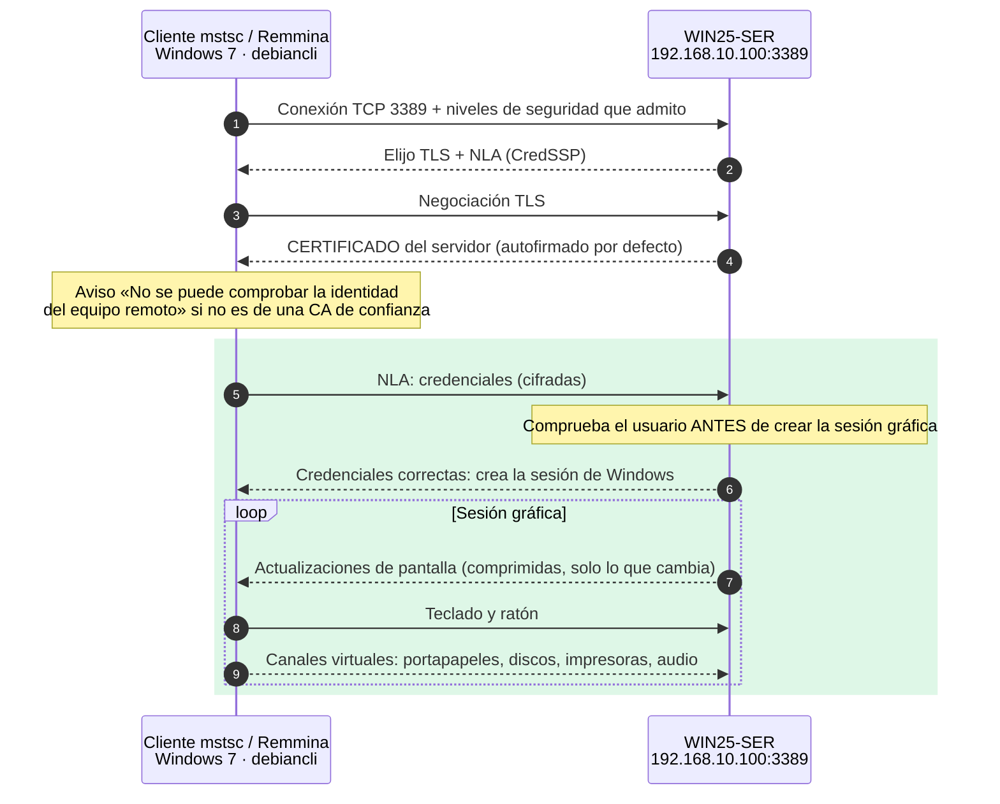
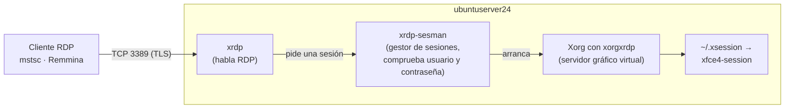
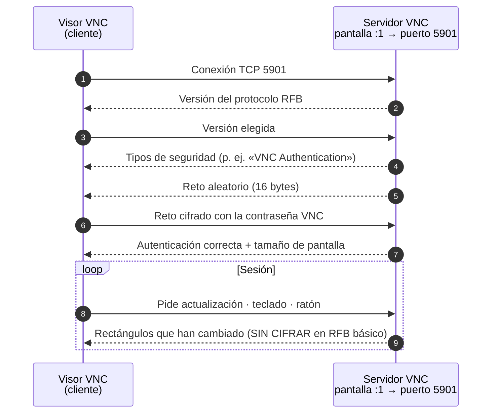
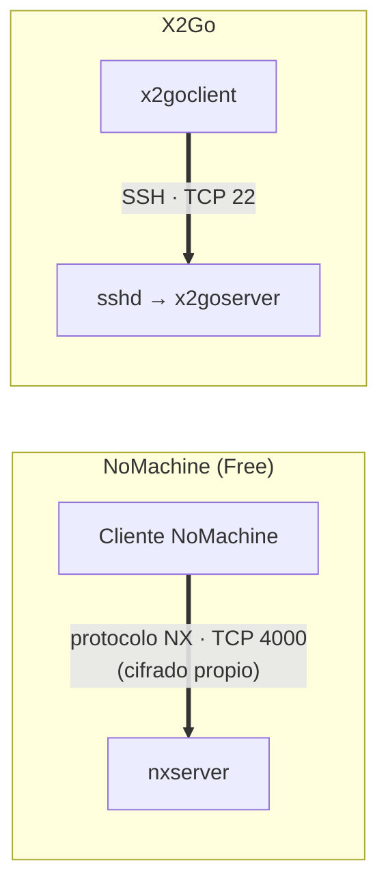

# UT3 · 4. Escritorio remoto: RDP, VNC y NX

> **Criterios:** RA6.a, RA6.c, RA6.d, RA6.e, RA6.f
> [← 3. SSH](03-ssh.md) · [Portada de la UT3](index.md) · **Siguiente:** [5. Resumen y repaso →](05-resumen.md)

## Índice

1. [El acceso remoto en modo gráfico](#1-el-acceso-remoto-en-modo-gráfico)
2. [RDP (Remote Desktop Protocol)](#2-rdp-remote-desktop-protocol)
3. [RDP en Linux: xrdp, Remmina y FreeRDP](#3-rdp-en-linux-xrdp-remmina-y-freerdp)
4. [VNC (Virtual Network Computing)](#4-vnc-virtual-network-computing)
5. [NX: NoMachine y X2Go](#5-nx-nomachine-y-x2go)
6. [Ejercicios](#6-ejercicios)
7. [Verificación](#7-verificación)
8. [Errores frecuentes](#8-errores-frecuentes)
9. [Entregable para Teams](#9-entregable-para-teams)
10. [Ampliación opcional](#10-ampliación-opcional)

---

## 1. El acceso remoto en modo gráfico

En el acceso gráfico, el servidor envía **imágenes de su escritorio** y el cliente envía **teclado y ratón**. Es más intuitivo que la línea de comandos, pero consume más ancho de banda y necesita un **entorno gráfico** en el servidor.

| | **RDP** | **VNC** | **NX** |
|---|---|---|---|
| Creado por | Microsoft | AT&T (hoy, muchas implementaciones libres) | NoMachine |
| Qué transmite | Órdenes de dibujo y mapas de bits, muy optimizados | Rectángulos de la pantalla que cambian (*framebuffer*) | Pantalla comprimida y con caché |
| Puerto | 3389/TCP y UDP | 5900 + N/TCP | 4000/TCP (NoMachine) · 22/TCP (X2Go) |
| Cifrado | ✅ TLS | ❌ en el protocolo básico | ✅ |
| Sesión | Nueva sesión de usuario | Comparte la pantalla real o crea una virtual | Comparte la real o crea una virtual |

---

## 2. RDP (Remote Desktop Protocol)

**RDP** es el protocolo de **escritorio remoto** de Microsoft. Permite usar el **escritorio completo** de otro equipo como si estuvieras delante.

- Puerto **3389/TCP** (y **3389/UDP** para mejorar la fluidez en las versiones modernas).
- **Cifrado** con TLS.
- Cliente de Windows: **Conexión a Escritorio remoto** (`mstsc.exe`).
- Además de la pantalla, **redirige** dispositivos locales a la sesión remota mediante **canales virtuales**: portapapeles, unidades de disco, impresoras, audio.

### Cómo se establece una sesión RDP



1. El cliente abre una conexión TCP con el puerto 3389 y ambos acuerdan el **nivel de seguridad**.
2. Se negocia **TLS**: el servidor presenta su **certificado**. Windows genera uno **autofirmado** con el nombre del equipo, que el cliente no reconoce; por eso aparece un aviso.
3. Con **NLA** (*Network Level Authentication*, autenticación a nivel de red), el cliente envía las credenciales **dentro del canal cifrado** y el servidor las comprueba **antes** de crear la sesión gráfica. Sin credenciales válidas, nadie ve siquiera la pantalla de inicio de sesión ni consume recursos del servidor.
4. Durante la sesión, el servidor envía **solo las zonas de pantalla que cambian**, comprimidas, y el cliente envía teclado y ratón.

> **Desconectar no es cerrar sesión.** Si cierras la ventana del cliente, la sesión sigue abierta en el servidor con tus programas en marcha; al volver a conectar, la recuperas. Para cerrarla: *Inicio → Cerrar sesión* dentro del escritorio remoto.

### RDP en Windows

| Elemento | Detalle |
|---|---|
| Activarlo | *Administrador del servidor → Servidor local → Escritorio remoto* (o *Panel de control → Sistema → Configuración de acceso remoto*). Abre automáticamente la regla del cortafuegos |
| Servicio | **Servicios de Escritorio remoto** (`TermService`) |
| Quién puede entrar | Los **Administradores** y los miembros del grupo **Usuarios de escritorio remoto** |
| Sesiones simultáneas | Windows Server permite **2 sesiones de administración** a la vez sin licencias adicionales. Para más usuarios hace falta el rol **Servicios de Escritorio remoto** (RDS) y sus licencias (CAL) |
| Windows cliente | Solo las ediciones **Pro, Education y Enterprise** pueden **recibir** conexiones. **Home** solo puede **conectarse** a otros |
| Ver sesiones | `quser` · *Administrador de tareas → Usuarios* |

### Ventajas y deficiencias de RDP

| ✅ Ventajas | ❌ Deficiencias |
|---|---|
| Escritorio completo, muy fluido incluso con poco ancho de banda | Servidor nativo solo en Windows (en Linux hace falta xrdp) |
| Cifrado TLS y NLA | Más ancho de banda que SSH |
| Redirige portapapeles, discos, impresoras y audio | Expuesto a Internet es uno de los servicios más atacados |
| Integrado en Windows; clientes para Linux, macOS y móviles | Límite de 2 sesiones de administración sin licencias RDS |
| Se puede desconectar y reanudar la sesión | Certificado autofirmado por defecto: hay que comprobar el nombre |

---

## 3. RDP en Linux: xrdp, Remmina y FreeRDP

| Papel | Software | Paquetes (Debian/Ubuntu) |
|---|---|---|
| **Cliente** RDP gráfico | **Remmina** | `remmina remmina-plugin-rdp` |
| **Cliente** RDP en línea de comandos | **FreeRDP** | `freerdp2-x11` (Debian 12) → `xfreerdp /v:192.168.10.100 /u:tecnico` |
| **Servidor** RDP | **xrdp** | `xrdp` + un entorno de escritorio |

**xrdp** permite conectarse a un **escritorio Linux** con cualquier cliente RDP, incluido el `mstsc` de Windows. Ubuntu Server no tiene escritorio, así que hay que instalar uno **ligero**: usaremos **XFCE**.



1. `xrdp` recibe la conexión RDP y muestra su pantalla de inicio de sesión.
2. `xrdp-sesman` comprueba el usuario y la contraseña **del sistema Linux** y arranca un **servidor gráfico virtual** (Xorg con el módulo `xorgxrdp`), sin necesidad de monitor.
3. Dentro, se lanza el escritorio indicado en el fichero `~/.xsession` del usuario: en nuestro caso, `xfce4-session`.

> Ubuntu **Desktop** 24.04 trae además su propio servidor RDP (*Configuración → Sistema → Escritorio remoto*). En Ubuntu **Server** se usa xrdp.

> ℹ️ En la UT1 y la UT2 trabajamos el servidor solo por terminal. Aquí instalamos un escritorio **porque lo exige el criterio RA6.c**. En un servidor real se evita: consume recursos y amplía lo que hay que mantener actualizado.

---

## 4. VNC (Virtual Network Computing)

**VNC** es un sistema de **escritorio remoto multiplataforma** basado en el protocolo **RFB** (*Remote Framebuffer*, RFC 6143). El servidor envía **rectángulos de la pantalla** que han cambiado y el cliente (el **visor**) envía teclado y ratón.

- Puerto **5900 + número de pantalla**: la pantalla `:0` usa el 5900, la `:1` el 5901…
- Funciona igual en Windows, Linux y macOS: el visor de un sistema se conecta al servidor de otro.
- **No cifra el tráfico** en la versión básica del protocolo.



### Dos formas de funcionar

| Modo | Qué ves | Ejemplos |
|---|---|---|
| **Compartir la pantalla real** | La misma sesión que el usuario sentado delante. Útil para **asistencia**: el técnico ve lo que ve el usuario | TightVNC o UltraVNC en Windows, `x11vnc` en Linux |
| **Sesión virtual** | Un escritorio **nuevo e independiente**, sin monitor. Útil en **servidores** | TigerVNC (`tigervnc-standalone-server`) en Linux |

**Visores:** TigerVNC Viewer, TightVNC Viewer, RealVNC Viewer, Remmina (plugin VNC).

### Seguridad de VNC

- La **contraseña VNC** es independiente de los usuarios del sistema y, en la autenticación clásica, **solo cuentan los 8 primeros caracteres**.
- Las imágenes y las pulsaciones de teclado viajan **sin cifrar**: todo lo que escribas dentro de la sesión se puede capturar.
- Soluciones: que el servidor escuche **solo en `localhost`** y acceder con un **túnel SSH** ([página 3](03-ssh.md#8-túneles-ssh)), usar una **VPN** o una implementación con TLS (TigerVNC admite *VeNCrypt*).

### Ventajas y deficiencias de VNC

| ✅ Ventajas | ❌ Deficiencias |
|---|---|
| Multiplataforma: cualquier visor con cualquier servidor | Sin cifrado en el protocolo básico |
| Permite **ver la misma pantalla** que el usuario (asistencia) | Contraseña débil (8 caracteres) |
| Muchas implementaciones libres | Más ancho de banda y menos fluido que RDP |
| Configuración básica sencilla | Necesita entorno gráfico en el servidor |

---

## 5. NX: NoMachine y X2Go

**NX** es una tecnología creada por **NoMachine** para que las sesiones gráficas funcionen bien **incluso con poco ancho de banda**, gracias a una **compresión** muy eficiente y a una **caché** que evita reenviar lo que no ha cambiado.

Su historia explica la confusión que hay en muchos apuntes:

| Época | Cómo funcionaba |
|---|---|
| **NX 3 y anteriores** (hasta 2013, núcleo libre) | Optimizaba el protocolo X11 y lo transportaba **dentro de SSH** |
| **NoMachine 4 y posteriores** (software **propietario**) | Usa su **propio protocolo NX**, con cifrado propio, en el **puerto 4000/TCP**. La conexión por **SSH** solo está en las ediciones **de pago** |

### NoMachine hoy

| Característica | NoMachine Free |
|---|---|
| Licencia | Propietaria, gratuita para **uso personal** |
| Plataformas | Windows, Linux, macOS, Android, iOS |
| Protocolo y puerto | NX, **4000/TCP** |
| Sesiones | Una conexión a la vez. Comparte la pantalla real o, si no hay, intenta crear una |
| Instalación en Linux | Paquete `.deb` de la web oficial (**no está en los repositorios** de Ubuntu ni Debian): `sudo dpkg -i nomachine_*.deb` |
| Servicio | `nxserver` · ficheros en `/usr/NX` |

### X2Go: la alternativa libre

**X2Go** nació de las bibliotecas libres de NX 3 y mantiene su enfoque:

- Software **libre**, en los repositorios de Debian/Ubuntu (`x2goserver` en el servidor, `x2goclient` en el cliente).
- Transporta todo **por SSH (puerto 22)**: no abre puertos nuevos y reutiliza los usuarios y claves de SSH.
- Crea **sesiones virtuales**, ideal para servidores Linux con escritorios ligeros (XFCE, MATE, LXQt).



| ✅ Ventajas de NX/X2Go | ❌ Deficiencias |
|---|---|
| Muy eficiente en redes lentas | NoMachine es propietario; la versión gratuita es solo para uso personal |
| Sesiones que se pueden suspender y reanudar | X2Go solo funciona como servidor en Linux |
| Cifrado (NX propio o SSH) | Necesita entorno gráfico en el servidor |
| Multiplataforma (clientes) | Menos extendido en empresas, donde predomina RDP |

---

## 6. Ejercicios

> **Requisitos previos:** páginas [1](01-conceptos.md) a [3](03-ssh.md) terminadas. Instantánea reciente de `WIN25-SER` y de `ubuntuserver24`.
> Usuarios de laboratorio (contraseñas **ficticias**): `tecnico` / `Tecnico.UT3!` en `WIN25-SER` y `alumno` / `Alumno.UT3!` en `ubuntuserver24`.

### Ejercicio 17 · Activar Escritorio remoto en `WIN25-SER` (RA6.c)

**Con el Administrador del servidor:**

1. *Administrador del servidor → Herramientas → Administración de equipos → Usuarios y grupos locales → Usuarios → Usuario nuevo*: crea `tecnico`, desmarca *El usuario debe cambiar la contraseña…*.
2. *Servidor local → Escritorio remoto* (aparece **Deshabilitado**) → haz clic.
3. Marca **Permitir las conexiones remotas a este equipo** y deja marcada la casilla **Permitir solo las conexiones desde equipos que ejecuten Escritorio remoto con Autenticación a nivel de red (recomendado)**. Acepta el aviso de la excepción del cortafuegos.
4. **Seleccionar usuarios… → Agregar** → `tecnico` → Aceptar.

**Equivalente en PowerShell** (como administrador). El script completo y comentado está en `recursos/ut3-acceso-remoto/ficheros-config/acceso-remoto-windows-server.ps1`:

```powershell
# Usuario de laboratorio (contraseña ficticia: se pide por teclado)
$clave = Read-Host -AsSecureString "Contraseña para tecnico"
New-LocalUser -Name "tecnico" -FullName "Técnico de soporte (UT3)" -Password $clave
# Grupo «Usuarios de escritorio remoto» por su SID, que no depende del idioma
Add-LocalGroupMember -SID "S-1-5-32-555" -Member "tecnico"

# Permitir conexiones de Escritorio remoto (0 = permitidas)
Set-ItemProperty -Path "HKLM:\System\CurrentControlSet\Control\Terminal Server" -Name fDenyTSConnections -Value 0
# Exigir NLA (1 = activada)
Set-ItemProperty -Path "HKLM:\System\CurrentControlSet\Control\Terminal Server\WinStations\RDP-Tcp" -Name UserAuthentication -Value 1
# Reglas del cortafuegos del grupo «Escritorio remoto» (nombre interno, independiente del idioma)
Enable-NetFirewallRule -Group "@FirewallAPI.dll,-28752"
```

**Comprueba:**

```powershell
Get-Service TermService                 # Status: Running
netstat -ano | findstr :3389            # TCP 0.0.0.0:3389 LISTENING y UDP 0.0.0.0:3389
Get-LocalGroupMember -SID "S-1-5-32-555"
```

Desde `debiancli`, repite la prueba del [ejercicio 5](02-telnet.md#ejercicio-5--telnet-como-herramienta-de-diagnóstico-de-puertos):

```bash
telnet 192.168.10.100 3389     # antes: timed out · ahora: Connected
```

### Ejercicio 18 · De Windows 7 a Windows Server con `mstsc` (RA6.d)

1. En Windows 7: *Inicio* → escribe `mstsc` → **Conexión a Escritorio remoto**.
2. **Mostrar opciones**:
   - *Equipo:* `192.168.10.100` · *Usuario:* `WIN25-SER\tecnico`.
   - Pestaña **Recursos locales → Más…** → marca **Unidades** (para ver el disco de Windows 7 dentro de la sesión).
3. **Conectar**. Escribe la contraseña de `tecnico`.
4. Aparece el aviso *No se puede comprobar la identidad del equipo remoto*. Pulsa **Ver certificado**: comprueba que está emitido **a** y **por** `WIN25-SER`. Pulsa **Sí**.
5. Dentro de la sesión:
   - Abre el **Explorador de archivos**: aparece la unidad **C en *nombre-del-equipo-Windows-7***. Copia un fichero de Windows 7 al escritorio remoto.
   - Copia un texto en Windows 7 y pégalo en el Bloc de notas remoto (portapapeles redirigido).
6. En la consola de `WIN25-SER` (como `Administrador`), mira las sesiones:

   ```powershell
   quser
   ```

   **Resultado esperado:** `tecnico` con sesión `rdp-tcp#N` en estado **Activo**.

7. Cierra la ventana de `mstsc` sin cerrar sesión y repite `quser`: la sesión pasa a **Desconectado**. Vuelve a conectar y ciérrala bien: *Inicio → usuario → Cerrar sesión*.

> Si Windows 7 muestra un error de **corrección de cifrado de CredSSP** o no llega a pedir el certificado, el cliente no está actualizado. Consulta la tabla de [errores frecuentes](#8-errores-frecuentes).

### Ejercicio 19 · De Debian a Windows Server con Remmina (RA6.f)

1. En `debiancli`:

   ```bash
   sudo apt install remmina remmina-plugin-rdp
   remmina &
   ```

2. En Remmina, elige **RDP** en el desplegable, escribe `192.168.10.100` y pulsa Intro. Usuario `Administrador`, la contraseña del laboratorio y, en *Dominio*, `WIN25-SER`.
3. Acepta el certificado: comprueba que el nombre (*Subject*) es `WIN25-SER`.
4. Dentro del escritorio, abre *Administrador del servidor → Herramientas → DNS* y revisa la zona `smr2ser.test` de la UT2: estás **administrando gráficamente Windows desde Linux**.
5. **Límite de sesiones:** con la sesión de `tecnico` desde Windows 7 aún abierta, ejecuta `quser` en la sesión de Remmina. ¿Cuántas sesiones hay? ¿Qué crees que pasaría con una tercera?

**Alternativa en línea de comandos (FreeRDP):**

```bash
sudo apt install freerdp2-x11
xfreerdp /v:192.168.10.100 /u:tecnico /d:WIN25-SER
```

> La primera vez, `xfreerdp` muestra los datos del certificado en el terminal y pregunta si confías en él.

### Ejercicio 20 · Instalar xrdp y XFCE en `ubuntuserver24` (RA6.c)

> 📸 Haz una **instantánea** de `ubuntuserver24` antes de empezar: se instalan varios cientos de MB. Comprueba que hay al menos 3 GB libres con `df -h /`.

1. Instala el escritorio XFCE y el servidor xrdp:

   ```bash
   sudo apt update
   sudo apt install xfce4 xfce4-terminal dbus-x11 xrdp
   ```

   > `xrdp` instala también `xorgxrdp`, el módulo que permite a Xorg funcionar sin monitor dentro de una sesión RDP. Si `apt` instala además un gestor de inicio de sesión gráfico (`lightdm`), al reiniciar el servidor verás un login gráfico en su consola; no inicies sesión en él con el mismo usuario que usarás por RDP.

2. Permite a xrdp leer el certificado del sistema (lo usa para el cifrado TLS):

   ```bash
   sudo adduser xrdp ssl-cert
   ```

3. Indica qué escritorio debe arrancar para el usuario `alumno` (conectado como `alumno`, sin `sudo`):

   ```bash
   echo "xfce4-session" > ~/.xsession
   ```

4. Activa y reinicia el servicio:

   ```bash
   sudo systemctl enable --now xrdp
   sudo systemctl restart xrdp
   systemctl status xrdp xrdp-sesman --no-pager
   sudo ss -tlnp | grep 3389
   ```

   **Resultado esperado:** `xrdp` y `xrdp-sesman` en `active (running)` y una línea `LISTEN … *:3389` (o `[::]:3389`) del proceso `xrdp`.

### Ejercicio 21 · De Windows 7 a Ubuntu Server por RDP (RA6.f)

1. En Windows 7, abre `mstsc`. *Equipo:* `172.16.2.1`. **Conectar**.
2. Acepta el aviso del certificado (es el certificado genérico del sistema Ubuntu, `ssl-cert-snakeoil`).
3. Aparece la pantalla de **xrdp**. *Session:* `Xorg` · *username:* `alumno` · *password:* la del laboratorio → **OK**.
4. Aparece el escritorio **XFCE** de `ubuntuserver24`. Abre un terminal y ejecuta:

   ```bash
   hostname
   echo $DISPLAY                # el display virtual de la sesión (p. ej. :10.0)
   ```

5. Cierra la sesión desde el menú de XFCE (*Cerrar sesión*), no cerrando la ventana.

> El cliente de **Windows** te ha dado el escritorio de un servidor **Linux**: RDP es un protocolo, no un producto exclusivo de Windows.

### Ejercicio 22 · De Debian a Ubuntu Server con Remmina (RA6.f)

1. En Remmina, nueva conexión **RDP** a `172.16.2.1`, usuario `alumno`.
2. Abre un terminal en XFCE y comprueba desde qué IP estás conectado. En una sesión **SSH** paralela a `ubuntuserver24`:

   ```bash
   sudo ss -tn state established '( sport = :3389 )'
   ```

   **Resultado esperado:** una conexión desde `172.16.2.50`.

### Ejercicio 23 · RDP en Wireshark (RA6.e)

En `debiancli`, captura mientras te conectas por Remmina a `192.168.10.100`. Filtro: `tcp.port == 3389`.

1. Localiza el *Client Hello* y el *Server Hello* de **TLS** y el **certificado** que envía el servidor. ¿Qué nombre aparece?
2. Los paquetes siguientes se muestran como *Application Data*: ¿puedes leer algo de lo que escribes en la sesión?
3. Compara con la captura de Telnet: ¿qué protocolo de los vistos hasta ahora se parece más a RDP en seguridad?

---

## 7. Verificación

| Comprobación | Dónde | Comando | Qué debe verse |
|---|---|---|---|
| Servicio RDP | WIN25-SER | `Get-Service TermService` | `Running` |
| Puerto RDP | WIN25-SER | `netstat -ano \| findstr :3389` | TCP y UDP `0.0.0.0:3389` |
| Conexiones permitidas | WIN25-SER | `Get-ItemProperty 'HKLM:\System\CurrentControlSet\Control\Terminal Server' fDenyTSConnections` | `0` |
| NLA | WIN25-SER | `Get-ItemProperty 'HKLM:\System\CurrentControlSet\Control\Terminal Server\WinStations\RDP-Tcp' UserAuthentication` | `1` |
| Sesiones | WIN25-SER | `quser` | Usuarios, sesión `rdp-tcp#N`, estado Activo/Desc. |
| Registro | WIN25-SER | *Visor de eventos → Registros de Windows → Seguridad*, evento **4624** con tipo de inicio de sesión **10** | Inicio de sesión remoto interactivo |
| Servicio xrdp | ubuntuserver24 | `systemctl status xrdp xrdp-sesman` | `active (running)` |
| Puerto xrdp | ubuntuserver24 | `sudo ss -tlnp \| grep 3389` | `LISTEN … :3389 … "xrdp"` |
| Registro xrdp | ubuntuserver24 | `sudo journalctl -u xrdp-sesman -n 20` | Inicio de sesión de `alumno` |
| Puerto accesible | Cliente | `nc -zv 172.16.2.1 3389` · `Test-NetConnection` | `succeeded` / `Connected` |

---

## 8. Errores frecuentes

| Error | Síntoma | Solución |
|---|---|---|
| Usuario sin permiso de Escritorio remoto | *Para iniciar sesión de forma remota, necesita el derecho…* | Añadirlo a **Usuarios de escritorio remoto** (o ser administrador) |
| Windows 7 se conecta con el usuario de su propio equipo | Credenciales incorrectas aunque la contraseña esté bien | Escribir el usuario como `WIN25-SER\tecnico` |
| Error de **corrección de cifrado de CredSSP** en Windows 7 | No conecta con NLA | Actualizar Windows 7 (cliente RDP y CredSSP). En el laboratorio, como último recurso, el profesor puede desactivar NLA solo en `WIN25-SER`; **nunca** en producción |
| RDP activado pero no responde desde `net02` | `telnet … 3389` se queda esperando | Regla del cortafuegos no activada para el perfil de red; `Enable-NetFirewallRule -Group "@FirewallAPI.dll,-28752"` |
| Tercera sesión de administración | Windows pide expulsar a otro usuario | Límite de 2 sesiones sin rol RDS |
| Cerrar la ventana en vez de cerrar sesión | La sesión sigue abierta (estado Desconectado) | *Inicio → Cerrar sesión* dentro de la sesión remota |
| xrdp: pantalla negra o se cierra al entrar | Falta `~/.xsession` o no hay escritorio instalado | `echo "xfce4-session" > ~/.xsession` en el usuario que se conecta |
| xrdp: falla si el usuario ya tiene sesión gráfica local | Sesión que se cierra o queda en negro | Cerrar la sesión local de ese usuario o usar otro usuario |
| xrdp no arranca o el cliente corta al negociar TLS | `journalctl -u xrdp` muestra errores con la clave | `sudo adduser xrdp ssl-cert` y reiniciar xrdp |
| VNC: conectar al puerto equivocado | `Connection refused` | Pantalla `:1` → puerto **5901**, no 5900 |
| VNC directo por la red | Contraseña y pantalla capturables | Servidor solo en `localhost` + túnel `ssh -L` |
| Servidor en adaptador puente | El escritorio remoto queda visible en la red del aula | Solo redes internas |

---

## 9. Entregable para Teams

Capturas de pantalla de:

1. *Propiedades del sistema → Remoto* de `WIN25-SER` con las conexiones permitidas, NLA marcada y `tecnico` en la lista de usuarios. O la salida de PowerShell equivalente.
2. `netstat -ano | findstr :3389` en `WIN25-SER` y `telnet 192.168.10.100 3389` conectado desde `debiancli`.
3. El aviso de certificado de `mstsc` en Windows 7 con el certificado abierto (emitido a `WIN25-SER`).
4. Sesión RDP de `tecnico` desde Windows 7 con la unidad del cliente visible en el Explorador.
5. `quser` en `WIN25-SER` con las dos sesiones (Windows 7 y Remmina).
6. Remmina en `debiancli` mostrando la consola DNS de `WIN25-SER`.
7. `systemctl status xrdp xrdp-sesman` y `ss -tlnp | grep 3389` en `ubuntuserver24`.
8. Escritorio XFCE de `ubuntuserver24` dentro de `mstsc` en Windows 7, con un terminal que muestre `hostname`.
9. Wireshark con el certificado del servidor en el *Server Hello* de una sesión RDP.

**Preguntas de reflexión:**

1. ¿Qué es NLA y qué ataque o problema evita?
2. ¿Por qué aparece un aviso de certificado al conectar a `WIN25-SER`? ¿Qué debes comprobar antes de aceptarlo?
3. ¿Qué diferencia hay entre **desconectar** y **cerrar sesión** en RDP? ¿Qué problema puede causar desconectar en un servidor con el límite de 2 sesiones?
4. xrdp, ¿es un servidor gráfico? Explica el papel de `xrdp`, `xrdp-sesman` y `~/.xsession`.
5. ¿Qué ventaja tiene VNC frente a RDP para dar soporte a un usuario? ¿Y qué deficiencia grave tiene?
6. Para administrar `ubuntuserver24`, ¿usarías SSH o xrdp? Justifica con dos criterios (ancho de banda, seguridad, recursos, automatización).

---

## 10. Ampliación opcional

- **RDP dentro de un túnel SSH.** Desde `debiancli`:

  ```bash
  ssh -L 33389:localhost:3389 alumno@172.16.2.1
  ```

  Deja esa sesión abierta y, en Remmina, conecta por RDP a `localhost:33389`. Captura con Wireshark: ¿qué puerto aparece en el tráfico entre `debiancli` y `ubuntuserver24`? ¿Para qué serviría esto con un servicio sin cifrar como VNC?

- **VNC (investigación).** Instala TigerVNC en `ubuntuserver24` (`tigervnc-standalone-server`), configúralo para que escuche **solo en `localhost`** y conéctate a través de un túnel `ssh -L 5901:localhost:5901`. Consulta `man vncserver` en tu versión antes de configurarlo: las opciones han cambiado entre versiones. Documenta los pasos que funcionen.

- **X2Go.** Instala `x2goserver` en `ubuntuserver24` y `x2goclient` en `debiancli`, y abre una sesión XFCE. Comprueba con `ss` que **no** se ha abierto ningún puerto nuevo.

---

**Siguiente:** [5. Resumen y repaso →](05-resumen.md)
