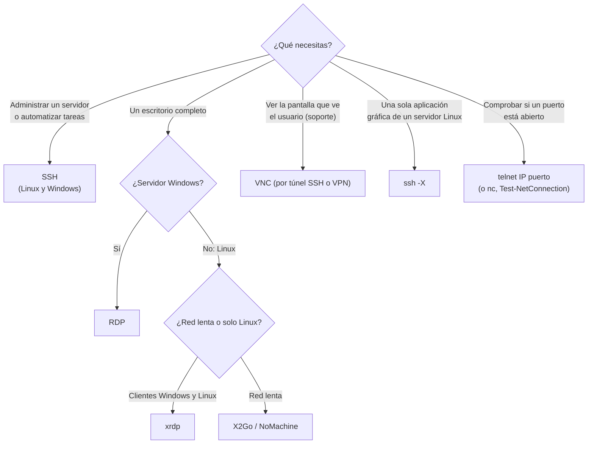
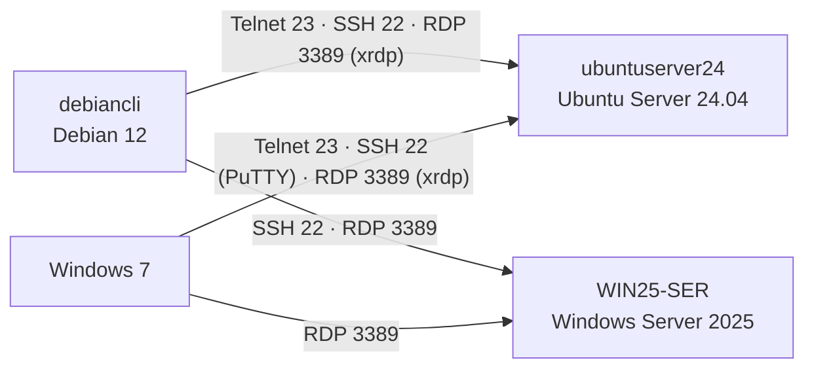

# UT3 · 5. Resumen y repaso

> **Criterios:** RA6.a, RA6.e (y repaso de RA6.b – RA6.g)
> [← 4. Escritorio remoto](04-escritorio-remoto.md) · [Portada de la UT3](index.md)

## Índice

1. [Comparativa de métodos](#1-comparativa-de-métodos)
2. [Herramientas de administración remota](#2-herramientas-de-administración-remota)
3. [Acceso entre sistemas de distinta naturaleza](#3-acceso-entre-sistemas-de-distinta-naturaleza)
4. [Herramientas de comprobación](#4-herramientas-de-comprobación)
5. [Puertos y protocolos](#5-puertos-y-protocolos)
6. [Errores de concepto frecuentes](#6-errores-de-concepto-frecuentes)
7. [Preguntas de repaso](#7-preguntas-de-repaso)

---

## 1. Comparativa de métodos

*(Criterio **RA6.e**)*

| | **Telnet** | **SSH** | **RDP** | **VNC** | **NX / X2Go** |
|---|---|---|---|---|---|
| Tipo | CLI | CLI (+ ficheros, túneles, X11) | GUI | GUI | GUI |
| Puerto | 23/TCP | 22/TCP | 3389/TCP+UDP | 5900+N/TCP | 4000/TCP · 22/TCP |
| Cifrado | ❌ Ninguno | ✅ Todo | ✅ TLS | ❌ En RFB básico | ✅ |
| Verifica al servidor | ❌ | ✅ Huella (clave de host) | ✅ Certificado | ❌ | ✅ |
| Ancho de banda | Mínimo | Mínimo | Medio (muy optimizado) | Alto | Bajo (muy optimizado) |
| Servidor nativo en | Equipos de red antiguos | Linux, macOS, Windows Server 2019+ | Windows | Ninguno (se instala) | Ninguno (se instala) |
| Clientes en otros SO | Todos | Todos (PuTTY en Windows antiguos) | Linux (Remmina, FreeRDP), macOS, móviles | Todos | Todos |
| Sesión | Nueva | Nueva | Nueva (se puede desconectar y reanudar) | Compartida o virtual | Compartida o virtual |
| Uso típico hoy | Diagnóstico de puertos, equipos de red antiguos | **Administrar servidores Linux** y equipos de red | **Escritorios y servidores Windows** | Asistencia, entornos mixtos | Escritorios Linux remotos |
| En esta UT | [Página 2](02-telnet.md) | [Página 3](03-ssh.md) | [Página 4](04-escritorio-remoto.md) | [Página 4](04-escritorio-remoto.md#4-vnc-virtual-network-computing) | [Página 4](04-escritorio-remoto.md#5-nx-nomachine-y-x2go) |

### Resumen de ventajas y deficiencias

| Método | ✅ Ventajas | ❌ Deficiencias |
|---|---|---|
| **Telnet** | Muy simple, casi sin recursos, disponible en equipos antiguos | **Todo en claro** (contraseñas incluidas); no verifica al servidor ni la integridad; obsoleto |
| **SSH** | Cifrado completo; claves; automatizable; SFTP/SCP; túneles; estándar en todos los sistemas | Solo texto (salvo X11); las claves exigen disciplina; expuesto a Internet recibe ataques de fuerza bruta constantes |
| **RDP** | Escritorio completo muy fluido; NLA; redirige portapapeles, discos e impresoras | Servidor nativo solo en Windows (xrdp en Linux); más ancho de banda que SSH; muy atacado si se expone a Internet; límite de sesiones sin licencias |
| **VNC** | Multiplataforma; permite **ver la misma pantalla** que el usuario; implementaciones libres | Sin cifrado en el protocolo básico; contraseña débil; menos fluido; necesita entorno gráfico |
| **NX / X2Go** | Muy eficiente en redes lentas; sesiones que se suspenden y reanudan; X2Go va por SSH | NoMachine es propietario (gratis solo uso personal); X2Go solo como servidor en Linux; necesita entorno gráfico |

### ¿Cuál elijo?

---

## 2. Herramientas de administración remota

Para **administrar** (RA6.g) no siempre hace falta un escritorio:

| Herramienta | Sistema administrado | Cómo funciona | Puerto |
|---|---|---|---|
| **SSH + comando** | Linux y Windows | `ssh alumno@172.16.2.1 'sudo systemctl status named'` · `ssh Administrador@192.168.10.100 "powershell -Command Get-Service DNS"` | 22/TCP |
| **PowerShell Remoting** | Windows | `Enter-PSSession -ComputerName WIN25-SER` sobre **WinRM**. Activado por defecto en Windows Server; entre equipos sin dominio requiere configurar `TrustedHosts` | 5985/TCP (HTTP) · 5986/TCP (HTTPS) |
| **Consolas MMC remotas / RSAT** | Windows | Desde el *Administrador del servidor* o las consolas (`dnsmgmt.msc`, `dhcpmgmt.msc`…) se puede **conectar a otro servidor** | Varios (RPC) |
| **Windows Admin Center** | Windows | Consola **web** gratuita de Microsoft para administrar servidores | 443/TCP |
| **Cockpit** | Linux | Panel **web**: servicios, registros, almacenamiento, red, terminal. En Ubuntu: `sudo apt install cockpit` | 9090/TCP |
| **Webmin** | Linux | Panel web clásico (no está en los repositorios oficiales de Ubuntu) | 10000/TCP |
| **Asistencia remota** | Escritorios de usuario | TeamViewer, AnyDesk, RustDesk: conectan a través de un servidor intermedio en Internet. Útiles para soporte a usuarios, **no** para servidores | Salida a Internet |
| **rlogin / rsh / rexec** | Unix | Herramientas antiguas, sin cifrar. **Obsoletas**: sustituidas por SSH | 513 · 514 · 512/TCP |

> En el **aula** no se usan herramientas de asistencia que dependan de servidores externos: rompen la regla de trabajar solo en red interna.

---

## 3. Acceso entre sistemas de distinta naturaleza

*(Criterios **RA6.f** y **RA6.g**)* · Lo que has hecho en la unidad:

| Origen ↓ · Destino → | **Ubuntu Server** (`ubuntuserver24`) | **Windows Server** (`WIN25-SER`) |
|---|---|---|
| **Debian** (`debiancli`) | **CLI:** `telnet`, `ssh` (ej. 3, 9) · **GUI:** `ssh -X` (ej. 14), Remmina → xrdp (ej. 22) · **Admin:** `ssh` + `systemctl` (ej. 9) | **CLI:** `ssh` al OpenSSH de Windows (ej. 16) · **GUI:** Remmina / `xfreerdp` (ej. 19) · **Admin:** `ssh` + PowerShell (ej. 16), consola DNS por RDP (ej. 19) |
| **Windows 7** | **CLI:** Cliente Telnet (ej. 4), PuTTY (ej. 15) · **GUI:** `mstsc` → xrdp (ej. 21) · **Admin:** PuTTY + `sudo` (ej. 15) | **GUI:** `mstsc` (ej. 18) |

> En la empresa, lo más habitual es **SSH para Linux y RDP para Windows**. Pero, como has comprobado, los protocolos son estándares independientes del sistema operativo: cualquier cliente puede hablar con cualquier servidor del mismo protocolo.

---

## 4. Herramientas de comprobación

| Herramienta | Sistema | Ejemplo | Qué muestra |
|---|---|---|---|
| `ss -tlnp` | Linux | `sudo ss -tlnp \| grep -E ':(22\|23\|3389)'` | Puertos TCP **en escucha** y el programa que los usa |
| `netstat -ano` | Windows | `netstat -ano \| findstr :3389` | Puertos en escucha y PID |
| `Get-NetTCPConnection` | PowerShell | `Get-NetTCPConnection -LocalPort 3389,22 -State Listen` | Equivalente moderno de `netstat` |
| `systemctl status` | Linux | `systemctl status inetd` · `ssh.socket ssh` · `xrdp` | Estado del servicio |
| `journalctl` | Linux | `sudo journalctl -u ssh -f` | Inicios de sesión y errores (en directo con `-f`) |
| `Get-Service` | PowerShell | `Get-Service sshd, TermService` | Estado de OpenSSH y Escritorio remoto |
| `sshd -t` · `sshd -T` | Linux | `sudo sshd -T \| grep -i passwordauth` | Sintaxis · configuración **efectiva** de SSH |
| `ssh -v` | Cliente | `ssh -v alumno@172.16.2.1` | Paso a paso de la conexión y por qué falla |
| `telnet` · `nc` | Cliente | `telnet 172.16.2.1 22` · `nc -zv 172.16.2.1 3389` | ¿El puerto está abierto y accesible? |
| `Test-NetConnection` | PowerShell (Windows 8.1 / Server 2012 R2 en adelante) | `Test-NetConnection 192.168.10.100 -Port 3389` | Lo mismo desde Windows |
| `who` · `w` | Linux | `w` | Quién está conectado y desde qué IP |
| `quser` | Windows | `quser` | Sesiones RDP abiertas |
| Wireshark · `tcpdump` | Ambos | `sudo tcpdump -i enp0s3 -A port 23` | Si el tráfico va cifrado o en claro |

> **`netstat` está obsoleto en Linux** (paquete `net-tools`, ya no se instala por defecto en Ubuntu Server). Su sustituto es **`ss`**, con opciones casi iguales: `ss -tlnp` ≈ `netstat -tlnp`.

**Cómo interpretar una prueba de puerto (`telnet IP puerto`, `nc -zv`):**

| Resultado | Significado |
|---|---|
| `Connected` / `succeeded` | Hay un servicio escuchando y el cortafuegos deja pasar |
| `Connection refused` | El equipo responde, pero **no hay ningún servicio** en ese puerto |
| Espera hasta `timed out` | Un **cortafuegos** descarta los paquetes, o el equipo no es accesible |

---

## 5. Puertos y protocolos

| Protocolo / servicio | Puerto | Transporte | Cifrado | Uso |
|---|---|---|---|---|
| **Telnet** | **23** | TCP | ❌ | Terminal remota en claro |
| **SSH** (+ SCP, SFTP, túneles, X11, X2Go) | **22** | TCP | ✅ | Terminal remota segura y transferencia de ficheros |
| **RDP** (y xrdp) | **3389** | **TCP** y UDP | ✅ TLS | Escritorio remoto |
| **VNC** (RFB) | **5900 + N** (5900, 5901…) | TCP | ❌ (básico) | Escritorio remoto multiplataforma |
| **NX** (NoMachine) | **4000** | TCP | ✅ | Escritorio remoto NoMachine |
| X11 sin SSH | 6000 + N | TCP | ❌ | No se usa en red: siempre a través de `ssh -X` |
| **WinRM** (PowerShell Remoting) | 5985 · 5986 | TCP (HTTP · HTTPS) | ✅ | Administración remota de Windows |
| Windows Admin Center | 443 | TCP (HTTPS) | ✅ | Administración web de Windows |
| Cockpit | 9090 | TCP (HTTPS) | ✅ | Administración web de Linux |
| rexec · rlogin · rsh | 512 · 513 · 514 | TCP | ❌ | Obsoletos |

> 🔥 Si hay cortafuegos, hay que permitir el puerto. Activar RDP desde el *Administrador del servidor* de Windows crea la regla automáticamente. En Ubuntu, `ufw` viene **desactivado** por defecto; si lo activas, permite antes el 22 (`sudo ufw allow 22/tcp`) o te quedarás sin acceso.

---

## 6. Errores de concepto frecuentes

| Idea errónea | Lo correcto |
|---|---|
| «Telnet no autentica al usuario» | Sí pide usuario y contraseña. Lo que no hace es **cifrar**, proteger la **integridad** ni verificar al **servidor** |
| «SSH autentica al usuario y después crea el túnel cifrado» | Al revés: primero el intercambio de claves y el cifrado; **después** la autenticación del usuario |
| «El túnel SSH se cifra con RSA» | La sesión se cifra con un algoritmo **simétrico** (AES, ChaCha20). RSA/Ed25519 solo **firman** y **autentican** |
| «Con clave pública, la clave viaja al servidor en cada conexión» | La **privada nunca sale** del cliente: solo envía una **firma** |
| «RDP solo sirve entre Windows» | Hay clientes RDP en Linux (Remmina, FreeRDP) y servidores RDP en Linux (xrdp) |
| «SFTP es FTP cifrado» | SFTP es un subsistema de **SSH** (puerto 22). FTP cifrado es **FTPS** (UT4) |
| «NoMachine va siempre por SSH» | Eso era NX 3. NoMachine actual usa su protocolo NX en el puerto 4000; SSH solo en ediciones de pago |
| «Si `ssh.service` está inactivo, SSH no funciona» (Ubuntu 24.04) | Escucha `ssh.socket` y arranca el servicio con la primera conexión |
| «Cerrar la ventana de RDP cierra la sesión» | Solo la **desconecta**: los programas siguen abiertos en el servidor |

---

## 7. Preguntas de repaso

1. ¿Qué diferencia hay entre **acceso remoto** y **administración remota**? Pon un ejemplo de cada uno con equipos del escenario. *(RA6.a)*
2. Compara el acceso en **línea de comandos** y en **modo gráfico**: qué se transmite, ancho de banda, necesidad de entorno gráfico y automatización. *(RA6.a, RA6.e)*
3. ¿Qué cuatro datos identifican una conexión TCP? ¿Por qué un servidor SSH puede atender a varios clientes en el mismo puerto?
4. Explica las tres carencias de seguridad de Telnet. ¿Para qué puede seguir siendo útil hoy? *(RA6.e)*
5. ¿Qué es `inetd` y qué papel tiene en el servicio Telnet de Ubuntu? *(RA6.b)*
6. Ordena las fases de una conexión SSH y explica por qué la contraseña del usuario no se puede capturar con Wireshark.
7. ¿Qué es la **huella** del servidor? ¿Qué debe hacer el usuario la primera vez que la ve? ¿Y si aparece `REMOTE HOST IDENTIFICATION HAS CHANGED`?
8. En SSH, ¿para qué se usa la criptografía simétrica y para qué la asimétrica?
9. Describe la autenticación con **clave pública**. ¿Qué clave va al servidor y en qué fichero? ¿Por qué la privada nunca viaja por la red? *(RA6.b)*
10. ¿Por qué en Ubuntu 24.04 `systemctl status ssh` puede mostrar `inactive` aunque el servidor acepte conexiones? ¿Qué hay que hacer tras cambiar el puerto?
11. ¿Por qué se recomienda escribir los cambios de SSH en `/etc/ssh/sshd_config.d/10-…conf` en vez de en `sshd_config`?
12. ¿Qué diferencia hay entre SFTP y FTP?
13. Escribe el comando para ver `xclock`, ejecutado en `ubuntuserver24`, en el escritorio de `debiancli`. ¿Qué paquete es imprescindible en el servidor? ¿Qué debe mostrar `echo $DISPLAY`?
14. ¿Qué es **NLA** en RDP y qué ventaja aporta? ¿Por qué aparece un aviso de certificado al conectar con `WIN25-SER`? *(RA6.c, RA6.d)*
15. Explica qué hacen `xrdp`, `xrdp-sesman` y el fichero `~/.xsession` cuando un cliente se conecta a `ubuntuserver24`. *(RA6.c)*
16. Indica dos formas de conectarse por RDP desde Debian a Windows Server y una de conectarse desde Windows a Ubuntu Server en modo gráfico. *(RA6.f)*
17. ¿En qué puerto escucha la pantalla `:2` de un servidor VNC? ¿Por qué se recomienda usar VNC a través de un túnel SSH? Escribe el comando del túnel.
18. ¿En qué se diferencian NoMachine (versión actual) y X2Go en licencia, protocolo y puerto?
19. Completa una tabla con Telnet, SSH, RDP y VNC: puerto, CLI o GUI, si cifra, una ventaja y una deficiencia de cada uno. *(RA6.e)*
20. Desde `debiancli`, ¿cómo reiniciarías el DNS de `ubuntuserver24` **sin abrir una sesión interactiva**? ¿Y cómo consultarías el ámbito DHCP de `WIN25-SER`? *(RA6.g)*
21. `telnet 172.16.2.1 3389` devuelve `Connection refused`. ¿Qué significa? ¿Y si se queda esperando hasta `timed out`?
22. ¿Por qué no debe exponerse nunca RDP o VNC directamente a Internet? Propón dos medidas de protección.

---

[← Volver a la portada de la UT3](index.md)
