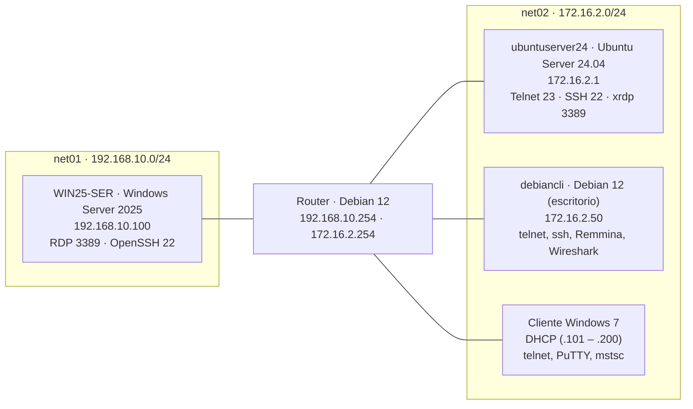

# UT3 · Instalación y configuración de servicios de acceso remoto

> **Módulo:** Servicios en Red · 2º CFGM Sistemas Microinformáticos y Redes · Curso 2026/2027
> **Duración:** 12 h (03/11 – 16/11/2026)
> [← Volver a la portada del módulo](../index.md)

## Resultado de aprendizaje

**RA6.** Gestiona métodos de acceso remoto describiendo sus características e instalando los servicios correspondientes.

| Criterio | Descripción | Dónde se trabaja |
|---|---|---|
| RA6.a | Se han descrito métodos de acceso y administración remota de sistemas. | [01](01-conceptos.md) · [05](05-resumen.md) |
| RA6.b | Se ha instalado un servicio de acceso remoto en línea de comandos. | [02 Telnet](02-telnet.md) · [03 SSH](03-ssh.md) |
| RA6.c | Se ha instalado un servicio de acceso remoto en modo gráfico. | [04 Escritorio remoto](04-escritorio-remoto.md) (RDP en Windows Server, xrdp en Ubuntu Server) |
| RA6.d | Se ha comprobado el funcionamiento de ambos métodos. | Apartados «Verificación» de [02](02-telnet.md), [03](03-ssh.md) y [04](04-escritorio-remoto.md) |
| RA6.e | Se han identificado las principales ventajas y deficiencias de cada uno. | Cada página · comparativa en [05](05-resumen.md) |
| RA6.f | Se han realizado pruebas de acceso remoto entre sistemas de distinta naturaleza. | [03](03-ssh.md) (PuTTY → Ubuntu, Debian → Windows) · [04](04-escritorio-remoto.md) (Windows 7 → xrdp, Debian → RDP) |
| RA6.g | Se han realizado pruebas de administración remota entre sistemas de distinta naturaleza. | [03](03-ssh.md) (administrar Ubuntu desde Windows 7 y Windows Server desde Debian) |

## Contenidos

Cada página tiene la **teoría** del bloque y, a continuación, sus **ejercicios guiados**. Los ejercicios son las prácticas de la unidad: las capturas que se piden al final de cada página se entregan en **Teams**.

| # | Página | Qué se aprende | Ejercicios | Horas orientativas |
|---|---|---|---|---|
| 1 | 📖 [Conceptos y funcionamiento general](01-conceptos.md) | Acceso frente a administración remota, CLI frente a GUI, modelo cliente/servidor, puertos | Preparar el escenario y comprobar la conectividad | 1 h |
| 2 | 🔓 [Telnet](02-telnet.md) | Primer protocolo de terminal remota y por qué es inseguro | Instalar `telnetd`, conectar desde Debian y Windows 7, capturar la contraseña con Wireshark | 1,5 h |
| 3 | 🔐 [SSH](03-ssh.md) | Cifrado, huella del servidor, claves pública/privada, SCP/SFTP, reenvío X11, túneles | OpenSSH en Ubuntu y Windows Server, claves Ed25519, PuTTY, X11, administración remota cruzada | 4 h |
| 4 | 🖥️ [Escritorio remoto: RDP, VNC y NX](04-escritorio-remoto.md) | Acceso gráfico, NLA, certificados, RFB, NoMachine y X2Go | RDP en Windows Server, xrdp + XFCE en Ubuntu Server, conexiones desde Windows 7 y Debian | 3,5 h |
| 5 | 📋 [Resumen y repaso](05-resumen.md) | Comparativa de métodos, herramientas de administración, puertos, preguntas de repaso | — | 1 h |
| | | | Prueba práctica | 1 h |

## Escenario de la unidad

Se reutilizan las **dos redes** de la UT1 y la UT2, pero ahora **enrutadas entre sí**: los clientes están en `net02` y llegan a `WIN25-SER` (en `net01`) a través del router. Así se pueden probar las conexiones entre sistemas distintos.

| Equipo | Red | IP | Sistema | Papel en la UT3 |
|---|---|---|---|---|
| `ubuntuserver24` | `net02` | `172.16.2.1` | Ubuntu Server 24.04 LTS | Servidor Telnet, SSH y xrdp (+ DHCP y DNS de las UT anteriores) |
| `WIN25-SER` | `net01` | `192.168.10.100` | Windows Server 2025 | Servidor RDP y OpenSSH (+ DHCP y DNS de las UT anteriores) |
| `debiancli` | `net02` | `172.16.2.50` (reserva DHCP) | Debian 12 con escritorio | Cliente Linux: `telnet`, `ssh`, `scp`, Remmina, Wireshark |
| Cliente Windows 7 | `net02` | DHCP (`.101` – `.200`) | Windows 7 | Cliente Windows: Telnet, PuTTY, Conexión a Escritorio remoto |
| Router | `net01` + `net02` + NAT | `.254` en cada red | Debian 12 | Encamina entre las dos redes y da salida a Internet |

> 🔒 Todo se monta en **redes internas de VirtualBox**. Ningún servidor debe estar en modo «Adaptador puente»: los servicios de esta unidad no pueden quedar accesibles desde la red real del aula.
>
> 👤 Las contraseñas de los ejemplos (`Alumno.UT3!`, `Tecnico.UT3!`) son **ficticias** y solo valen para el laboratorio.

Esquema completo, en Mermaid y ASCII, y configuración de VirtualBox: `recursos/ut3-acceso-remoto/diagramas/escenario-red.md`.

## Recursos

- Diagramas: `recursos/ut3-acceso-remoto/diagramas/`
- Ficheros de configuración de ejemplo: `recursos/ut3-acceso-remoto/ficheros-config/`
- [Manual de OpenSSH](https://www.openssh.com/manual.html) · [OpenSSH en Windows (Microsoft Learn)](https://learn.microsoft.com/es-es/windows-server/administration/openssh/openssh_install_firstuse) · [Proyecto xrdp](https://www.xrdp.org/) · [Wireshark](https://www.wireshark.org/docs/)

> Las tareas, entregas y la evaluación están en **Microsoft Teams** (Trabajo de clase → UT3). Esta web es solo material de consulta.
